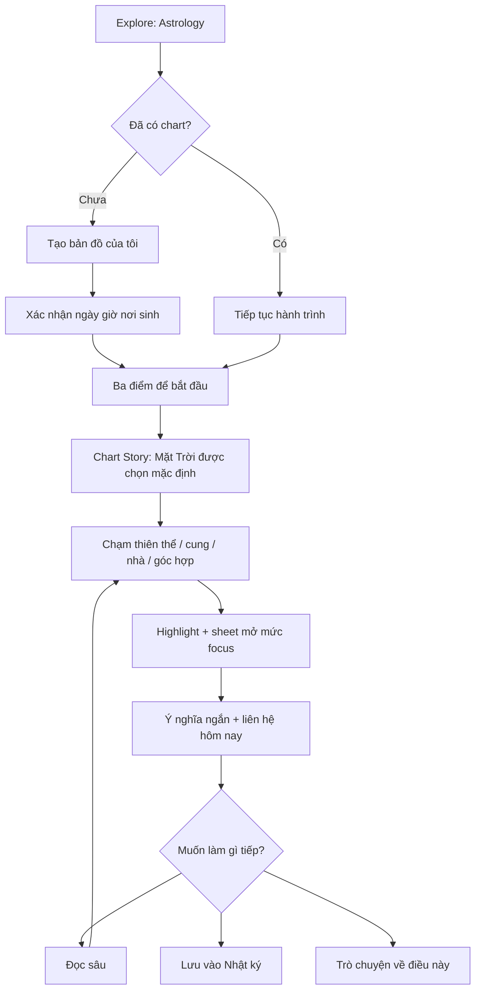

# Astrology — quyết định UX cho hành trình Bản đồ sao thống nhất

Ngày: 22/09/2026  
Trạng thái: visual đã được owner duyệt và candidate `Chart Story` đã tích hợp để review nội bộ; chưa phải phê duyệt phát hành production.

## 1. Quyết định đề xuất

Nilaza nên dùng **bottom sheet ba trạng thái trên màn Bản đồ sao tương tác**, nhưng không chuyển nguyên trạng toàn bộ danh sách điều khiển hiện tại vào sheet. Sheet phải là lớp kể chuyện theo đúng điểm người dùng đang chạm trên bản đồ.

Nilaza cũng nên **tích hợp và kiểm thử hành trình này ngay trong app chính**, dưới cờ `internal_preview`. Không nên chờ Astrology “hoàn chỉnh độc lập”, vì phần lớn vấn đề hiện tại chỉ xuất hiện khi đi xuyên suốt Explore → Astrology → Bản đồ → Câu chuyện → Journal/Chat → Profile.

Các quyết định cụ thể:

| ID | Quyết định | Lý do |
| --- | --- | --- |
| UX-AST-01 | Hợp nhất “báo cáo chi tiết” và “bản đồ tương tác” thành một trải nghiệm `Chart Story` | Loại bỏ việc người dùng phải chuyển màn rồi tự tìm lại nội dung tương ứng |
| UX-AST-02 | Giữ vòng sao cố định ở phần trên; dùng sheet ở ba mức `peek / focus / full` | Người dùng luôn thấy quan hệ giữa hình và câu chuyện, đồng thời vẫn có không gian đọc sâu |
| UX-AST-03 | Một selection model duy nhất cho thiên thể, cung, nhà và góc hợp | Ngăn highlight và nội dung kể hai câu chuyện khác nhau |
| UX-AST-04 | Thiết kế lại portal thành một cổng vào có một hành động chính | Giảm nhầm lẫn giữa tạo bản đồ, khám phá 12 cung, chart đã lưu, múi giờ, export và xóa dữ liệu |
| UX-AST-05 | Đưa thông tin UTC, IANA, provenance, sai số và cách tính vào lớp “Cách Nilaza tính” | Giữ sự minh bạch mà không đặt ngôn ngữ kỹ thuật ngang hàng với trải nghiệm người dùng |
| UX-AST-06 | Tích hợp candidate trong app chính để kiểm thử end-to-end; giữ release gate riêng trước mọi build ngoài nhóm nội bộ | Cho phép kiểm tra continuity thật mà chưa coi feature là production |
| UX-AST-07 | Mở hành trình thật ở tab `Câu chuyện`; chỉ mở visual preview trực tiếp ở tab `Người dẫn đường` | Cho người dùng nhận giá trị miễn phí trước khi chủ động xem lớp AI Premium |

### Trạng thái triển khai candidate

- Chart exact mới tạo và chart exact đã lưu đi thẳng vào `Chart Story`; trường hợp giờ không chắc chắn vẫn dùng báo cáo có caveat thay vì dựng dữ kiện giả.
- Vòng sao, nội dung, evidence AI và tab dữ liệu dùng cùng một selection model cho thiên thể, cung, nhà và góc hợp.
- Sheet đã có `peek / focus / full`, nút truy cập, thao tác vuốt tại handle và thứ tự Back `full → focus → peek → màn trước`.
- App thật mở ở `Câu chuyện`. Route review visual mở ở `Người dẫn đường` để đối chiếu đúng target đã duyệt.
- `Người dẫn đường AI` hiện là preview khóa an toàn. Không gọi model, không mở thanh toán, không trừ credits và không giả lập kết quả AI.
- Contract AI versioned đã có schema request/response, evidence, caveat, privacy và entitlement `premium_astrology_ai`; prompt/method pack chuyên môn vẫn là release gate trước khi nối provider thật.
- Browser QA đã đạt ở 390×844 và 320×568; `design-qa.md` đặt visual đã duyệt và implementation trong cùng comparison input. Full mobile regression đạt 35/35 suites, 207/207 tests; AI contract đạt 9/9 tests. Nghiệm thu Android/TalkBack vẫn là gate riêng.

## 2. Whole-App Impact Brief

| Mặt ảnh hưởng | Phạm vi |
| --- | --- |
| Điểm vào | Home/Explore/Oracle hoặc notification hợp lệ → Astrology portal → tạo/mở chart → Chart Story |
| Dữ liệu ghi | Chart local theo account, vị trí đang đọc, bookmark/reflection; không thêm migration trong chặng UX này |
| Backend contract | Calculator local và chart contract v0.2 là nguồn dữ kiện duy nhất; endpoint Astrology cũ không tham gia tạo chart mới |
| Admin visibility | Không đưa raw birth data vào Admin. Chỉ metadata tổng hợp nếu sau này có analytics được duyệt |
| Privacy/safety | Không đưa ngày, giờ, nơi sinh, tọa độ hoặc UTC vào analytics, Chat hay Journal; giữ export/delete |
| Analytics | Chỉ sự kiện cấu trúc như `chart_created`, `chart_element_selected`, `chapter_opened`, `reflection_saved`; không có payload nhạy cảm |
| Rollback | Trước limited beta phải có build-time flag bao phủ mọi entry; chart local đã có vẫn phải export/xóa được |
| Manager test path | Đăng nhập → Explore → Astrology → tạo/mở chart → chọn điểm → đọc chuyện → lưu Journal/Chat → Profile export/xóa |
| Chủ ý chưa đụng tới | Cloud sync, DB migration, paywall thật, credit, store listing, quảng cáo public và production release |

## 3. Audit runtime hiện tại

Audit được chạy ở viewport điện thoại 390 × 844 trên preview hiện tại. Toàn bộ bằng chứng ảnh nằm tại:

`D:\nilaza\output\ux-audit-astrology-2026-09-22`

| Bước | Màn hình/thao tác | Tình trạng | Nhận xét chính |
| --- | --- | --- | --- |
| 1 | Mở portal Astrology | Cần cải thiện — P1 | Tranh đẹp nhưng hero, giờ địa phương, CTA thế giới thần thoại và CTA tạo chart tranh nhau vai trò; người mới chưa biết bắt đầu từ đâu |
| 2 | Cuộn xuống portal | Cần cải thiện — P1 | Chart đã lưu, timezone, reflection, export và xóa dữ liệu nằm cùng một luồng discovery; hành động phá hủy có trọng lượng thị giác quá lớn |
| 3 | Mở báo cáo cá nhân | Cần cải thiện — P1 | Nội dung mở đầu thiên về chữ; Big 3 chưa trở thành bản tóm tắt trực quan; CTA sang bản đồ làm trải nghiệm bị tách đôi |
| 4 | Mở bản đồ tương tác | Cần cải thiện — P1 | Quá nhiều hàng chọn và thanh cuộn; màn hình giống data explorer hơn một hành trình tự khám phá |
| 5 | Chạm Mặt Trời trên vòng | Cần cải thiện — P0 UX | Điểm có highlight nhưng phần ý nghĩa vẫn dưới fold; phản hồi quan trọng nhất của thao tác không xuất hiện ngay trong vùng nhìn |
| 6 | Cuộn tới câu chuyện | Cần cải thiện — P1 | Vòng sao và câu chuyện có tồn tại cùng màn nhưng kết nối thị giác yếu; nested scrolling tạo cảm giác phải tự đi tìm câu trả lời |
| 7 | Mở form tạo chart | Khá, còn ma sát — P1 | Luồng chính rõ hơn portal nhưng ngày/giờ dạng kỹ thuật và thông tin GeoNames/IANA/giấy phép xuất hiện quá sớm |

### Bằng chứng từng bước

#### 1. Portal — vùng đầu


#### 2. Portal — vùng dưới


#### 3. Báo cáo cá nhân


#### 4. Bản đồ tương tác ban đầu


#### 5. Sau khi chọn Mặt Trời


#### 6. Câu chuyện nằm dưới vùng nhìn


#### 7. Form tạo bản đồ


## 4. Nguyên nhân gốc

Vấn đề không nằm ở việc thiếu một bottom menu. Luồng hiện tại đang dùng cấu trúc dữ liệu làm cấu trúc trải nghiệm: thiên thể, cung, nhà, góc hợp, độ số, UTC và nguồn tính đều được trình bày gần như cùng cấp.

Khi người dùng chạm một điểm, ứng dụng hiện chủ yếu trả lời **“đây là thông số gì”**. Người mới cần ứng dụng trả lời theo thứ tự:

1. **Đây là phần nào trong bản đồ của tôi?**
2. **Nó gợi mở điều gì về tôi?**
3. **Tôi có thể nhận ra điều đó ở đâu trong đời sống?**
4. **Tôi muốn khám phá hoặc ghi lại điều gì tiếp theo?**

Bottom sheet chỉ có giá trị nếu nó thực thi đúng bốn bước này và luôn đồng bộ với highlight trên vòng sao.

## 5. Hành trình người dùng mới



Mạch kể chuyện cố định của mọi điểm:

> Dữ kiện của tôi → Điều này gợi mở gì → Liên quan đến đời sống hôm nay → Hành động tiếp theo

Mạch đầu tiên của toàn chart:

> Mặt Trời → Mặt Trăng → Cung Mọc → Ba phần phối hợp ra sao → Tự khám phá vòng sao

Nếu không biết giờ sinh, giao diện không tạo khoảng trống giả cho Cung Mọc/nhà. Nó giải thích ngắn gọn phần nào vẫn tính được và cho phép tiếp tục với Mặt Trời, Mặt Trăng cùng các thiên thể đủ tin cậy.

## 6. Thiết kế portal mới

Portal không dùng bottom sheet. Đây là trang định hướng, nên cần một hệ phân cấp bình tĩnh và rõ ràng.

### Trạng thái chưa có chart

- Hero giữ hình thần thoại toàn cảnh với một lời hứa: **“Bầu trời của bạn kể câu chuyện nào?”**
- CTA chính: **“Tạo bản đồ của tôi”**.
- CTA phụ: **“Khám phá 12 câu chuyện”**, kèm nhãn “Không cần ngày sinh”.
- Link hỗ trợ: **“Chưa biết giờ sinh? Bạn vẫn có thể bắt đầu.”**
- Không hiển thị timezone, export, delete hoặc license trong hero.

### Trạng thái đã có chart

- Hero ngắn hơn, chứa ảnh/đồ họa chart cá nhân.
- CTA chính: **“Tiếp tục khám phá bản đồ”** và đưa người dùng về đúng điểm đọc dở.
- “Ba điểm của bạn” xuất hiện như ba thẻ trực quan Mặt Trời / Mặt Trăng / Cung Mọc.
- Chart khác nằm trong danh sách lịch sử gọn; đổi tên, xuất và xóa nằm trong menu chi tiết.
- Timezone, độ chính xác, nguồn tính và dữ liệu local nằm trong **“Dữ liệu & quyền riêng tư”**.

Nhãn “Bước qua cánh cửa ↗” nên bỏ vì ký hiệu dễ được hiểu là mở liên kết ngoài. “Bản 1/revision” cũng không nên xuất hiện trong UI chính.

## 7. `Chart Story` và bottom sheet

### Bố cục

- Vòng sao chiếm khoảng 42–48% chiều cao khi sheet ở `peek/focus`.
- Sheet có ba snap state:
  - `peek` 72–96 px: glyph, tên điểm, cung và một câu mở đầu.
  - `focus` khoảng 46–55% màn hình: ý nghĩa ngắn, liên hệ đời sống, một câu hỏi phản chiếu.
  - `full` khoảng 88–92%: câu chuyện sâu, tổng hợp, nguồn và phương pháp.
- Mặc định khi mở chart: chọn Mặt Trời và mở `focus`, thay vì bắt người mới tự đoán phải chạm đâu.

### Hợp đồng tương tác

Một selection duy nhất có dạng khái niệm:

```ts
type AstrologySelection =
  | { kind: 'body'; bodyId: string; signId: string }
  | { kind: 'sign'; signId: string }
  | { kind: 'house'; houseNumber: number }
  | { kind: 'aspect'; aspectId: string; fromBodyId: string; toBodyId: string };
```

Mọi điểm chạm phải thực hiện cùng một transaction UI:

1. cập nhật selection;
2. highlight đúng điểm, cung/nhà và đường liên quan;
3. thay nội dung sheet;
4. đưa sheet tới `focus` nếu đang ở `peek`;
5. thông báo selection mới cho TalkBack/VoiceOver;
6. ghi analytics không chứa dữ liệu sinh.

Người dùng không cần cuộn trang để thấy kết quả của thao tác. Sheet chỉ nhận gesture kéo từ handle/header để tránh xung đột với pinch/pan của vòng sao. Luôn có nút **“Mở rộng nội dung”** và **“Thu gọn”**; gesture không phải con đường duy nhất.

### Cấu trúc nội dung sheet

Sheet ưu tiên ba tab có ngôn ngữ của người dùng:

1. **Câu chuyện** — nội dung cá nhân và hình ảnh minh họa.
2. **Người dẫn đường** — lớp tổng hợp AI Premium, evidence tương tác và composer theo ngữ cảnh.
3. **Dữ liệu** — độ số, độ chính xác, nguồn, cách tính, lưu local và ranh giới riêng tư.

Không dùng `Thiên thể / Góc hợp / Nhà` làm điều hướng chính đầu tiên. Chúng là mô hình chuyên môn, xuất hiện như các điểm tương tác/evidence sau khi người dùng đã có ngữ cảnh.

### Back behavior

Nút Back/hardware Back đi theo thứ tự:

`full → focus → peek → màn trước`

Không thoát khỏi feature ngay khi người dùng chỉ muốn đóng nội dung sâu.

### Khả thi kỹ thuật

- Hướng production ưu tiên một bottom-sheet component đã được kiểm chứng. Candidate hiện dùng `PanResponder` chỉ trên handle để không thêm native dependency trước lượt build Android; phần nội dung và vòng sao không nhận responder của sheet. Đây là lựa chọn tạm thời phải qua kiểm thử gesture trên thiết bị thật. Nếu pinch/pan, scroll hoặc TalkBack tranh quyền, thay candidate bằng component native đã kiểm chứng trước release.
- Vòng sao nằm ngoài sheet. Ở bản đầu, chỉ vùng handle/header được phép kéo sheet; phần nội dung chỉ scroll khi sheet đã mở đủ cao.
- Portrait dùng `peek / focus / full`. Tablet, landscape và desktop web chuyển cùng nội dung sang panel bên phải để giữ đủ diện tích cho chart.
- Nếu cần thêm native gesture dependency, bản thay đổi phải đi qua một APK/IPA mới; OTA không đủ để nghiệm thu.
- Một coordinator duy nhất xử lý Back/Escape theo thứ tự `help → full reader → focus → peek → màn trước`, tránh nhiều `BackHandler` cạnh tranh.
- Chưa đưa component này vào A2UI dùng chung. Chỉ tách thành primitive chung sau khi có thêm một consumer thật ngoài Astrology.

## 8. Kết nối report, thần thoại, Journal và Chat

- “Báo cáo cá nhân” không còn là một trang văn bản dài tách biệt. Big 3 là chương mở đầu của `Chart Story`.
- Khi mở chương thần thoại, khối **“Trên bản đồ của bạn”** phải đứng ngay sau tiêu đề/tranh, trước dị bản và phân tích dài.
- “Đọc câu chuyện của [cung]” mở sheet full hoặc reader nối tiếp nhưng giữ selection và có đường quay lại chính điểm trên chart.
- “Lưu vào Nhật ký” lưu câu hỏi/insight cùng một source reference an toàn để sau này quay lại đúng điểm; không lưu raw birth data.
- “Trò chuyện về điều này” chỉ handoff placement/chủ đề đã whitelist; không gửi ngày, giờ, nơi sinh, tọa độ hoặc UTC.

### 8.1. Cập nhật visual target: Thiên Thư Mở có Người dẫn đường AI

Owner chọn phương án **Thiên Thư Mở** và yêu cầu AI trở thành khác biệt trung tâm của trải nghiệm. Bản revision được lưu tại:


AI không xuất hiện như một bubble chat nổi hoặc một nút “lấp lánh”. Nó là lớp **mực sống** nối nhiều dữ kiện đã tính trên vòng sao thành một cách đọc riêng và cho phép người dùng tiếp tục hỏi trong đúng ngữ cảnh.

#### Bốn tầng giá trị

| Tầng | Phạm vi | Quyền truy cập |
| --- | --- | --- |
| Bản đồ đã tính | Placement, cung, nhà/góc hợp đủ tin cậy, precision và caveat | Miễn phí |
| Chú giải biên tập | Big Three, ý nghĩa nền, chương thần thoại và câu hỏi tự soi | Miễn phí |
| Người dẫn đường AI | Tổng hợp nhiều placement/nhà/góc hợp theo câu hỏi của người dùng; mỗi nhận định chỉ rõ dữ kiện nguồn | Premium |
| Hỏi tiếp trong ngữ cảnh | Tiếp tục đối thoại mà không phải nhập lại chart; lưu insight vào Journal | Premium |

Giá trị Premium là **khả năng kết nối, giải thích có căn cứ và duy trì mạch đối thoại**, không phải chỉ mở thêm nhiều đoạn văn.

#### Cách AI xuất hiện trong `Chart Story`

- Sheet có ba vùng: **Câu chuyện · Người dẫn đường ✦ · Dữ liệu**.
- Khi mở Người dẫn đường, nhiều điểm liên quan trên chart được nối bằng các sợi gold mảnh tới nội dung AI; chạm evidence sẽ highlight ngược lại đúng điểm nguồn.
- Nhãn luôn ghi rõ **“Người dẫn đường AI · Premium”**.
- Entry copy: **“Nối các điểm trong bản đồ của bạn”**.
- Trust line: **“Dựa trên dữ kiện đã tính · AI không tự tạo vị trí”**.
- Composer theo ngữ cảnh: **“Bạn muốn hiểu điều gì về mình?”**, hoặc **“Hỏi về điểm này…”** khi đang chọn một placement/aspect/house.
- CTA Premium: **“Mở khóa Người dẫn đường AI”**.
- Secondary: **“Tiếp tục đọc bản đồ miễn phí”**.

Không hiển thị paywall khi vừa tạo chart hoặc chạm điểm đầu tiên. Người dùng phải hoàn thành được vòng giá trị miễn phí gồm tạo chart, hiểu Big Three, khám phá dữ kiện và đọc nội dung nền. AI được giới thiệu khi người dùng chủ động mở tab Người dẫn đường hoặc sau khi đã đọc đủ nội dung để hiểu lợi ích của việc tổng hợp.

#### Cấu trúc bản đọc AI

1. **Mạch nổi bật** — kết luận ngắn, dùng ngôn ngữ khả năng.
2. **Các phần đang kết nối** — placement, house/aspect đã được calculator xác nhận.
3. **Vì sao Nilaza đọc như vậy** — evidence fact IDs tương tác với chart.
4. **Điều này có thể xuất hiện trong đời sống** — liên hệ với chủ đề người dùng đã chọn.
5. **Một câu hỏi để tự soi** — có thể lưu vào Journal.
6. **Hỏi tiếp** — các gợi ý kế thừa cùng chart và bài đọc vừa tạo.

Dòng minh bạch luôn có: **“Đây là một cách diễn giải để tự chiêm nghiệm, không phải dự đoán chắc chắn.”**

#### Contract và release gate

Candidate hiện tại chưa đủ để tuyên bố AI đã phân tích toàn chart:

- Luồng A3/A4 mới chỉ tính chart local và handoff an toàn Sun/Moon/Rising sang `The Astrologer`.
- Chat hiện chưa có method pack Astrology chuyên biệt đủ sâu.
- Entitlement/payment mobile vẫn là preview; chưa có server-side gate cho AI Astrology.

Contract versioned đã được tạo tại `packages/agent-config/astrology-ai-insight`. Request chỉ nhận chart facts đã tính, selected fact IDs, confidence/caveats và câu hỏi do người dùng chủ động gửi. Contract v1 cấm raw ngày/giờ/nơi sinh, tọa độ, timezone, Journal, lịch sử chat, tài khoản và thiết bị. Muốn dùng Journal trong tương lai phải tạo contract/version mới, consent riêng và qua review privacy.

Response bắt buộc nối mọi insight với `evidenceFactIds`, mang caveat và metadata model/prompt/moderation theo schema. Mọi model call sau này phải đi qua entitlement server-side `premium_astrology_ai`; khóa ở client không đủ. Trước khi nối provider thật còn phải hoàn thiện prompt/method pack chuyên môn, bộ đánh giá chất lượng và kiểm thử hallucination/evidence.

Nếu giờ sinh không chính xác, AI không được dùng Cung Mọc/nhà như fact chắc chắn. UI phải nói rõ phạm vi đã loại bỏ trước khi người dùng trả phí.

## 9. Chiến lược tích hợp vào Nilaza

### Tích hợp ngay

Đưa trải nghiệm mới vào app shell thật để kiểm tra:

- Safe area và bottom navigation.
- Back từ Home/Explore/Oracle về đúng nơi.
- Account switch, logout và local storage isolation.
- Journal/Chat handoff.
- Profile export/delete.
- Offline, màn hình ngắn, font lớn, TalkBack và hiệu năng native.

### Giữ ở internal preview

Candidate hiện đã được nối trực tiếp vào app development để chuẩn bị test Android, nhưng build-time flag dưới đây chưa được triển khai. Vì vậy không được phân phối build này ngoài nhóm nội bộ cho tới khi flag bao phủ mọi entry/deep link và mặc định production là `off`.

Feature flag nên có bốn trạng thái:

| Trạng thái | Hành vi |
| --- | --- |
| `off` | Ẩn entry/tạo mới; vẫn cho export/xóa chart đã có |
| `internal_preview` | Bật trong development/EAS preview cho nhóm review |
| `limited_beta` | Mở theo cohort sau khi release gates đạt |
| `public` | Chỉ dùng sau nghiệm thu production |

Trong trạng thái repo hiện tại, dùng build-time flag là phù hợp; chưa thêm remote DB flag vì migration ledger còn bị chặn. Mặc định production phải là `off`.

### Nợ tích hợp cần đóng trong cùng lát cắt

- Cô lập hoặc loại bỏ Astrology flow cũ để calculator local/contract v0.2 là nguồn dữ kiện duy nhất.
- Trả Back về đúng màn hình nguồn thay vì luôn quay về Explore.
- Notification/deep link phải mang đúng intent/report; nếu chưa hỗ trợ thì fail closed, không mở nhầm portal chung.
- Journal phải dùng pipeline lưu chuẩn thay vì chèn entry local riêng.
- Birth profile chung và Astrology v2 phải có quy tắc đồng bộ rõ ràng; không để người dùng sửa ở một nơi nhưng nơi khác vẫn dùng dữ liệu cũ.
- Flag phải bao phủ mọi entry và direct navigation, không chỉ thẻ Explore.

### Tiến độ so với kế hoạch

- **UX1:** hoàn tất; owner đã chọn target `Thiên Thư Mở + Người dẫn đường AI`.
- **UX2:** portal mới chưa triển khai; cổng hiện tại vẫn là nợ UX riêng.
- **UX3:** candidate đã tích hợp; selection chung, ba tab, ba mức sheet và Back coordinator trong chart đã có. Gesture cần nghiệm thu Android.
- **UX4:** visual/câu chuyện/evidence đã tích hợp một phần; Journal pipeline chuẩn, Chat handoff từ Chart Story và trải nghiệm thích nghi nhiều phiên còn thiếu.
- **UX5:** chưa đạt; chưa có build-time flag, analytics mới, tablet side panel hoặc nghiệm thu native/accessibility.

### Chưa mở trong chặng này

- Paywall, credit hoặc premium upsell thật.
- Cloud sync và notification `astrology_report_ready`.
- Marketing claim “phân tích chuyên sâu/chính xác cao”.
- Store screenshots, paid traffic và public release.

## 10. Kế hoạch triển khai sau khi duyệt hướng

### UX1 — Chốt target thị giác và trạng thái

- Dựng ba phương án hình ảnh cho portal + `Chart Story` từ bằng chứng audit hiện tại.
- Chọn một phương án trước khi sửa component.
- Chốt tokens, snap states, selection state, back behavior và copy VI/EN.

**Đạt khi:** owner chọn target; mọi state chính có hình minh họa và acceptance criteria.

### UX2 — Portal và information architecture

- Tách discovery khỏi dữ liệu/cài đặt.
- Một CTA chính theo trạng thái có/không chart.
- Saved chart gọn; export/delete vào menu chi tiết.
- Form dùng picker phù hợp, progressive disclosure cho precision/timezone/license.

**Đạt khi:** người mới xác định được hành động chính trong viewport đầu và không nhầm hai lối khám phá.

### UX3 — Unified Chart Story shell

- Tạo selection model duy nhất.
- Dựng sheet ba mức, hành vi back, gesture boundary và accessible controls.
- Big 3 là mặc định; loại bỏ chuyển màn report → interactive.

**Đạt khi:** chọn thiên thể/cung/nhà/góc hợp luôn cho phản hồi có ý nghĩa ngay trong vùng nhìn, không cần cuộn tìm.

### UX4 — Nội dung, hình ảnh và vòng phản chiếu

- Biên tập nội dung theo bốn bước kể chuyện.
- Đồng bộ ảnh, glyph, highlight và micro-motion.
- Đưa “Trên bản đồ của bạn” lên đầu chương liên quan.
- Kết nối nguồn Journal và handoff Chat an toàn.

**Đạt khi:** tester mới có thể giải thích bằng lời của họ “điểm này liên quan gì đến tôi” sau một lượt dùng.

### UX5 — Tích hợp app thật và native acceptance

- Thêm flag; sửa toàn bộ entry/back/deep link hợp lệ.
- Dùng Journal pipeline chuẩn và xóa đường Astrology legacy khỏi source of truth.
- Build Android mới; kiểm màn nhỏ, font lớn, TalkBack, pinch/pan, force-stop, offline, account switch, export/delete.

**Đạt khi:** manager hoàn thành hành trình end-to-end trên thiết bị thật mà không cần hướng dẫn kỹ thuật và không gặp dữ liệu chéo tài khoản.

## 11. Acceptance criteria cấp sản phẩm

1. Trong viewport portal đầu tiên chỉ có một CTA chính; lối thư viện ghi rõ không cần ngày sinh.
2. Người đã có chart quay lại đúng vị trí/chương gần nhất.
3. Chạm bất kỳ đối tượng tương tác nào làm chart và sheet cập nhật cùng selection; ý nghĩa ngắn thấy ngay.
4. Không có nested page scroll bên ngoài sheet trong `Chart Story`.
5. Pinch/pan chart không kéo sheet ngoài ý muốn; sheet có nút expand/collapse thay thế gesture.
6. Back vật lý thu sheet theo cấp trước khi rời màn.
7. Exact/approximate/unknown time có trạng thái rõ; không dựng ASC/nhà như dữ kiện chắc chắn khi thiếu giờ.
8. VI/EN đầy đủ; font lớn không che CTA hoặc nội dung đang chọn.
9. TalkBack đọc được đối tượng, trạng thái selected và sheet expanded/collapsed.
10. Journal/Chat/analytics không nhận raw birth data.
11. Tắt flag không xóa dữ liệu; export/delete vẫn sử dụng được.
12. Không có paywall hoặc tuyên bố production trước native acceptance và product evidence.

## 12. Kết luận thiết kế

Bottom sheet là lựa chọn phù hợp cho vùng bản đồ nếu được xây như **một story surface đồng bộ theo selection**. Nó không nên là ngăn chứa các điều khiển kỹ thuật hiện tại. Portal cần thiết kế lại riêng như một cổng định hướng. Report và map nên hợp nhất thành một trải nghiệm liên tục.

Tích hợp nội bộ vào Nilaza là bước cần thiết để hoàn thiện Astrology, không phải bước thực hiện sau khi feature đã hoàn chỉnh. Public exposure, paywall và marketing vẫn là các gate sau native acceptance và bằng chứng hành vi người dùng.
