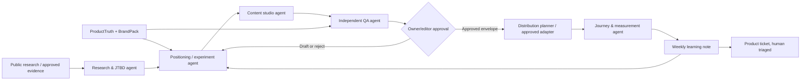

# Kế hoạch B — vận hành pilot phòng Marketing AI song song nhánh A

Phiên bản 1.0 · 21/09/2026 · **Đề xuất để duyệt**

Tài liệu này biến [Kế hoạch B theo phase](MARKETING_AI_PHASED_DELIVERY_PLAN_2026-09-20.vi.md) thành một kế hoạch vận hành song song với nhánh sản phẩm A. Nó không thay thế [lộ trình chung](DELIVERY_ROADMAP_APPROVAL_2026-09-20.vi.md), [blueprint framework](AI_MARKETING_FRAMEWORK_PLAN_2026-09-20.vi.md), [sổ quyết định A1](A1_BASELINE_AND_DECISION_REGISTER_2026-09-20.vi.md), hay [kế hoạch waitlist](NILAZA_WAITLIST_MARKETING_AUTOMATION_PLAN.md).

**Trạng thái hiện tại:** có thể bắt đầu ngay B0 và B1 ở chế độ nội bộ/draft-only. Tài liệu này không tự cho phép đăng bài công khai, gửi email/DM, mở tài khoản quảng cáo, mua media, thêm tracking SDK hoặc sửa database.

## 1. Quyết định đề xuất

Khởi động phòng Marketing AI ngay trong khi nhánh A tiếp tục, nhưng vận hành theo ba lớp quyền rõ ràng:

1. **AI tự làm phần chuẩn bị:** nghiên cứu công khai, tổng hợp insight, brief, nhiều phương án nội dung, storyboard, lint claim/policy, dashboard và đề xuất điều chỉnh.
2. **Con người phê duyệt mọi tác động bên ngoài:** claim, creative, kênh, đối tượng, lịch đăng, email, ngân sách, thay đổi offer và resume sau khi hệ thống tự pause.
3. **Hệ thống chỉ thực thi trong envelope đã được duyệt:** về sau mới được schedule/publish, gửi lifecycle hoặc pause campaign, với version, receipt, cap, audit và kill switch.

Vì vậy, từ hôm nay Nilaza có thể tạo được tài sản marketing, thử quy trình sản xuất, hiệu chỉnh ngôn ngữ, lập bản đồ customer journey và chuẩn bị đo lường. Khi A hoàn tất đủ các gate, đội đã có content library, playbook, dashboard, hồ sơ claim và quy trình vận hành để mở beta/MVP có kiểm soát thay vì bắt đầu từ số không.

Điều này cũng tạo bằng chứng cần thiết nếu sau này tách framework thành business: đo được thời gian từ brief đến asset được duyệt, tỷ lệ asset dùng được, ảnh hưởng đến activation/retention và chi phí người + AI + media, thay vì chỉ đo số lượng nội dung do agent tạo.

## 2. Mục tiêu vận hành và giới hạn thành công

### Mục tiêu khi A6/A7 sẵn sàng

- Một nguồn **ProductTruth** duy nhất xác định feature nào được nói, cho build/platform nào, với bằng chứng nào và trong bao lâu.
- Một nhà máy nội dung song ngữ VI/EN có brief, version, QA độc lập, người duyệt và lịch sử quyết định.
- Một journey map nối được nội dung/landing/waitlist với onboarding, kết quả đầu tiên, giá trị người dùng tự ghi nhận và quay lại.
- Một beta playbook cho nhóm 30–50 người và một paid-pilot playbook cho một kênh, không cần dựng toàn bộ hệ thống quảng cáo từ đầu.
- Dữ liệu đủ để quyết định: tiếp tục, sửa sản phẩm/định vị, mở rộng có giới hạn, hoặc chưa nên scale.

### Không dùng làm thước đo thành công

- Follower, lượt tạo bài, CTR rẻ, lượt cài, hoặc một campaign thắng đơn lẻ.
- Save hoặc điểm model tự chấm như bằng chứng người dùng nhận giá trị.
- Giá trị của Nilaza được suy từ khả năng viết prompt giả lập Persona/Tarot trên General AI.

Nilaza phải chứng minh được chuỗi: **đúng lời hứa → người dùng vào đúng trải nghiệm → nhận kết quả thực → tự đánh giá hữu ích hoặc chọn hành động → quay lại**, với privacy và trust không giảm.

## 3. Nền tảng đã có và các khoảng trống cần kế hoạch B xử lý

| Hạng mục | Có thể dùng ngay | Chưa đủ để launch/scale |
| --- | --- | --- |
| Owned acquisition | Website VI/EN, landing/feature/intent pages, SEO/OG và waitlist tại `apps/web`; form chỉ nhận trường đã allow-list | Cần rà lại copy theo ProductTruth; chưa có attribution landing → app → cohort đáng tin cậy |
| Waitlist và privacy | Edge Function chống spam; consent, suppression, token, delivery ledger và beta-invite foundation; Growth Operations chỉ đọc aggregate | Chưa có sender, domain SPF/DKIM/DMARC, queue/Cron, confirmation/unsubscribe endpoints, provider webhook hoặc email automation |
| Assets | 18 graphic VI/EN, OG, avatar và feature art trong `design/launch/open-reflection-v1`/`assets/features` | Chúng được ghi `prepared-not-released`; cần đối chiếu build, locale, ngày và claim trước mỗi lần dùng |
| Đo lường | Một số AI endpoint có `usage_events`; trace đã redacted; A1 event dictionary đã nháp | Mobile event phổ thông chủ yếu là local AsyncStorage; chưa có ingestion, dedupe, identity bridge, funnel/cohort hoặc postback an toàn cho ads |
| Admin và lifecycle | Growth workspace protected/aggregate-only; notification contract cho thông báo sản phẩm | Không có review queue marketing, marketing opt-in riêng, cap tần suất/quiet hours hoặc lifecycle scheduler |
| Distribution và paid | Có thể chuẩn bị copy, asset, UTM allow-list và manual export | Không có OAuth/API publishing, scheduler, receipt/reconciliation, campaign builder, spend cap, attribution, cost/revenue reconciliation hay kill switch |
| Database | Cấu trúc consent/waitlist hiện có là nền tốt | `supabase/migration-ledger` vẫn `blocked_pending_reconciliation`; không đưa schema bền mới vào remote cho đến khi owner duyệt forward path |

Một điểm phải xử lý ở B0: landing hiện có các wording Astrology khác mức độ sẵn sàng của feature. ProductTruth phải trở thành nguồn công bố duy nhất trước khi mở rộng nội dung hay traffic.

## 4. Kiến trúc phòng Marketing AI

Các ô trong sơ đồ là **vai trò và workflow**, không mặc định là một agent có quyền thực thi bên ngoài. Mỗi action có scope hẹp, input/output versioned và điều kiện dừng.

| Vai trò | Skill/đầu ra chính | Có thể tự động | Bắt buộc người duyệt |
| --- | --- | --- | --- |
| Growth Orchestrator | backlog tuần, dependency/gate map, job registry | Điều phối draft và phát hiện blocker | Đổi mục tiêu, kênh, ngân sách hoặc priority sản phẩm |
| Research & JTBD | research brief, interview synthesis, evidence links, segment hypotheses | Tóm tắt nguồn công khai và phản hồi đã consent | Tuyển người, liên hệ ai, kết luận market claim |
| ProductTruth & Claim | feature/build/evidence/expiry/allowed-copy registry | Lint copy, chặn claim vượt evidence | Mở claim mới, sửa disclaimer, dùng testimonial/screenshot |
| Positioning & Experiment | hypothesis, 3 message angles × 2 formats, success/guardrail metrics | Tạo phương án và scorecard | Offer, audience, promise trọng yếu |
| Content Studio | hook, caption, storyboard, visual brief, CTA, VI/EN adaptation | Sản xuất asset package và versioning | Creative cuối, ảnh/screenshot dùng công khai |
| Independent QA | claim/brand/safety/IP/privacy/policy checklist | Chấm rule-based, so khác build/version | Override hard fail hoặc exception |
| Distribution Planner | channel package, schedule draft, UTM allow-list, preflight | Chuẩn bị export/test receipt | Publish, schedule, account/OAuth, retraction |
| Journey & Measurement | funnel spec, cohort report, learning note | Tính aggregate khi nguồn đã hợp lệ | Đổi metric definition, chuyển learning thành product change |
| Lifecycle / Paid Pilot | lifecycle/campaign draft, cap monitor, pause recommendation | Chỉ auto-pause theo hard cap đã duyệt | Send/resume, mở campaign, tăng cap, đổi audience/creative/offer |

## 5. Các workflow và sub-workflow bắt buộc

| ID | Workflow | Sub-workflow | Trạng thái trong A1 | Output kiểm được |
| --- | --- | --- | --- | --- |
| W0 | Readiness | ProductTruth → BrandPack → account/capability/budget matrix → risk log | Bắt đầu ngay | Một source-of-truth cho claim và blocker |
| W1 | Research → plan | source scan → JTBD interview kit → insight → hypothesis → weekly plan | Bắt đầu ngay; outreach cần quyền riêng | Insight có provenance và experiment backlog |
| W2 | Content factory | brief → 3 concepts → 1 asset → deterministic QA → independent QA → human decision | Draft-only bắt đầu ngay | Asset package có version, evidence, QA verdict |
| W3 | Controlled publishing | preflight → immutable approval hash/expiry → channel execution → receipt/reconcile → rollback | Chỉ test/private sau quyền kênh; public theo G6 | URL/receipt/retry/retraction evidence |
| W4 | Journey/lifecycle | attribution → onboarding → activation → useful/action → return → consent/suppression | Contract/fixture chuẩn bị ngay; activation sau A5 | Cohort report và lifecycle stop proof |
| W5 | Paid learning | approved creative → one campaign → consented neutral postback → cap monitor → weekly decision | Sau A6/A7/M3/M4 | Spend, conversion, quality/cost report |
| W6 | Learning → product | anomaly → root-cause hypothesis → product ticket → owner triage → re-measure | Bắt đầu ngay ở mức nội bộ | Learning note không tự sửa prompt/UI/price |

### W2: một vertical slice phải chạy trong B1

1. Research agent dùng nguồn đã duyệt tạo một brief với audience hypothesis, job, pain, claim được phép và claim cấm.
2. Positioning agent tạo ba concept cho cùng một hypothesis; Content Studio hoàn thiện một asset VI trước và bản EN nếu nhận định không đổi.
3. ProductTruth lint kiểm feature/build/expiry; QA độc lập kiểm brand, safety, policy, IP, privacy, locale, screenshot provenance và CTA.
4. Editor/owner chọn **accept / revise / block**, ghi lý do. Một thay đổi câu chữ làm approval cũ hết hiệu lực.
5. Trong B1 asset chỉ được dry-run hoặc vào thư viện nội bộ; chưa tự đăng. Khi đủ gate, cùng workflow mới có quyền chuyển thành publish package.
6. Journey agent đo từ receipt/URL đến event aggregate đã có consent; cuối tuần viết learning note và đề xuất một thay đổi nhỏ để owner quyết định.

## 6. Kế hoạch triển khai theo gate của nhánh A

### B0 / M1 — nền sự thật, đo lường và quyền vận hành

**Bắt đầu:** ngay bây giờ. **Ước lượng:** 5 ngày công. **Không cần database write hoặc tài khoản quảng cáo.**

| Work package | Đầu ra bắt buộc | Điều kiện hoàn tất |
| --- | --- | --- |
| ProductTruth registry | Bảng `feature × build/platform × verification evidence × status × expiry × allowed copy × prohibited copy × owner` | Mỗi claim trên landing/content thử đều truy được evidence; feature chưa sẵn sàng nhận trạng thái draft/preview/blocked rõ ràng |
| BrandPack & claim rubric | Giọng Nilaza, VI/EN glossary, disclaimer, screenshot provenance, checklist hard-fail | Chặn deterministic prediction, health/mental-health/financial/legal claim, “AI là người thật/chuyên gia chính thức”, testimonial/price/date chưa xác minh |
| Customer & JTBD research kit | Screener 18+, consent script, 15–20 interview guide, synthesis rubric; gồm cả người dùng General AI và Tarot/Astrology | Không dùng chat/journal/birth/photo, không khuyến khích feedback tích cực; không outreach khi chưa được cấp quyền liên hệ |
| Event/funnel ownership map | `landing → waitlist → invite → auth/onboarding → first result viewed → useful rating/action → return`; owner product vs marketing; allow/deny payload | Không có hai nhánh tự sửa analytics schema; raw birth/chart/chat/journal/email không đi vào analytics/marketing audience |
| Channel/capability matrix | Account owner, access, region, policy, destination, measurement, budget, manual fallback, rollback | Phát hiện rõ rằng Email, social API, paid account và attribution hiện chưa sẵn sàng |
| KPI and decision sheet | Metric definition, denominator, source, freshness, decision owner, guardrail | Không dùng KPI chưa có event/source làm số liệu thật |
| Experiment backlog | Sáu thử nghiệm: 3 message angles × 2 formats, mỗi thử có hypothesis, claim, CTA, measurement, stop condition | Không có angle nào dẫn traffic đến Astrology như một feature hoàn tất |

**Gate G-M1:** owner có thể mở ProductTruth, chọn một feature và biết chính xác “được nói gì/không được nói gì”; QA chặn được một claim cố tình sai; event map chỉ rõ data owner và privacy boundary. Khi chưa đạt, B1 chỉ làm research, không tạo asset mang claim sản phẩm.

### B1 / M2 — content factory draft-only và hiệu chỉnh reviewer

**Phụ thuộc:** G-M1. **Ước lượng:** 7–10 ngày công. **Chạy song song A2/A3.**

Mục tiêu là tạo một dây chuyền nhỏ chạy thật trong nội bộ, thay vì xây 18 skill/agent trước khi biết workflow nào hữu ích.

| Công việc | Đầu ra | Manager test |
| --- | --- | --- |
| Tám skill vận hành đầu | ProductTruth/claim, research/JTBD, positioning, editorial plan, content production, independent QA, distribution planning, journey/measurement | Mỗi skill có input, output, sources, stop condition và không cần secret/raw user data |
| 12 asset packages | 6 angle × 2 format; mỗi gói có brief, source, caption, visual spec, CTA, locale, audience hypothesis, version, QA verdict | Chọn ngẫu nhiên một asset, truy ra feature/build, claim và bằng chứng trong dưới vài phút |
| 10 QA calibration fixtures | Nội dung cố tình có claim sai, privacy leak, deterministic prediction, screenshot cũ, nguồn không rõ, locale lỗi | QA phải block hard-fail và nêu lý do, không chỉ trả điểm đẹp |
| Creative library | Asset reusable, prompt/brief version, template/rights/provenance, status approved/revise/blocked | Asset `prepared-not-released` cũ chỉ được tái sử dụng khi refresh theo ProductTruth/build hiện tại |
| Weekly learning loop | Báo cáo: asset acceptance/revision/block, thời gian người/AI, reason codes, open questions | Một learning không được biến thành product/UI/prompt change nếu product owner chưa triage |

**Ba message angle ưu tiên cho B1:**

1. “Khi suy nghĩ còn rối, Nilaza giúp bạn đặt một câu hỏi rõ hơn và chọn bước nhỏ cho mình.”
2. “Một nghi thức Tarot để nhìn lại điều đang diễn ra, không phải lời hứa về tương lai.”
3. “Một khoảng mở để lắng nghe mình: nói chuyện, lưu lại, rồi quay về khi bạn cần.”

Council chỉ là material draft cho đến G-A2 đóng. Astrology được làm dưới dạng giáo dục/visual brief hoặc “đang chuẩn bị”; không nói “chính xác cao”, “bản đồ sao hoàn thiện”, Rising/nhà chắc chắn hoặc deep personalization trước G-A3/G-A4. Nhân tướng học không nằm trong library/wave này.

**Gate G-M2:** 12 asset package qua QA, reviewer calibration ổn định, ProductTruth có owner/expiry và cách chặn approval cũ sau khi sửa nội dung. G-M2 cho phép chuẩn bị publish package; không tự cho phép publish.

### B2 — closed-core-beta research và journey measurement readiness

**Phụ thuộc:** G-A2 vận hành đóng, G-M2 và build Android được xác minh. **Hiện tại:** A2 đang được owner test; formal G-A2 vẫn cần authenticated staging E2E/retry-idempotency nên B2 chỉ chuẩn bị tài liệu và cohort plan cho đến khi gate đóng.

| Công việc | Cách chạy | Bằng chứng cần có |
| --- | --- | --- |
| Beta charter | Nhóm 30–50 người trưởng thành, VI-first, 14 ngày; incentive cố định, nhận cả feedback bỏ dở | Consent, scope build, support/incident route và stop criteria |
| Diary/research flow | Ngày 0 onboarding; ngày 1/3/7/14 hỏi phản hồi ngắn về clarity, specificity, safety, reason to return | Không trả thưởng theo lượt mở/đánh giá tốt; ghi cả drop-off |
| Benchmark product value | 60 scenario set tách development/holdout; blind comparison với General AI được cấu hình công bằng | Model/version/cost/rubric và kết quả win/tie/loss, không dùng để quảng cáo nếu mẫu chưa đủ |
| Journey dashboard contract | Attribution-safe cohort ID, build/feature version, value/return events và missing-event rules | Generated khác viewed, viewed khác useful, useful khác repeat value; không nhầm lẫn chúng |
| Waitlist collection-only readiness | Copy invitation/FAQ/policy draft, capacity plan, manual cohort selection rules | Không gửi email tự động cho đến khi sender/confirmation/unsubscribe/queue/webhook đều qua gate |

**Gate G-M3 (beta):** manager có thể đi từ invite tới result thật trên đúng build, thấy consent/opt-out và aggregate cohort; không lẫn người dùng/nhật ký/dữ liệu sinh vào marketing. B2 chỉ cho closed beta trong phạm vi owner duyệt, không suy ra “đã sẵn sàng launch”.

### B3 — chuẩn bị public proof, publishing adapter và Astrology content system

**Phụ thuộc:** G-A3 cho claim tính toán; G-A4 cho demo chart tương tác; account/API proof cho adapter. Có thể chuẩn bị trước các phần không claim feature hoàn tất.

| Nhánh | Làm trước gate | Chỉ làm sau gate |
| --- | --- | --- |
| Astrology | 12 chapter outline có nguồn, visual brief, FAQ phân biệt natal chart/cung/chòm sao, copy “đang chuẩn bị” | Screenshot/video/chart demo từ build đã xác minh, wording về chart cá nhân và độ chính xác trong phạm vi evidence |
| Publishing | Asset manifests, approval hash/expiry, test checklist, native scheduler/manual export fallback | Một test/private adapter có OAuth quyền đúng, receipt, reconciliation, bounded retry và retraction path |
| Public proof | Capture plan ghi build/device/locale/date và người chịu trách nhiệm | Dùng screenshot/video thật, accessible caption/alt, source-build proof và ProductTruth status đúng |

**Gate G-M4:** một publish package thay đổi một ký tự sẽ cần duyệt lại; test/private execution có receipt, retry không duplicate, và có thể stop/retract. Không có G-M4 thì giữ manual export/draft-only.

### B4 — controlled public beta và lifecycle đủ consent

**Phụ thuộc:** G-A5, G-A6, G-M4; public scope/owner/account cụ thể được duyệt. Đây là điểm bắt đầu có thể công khai theo phạm vi hẹp, không cần đợi paid scale.

1. Chọn **một** kênh owned/organic đầu tiên và một destination thật: waitlist hoặc build beta có support route.
2. Duyệt một batch nhỏ gồm asset, caption, CTA, locale, schedule, campaign/source/content ID, build proof và rollback owner.
3. Publishing dùng scheduler native/manual như fallback; API automation chỉ dùng khi quyền OAuth/App Review/audit trail đầy đủ.
4. Lifecycle chỉ được bật sau khi có marketing consent tách riêng, suppression, frequency cap, quiet hours, deterministic templates, queue, sender/webhook và unsubscribe test. Notification contract hiện tại là product/account, chưa phải marketing opt-in.
5. Báo cáo tuần theo cohort và value; pause nội dung nếu claim, onboarding error, complaint/opt-out hoặc attribution có vấn đề.

**Gate G-M5:** nguồn traffic đến được destination thực, consent revoke dừng lifecycle, receipt/aggregate attribution đối soát được, và beta cho thấy chất lượng không suy giảm khi có traffic. Nếu chưa đạt, sửa flow/creative/product; không tăng volume.

### B5 / M5 — paid learning pilot và tối ưu có kiểm soát

**Phụ thuộc cứng:** G-A6 release candidate, tín hiệu đầu của A7, G-M5, một attribution strategy, consent/data map, store/landing thực, account owner và owner phê duyệt ngân sách/caps. A1 hoàn tất một mình **không** là điều kiện đủ để mua traffic.

Phạm vi pilot đầu:

- Một kênh, một objective, một geography/language cohort, một đến hai creative đã QA, một destination.
- Android có thể bắt đầu đo `first_open` **hoặc** `app_install` cho người dùng mới, rồi chỉ chuyển sang `activation_completed` khi volume đủ để học; không tối ưu subscription khi dữ liệu còn ít.
- Postback chỉ có event trung tính: `onboarding_completed`, `activation_completed`, rồi `trial_started`/`subscription_started` khi có payment. Chỉ gửi timestamp, campaign/creative ID, consent state và conversion value tối thiểu.
- Chạy broad 18+ theo vùng/ngôn ngữ và creative/context an toàn. Không upload email list, Customer Match, retargeting, lookalike/audience expansion, hoặc audience dựa trên tarot/astrology/journal/chat/birth profile/tình trạng quan hệ/cảm xúc/niềm tin.
- Không đặt dữ liệu nhạy cảm trong event name, URL, UTM, audience name hoặc conversion payload.

Các hard cap được code/config trước mỗi action và đặt lại trên platform khi khả dụng: daily cap, lifetime cap, lịch chạy, số creative, tần suất thay đổi và cap cohort. Hệ thống chỉ được auto-pause khi hết ngân sách, tracking stale/mismatch, ad bị reject hoặc lỗi onboarding vượt ngưỡng đã duyệt. Resume, mở campaign, tăng ngân sách, đổi audience/claim/offer luôn cần người duyệt.

**Gate G-M6:** dashboard chứng minh được spend → neutral conversion → activated/retained value theo attribution window đã công bố; ít nhất hai cohort đủ tuổi; quality, opt-out và privacy guardrails không xấu đi. Khi fail, pause scale và tạo product/content ticket, không tăng bid để che retention thấp.

### B6 / M6 — quyết định tách business

Chỉ mở sau B5, khi Nilaza có ít nhất 2–3 chu kỳ thử nghiệm có baseline/control và chi phí đầy đủ. Framework chỉ đáng tách khi có thêm 2–3 design partner trả phí, ≥70% workflow dùng lại bằng cấu hình, onboarding một khách đủ quyền/dữ liệu tới workflow đầu ≤5 ngày làm việc, gross margin dương sau LLM/media/API/human QA/support và kiểm thử tenant isolation/export/delete/audit. Nếu founder vẫn phải tư vấn thủ công quá nhiều cho từng khách thì đây là dịch vụ vận hành hợp lệ, chưa phải SaaS framework scale tốt.

## 7. Bản đồ marketing claim theo mức sẵn sàng sản phẩm

| Mốc sản phẩm | Marketing có thể chuẩn bị | Marketing có thể nói/phát hành khi có proof | Cấm cho đến gate sau |
| --- | --- | --- | --- |
| A1 | Research, BrandPack, ProductTruth, visual/education brief | “Nilaza là không gian phản chiếu” nếu landing/bản build tương ứng được owner xác minh | Astrology high-accuracy, feature roadmap như hàng đã có, paid acquisition |
| A2 | Persona/Tarot/Council drafts, beta interview kit, event dashboard contract | Closed beta Persona/Tarot/Council trên đúng build sau G-A2 | “Tốt hơn ChatGPT/Gemini/Claude”, Council là chuyên gia thật, continuity/personalization chưa benchmark |
| A3 | Astrology FAQ, 12 chapter source plan, test fixture-based content | Claim giới hạn về calculator/convention chỉ sau fixture/timezone/unknown-time/contract proof | “Chính xác cao”, natal chart cá nhân chắc chắn, ASC/house khi thiếu giờ |
| A4 | Chart capture plan, art pack, interactive demo script | Chart interactive/reduce-motion/accessibility evidence từ device build | Artwork tự sinh dùng như dữ liệu chart; lời hứa full 3D sky hay tất cả trường phái |
| A5 | Lifecycle copy/templates và journey map | Quay lại/reflection follow-up sau consented save→action→recap proof | Reminder marketing, memory claim hoặc recurring promise chưa có consent/flow |
| A6 | Store/landing/public beta package, publishing receipt | Public beta hoặc release trong scope owner duyệt | Paid scale khi payment/privacy/store evidence chưa hoàn tất |
| A7 | Paid pilot plan, cohort report | Scale có giới hạn nếu quality/retention/cost đạt gate | Không scale từ CTR/install rẻ hoặc cohort chưa đủ tuổi |

## 8. KPI, guardrails và nhịp ra quyết định

Vì Nilaza chưa có baseline cohort tin cậy, các chỉ số dưới đây là **định nghĩa và giả thuyết vận hành**, không phải số liệu hiện tại hay lời hứa tăng trưởng. B2 dùng 30–50 người để lấy baseline; sau đó owner chốt target theo dữ liệu thật.

| Loại | Metric | Định nghĩa | Quyết định nó hỗ trợ |
| --- | --- | --- | --- |
| Primary 1 | Tỷ lệ kích hoạt có giá trị | `người hoàn tất onboarding → xem kết quả thực → tự ghi hữu ích hoặc hoàn tất action phản chiếu đã định nghĩa` / người vào cohort đủ điều kiện | Lời hứa và onboarding có đưa người đến giá trị đầu không |
| Primary 2 | Ngày giá trị lặp lại | Tỷ lệ người có ít nhất hai ngày khác nhau trong 7 ngày tạo một value signal hợp lệ | Có lý do quay lại hay chỉ tò mò một lần |
| Primary 3 | Cost per retained activated user | Tổng cost media + creative + AI + người phân bổ / người đạt activation có giá trị và return đủ định nghĩa | Paid pilot có economic signal hay không |
| Driver | Landing/waitlist/invite/onboarding/first-result conversion; time-to-value; asset QA acceptance | Mỗi driver có denominator, version và source rõ | Chẩn đoán điểm rơi, không tối ưu blind |
| Guardrail | Claim hard-fail, privacy breach, duplicate send, tracking mismatch, app error, complaint/opt-out, paid-policy rejection | Mỗi lỗi nghiêm trọng là 0 tolerance cho scale | Pause, điều tra và sửa trước khi tăng traffic |

`Generated`, `viewed`, `saved/actioned`, `user-rated useful` và `repeat value` phải là các event/signal khác nhau. Không suy luận “useful” chỉ vì model sinh xong hoặc người dùng mở màn hình.

Các ngưỡng khám phá ban đầu để hiệu chỉnh bằng B2 là: activation 50%, hai value days trong tuần đầu 30%, D7 20%, D28 10%. Đây là giả thuyết từ kế hoạch hiện có để chọn việc cần sửa, không được dùng làm claim marketing hoặc thay thế cohort/quality review. Scale B5 còn phải chứng minh không làm các guardrail xấu đi.

**Cadence:** daily chỉ xem health/cap/anomaly; hàng tuần xem cohort, asset QA, journey drop-off và learning note; sau mỗi cohort đủ tuổi, owner quyết định `continue / revise product / revise message / pause`. Không đổi prompt, UI, giá hay đối tượng tự động từ dashboard.

## 9. Data, privacy, policy và platform boundary

| Boundary | Quy tắc bắt buộc |
| --- | --- |
| Dữ liệu marketing | Chỉ aggregate hoặc pseudonymous IDs có consent, campaign/source/medium/content, version và outcome an toàn; không raw birth data, raw chart, tarot card, journal/chat/prompt, photo, email, trạng thái tình cảm/cảm xúc hoặc inference nhạy cảm |
| Claim và creative | Self-reflection/entertainment; không deterministic future, medical/mental-health/legal/financial advice, fear/FOMO, personal-attribute claim, unlicensed text hoặc Persona như người thật/đại diện chính thức |
| Consent | Người từ chối tracking vẫn dùng app bình thường; consent analytics/ads/marketing tách mục đích; revoke phải dừng future send/postback theo scope; email/push marketing cần opt-in riêng |
| Google / app ads | Chọn một signal người dùng mới (`first_open` hoặc `app_install`), dữ liệu consent rõ; không dùng audience nhạy cảm hay Customer Match/remarketing/lookalike từ dữ liệu Nilaza nhạy cảm |
| Meta / TikTok | Không upload identifier hay gửi event/URL/UTM chứa dữ liệu nhạy cảm; paid creative không hứa kết quả phi thực tế hoặc khai thác vulnerability; review chính sách lại ngay trước lúc chạy |
| Social publishing | TikTok Direct Post/Instagram API chỉ khi quyền app/account/OAuth/audit đúng; trước đó dùng hàng đợi được duyệt + native scheduler/manual publish |
| SDK/attribution | Một strategy có consent trước khi gắn Meta/TikTok song song; data inventory, privacy policy và Play Data Safety phải phản ánh SDK thực tế |

Nguồn chính sách cần rà lại trước B4/B5: [Google App Campaign measurement](https://support.google.com/google-ads/answer/16056245?hl=en), [Google personalized advertising](https://support.google.com/adspolicy/answer/143465?hl=en-GB), [TikTok app attribution](https://ads.tiktok.com/help/article/set-up-app-attribution-tiktok-ads-manager?lang=en), [TikTok prohibited data sharing](https://ads.tiktok.com/resources/help/article/how-to-resolve-notifications-of-potentially-prohibited-data-sharing-on-tiktok), [TikTok Direct Post](https://developers.tiktok.com/docs/en/content-posting-api-get-started), [Meta Custom Audience Terms](https://www.facebook.com/legal/terms/customaudience/update), và [Google Play Data Safety](https://support.google.com/googleplay/android-developer/answer/13326895?hl=en-GB). Chính sách và capability nền tảng có thể thay đổi; các link này không thay thế review theo tài khoản/thị trường thực tế.

## 10. Whole-App Impact Brief và rollback

| Khía cạnh | B0/B1 ngay bây giờ | Khi triển khai các phase sau |
| --- | --- | --- |
| Entry point | Nội bộ: docs, content library, dry-run dashboard | Landing, waitlist, beta invitation, channel/post/ad destination đã duyệt |
| Data write | Không cần remote DB write để lập ProductTruth/draft asset | Contract/version/consent/audit mới chỉ sau forward path của migration ledger |
| Backend/admin | Dùng Growth Operations aggregate/read-only và hiện trạng waitlist | Review queue, job registry, publishing receipt/lifecycle chỉ khi có contract/quyền/validation |
| Mobile | Không sửa app chỉ để làm cho claim marketing đẹp | Product team sở hữu event producers; marketing chỉ tiêu thụ event allow-list đã duyệt |
| Privacy/safety | Không đọc raw user content hoặc secrets; qa kiểm policy | Consent revoke, suppression, rate cap, redacted audit, delete/export và kill switch qua E2E |
| Analytics | Định nghĩa event/denominator/source/freshness | Canonical ingestion, dedupe, identity bridge, cohort/attribution trong scope A2–A6 đã duyệt |
| Rollback | Bỏ draft/approval version, không có tác động ngoài | Pause schedule/worker/campaign trước; giữ consent/receipt/audit; rollback copy/version không xóa dữ liệu cần cho compliance |

Các surface cố ý chưa động tới trong kế hoạch này: runtime mobile, prompt active, database migration, Supabase secrets, email provider, social account, ad account, public post và paid spend.

## 11. Bằng chứng nghiệm thu và việc owner cần duyệt theo từng gate

| Gate | Owner review | Khi duyệt thì mở được |
| --- | --- | --- |
| G-M1 | ProductTruth, claim hard-fail, event/data boundary, target-research kit, account/budget matrix | B1 draft factory |
| G-M2 | 12 asset packages, calibration test, chosen three angles, editor decision log | B2 cohort prep và publish-package preparation |
| G-M3 | Beta charter, support/incident route, build proof, consent and aggregate journey | Closed core beta trong scope cụ thể |
| G-M4 | Approval hash/expiry, private-channel receipt/retry/retraction test | Public batch proposal hoặc one-channel controlled publishing |
| G-M5 | Consent/lifecycle evidence, source→activation cohort report, channel/destination proof | Paid-pilot proposal |
| G-M6 | Paid report with contribution/retention/guardrails and two mature cohorts | Quyết định scale/iterate/pause |
| G-M7 | Reuse/margin/design-partner evidence | Quyết định thử business độc lập |

Trước B4/B5, owner cần chốt bằng dữ liệu thực: segment/khu vực ưu tiên, owner editorial/ads, tài khoản kênh và quyền, destination beta/store, learning budget và hard cap, người xử lý incident/support, incentive cohort, email provider/domain nếu bật email, và ai có quyền pause/resume. Các quyết định này không cần chặn B0/B1.

## 12. Kết quả cần có khi nhánh A đến release candidate

Nếu chạy đúng thứ tự, đến G-A6 Nilaza có:

1. Một ProductTruth registry đã kiểm qua asset/reviewer thật, không phải slide định vị.
2. 12+ asset package phù hợp build đã xác minh, với angle nào nên bỏ/giữ.
3. Bộ nghiên cứu, beta charter, journey map và KPI definition đã dùng trong cohort thực.
4. Một publish playbook có approval, receipt, cap và rollback; manual fallback vẫn dùng được nếu API chưa audit.
5. Dashboard/learning cadence biết phân biệt traffic, activation, value và return.
6. Paid-pilot brief đã sẵn để owner duyệt ngay khi A7 cung cấp evidence, thay vì vội mua traffic khi retention chưa rõ.

Đây là trạng thái “sẵn sàng vận hành MVP và truyền thông có kiểm soát”. Nó không hứa scale tự động, nhưng giảm đáng kể nguy cơ marketing tạo nhu cầu cho một lời hứa sản phẩm chưa được kiểm chứng.

## 13. Validation cho tài liệu và triển khai sau duyệt

**Đã dùng để lập kế hoạch:** tài liệu A/B/brand/waitlist trong repo, audit implementation hiện tại, và tài liệu chính sách nền tảng chính thức được link ở trên. Không dùng dữ liệu người dùng thật, không chạy campaign hay tạo tài khoản ngoài.

**Khi bắt đầu B implementation:** mỗi vertical slice phải chạy các check theo surface thực sự sửa: claim/brand lint; unit tests contract; approval hash/expiry/idempotency; consent/suppression; adapter sandbox/private channel; audit redaction; event missing/late/duplicate; mobile/admin/web checks. Nếu thay agent/workflow governance phải chạy `npm run validate:governance`; nếu thay brand asset phải chạy `npm run validate:brand`. Không chạy `db push` hoặc migration repair khi ledger còn blocked.

