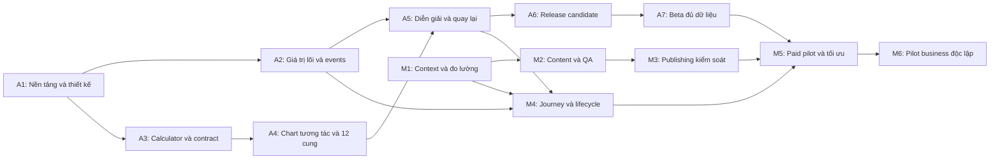

# Lộ trình triển khai Nilaza — bản trình duyệt

Phiên bản 1.0 · 20/09/2026 · **Đề xuất, chưa được duyệt và chưa bắt đầu triển khai.**

Hai kế hoạch thực thi riêng:

1. [Kế hoạch A — Hoàn thiện ứng dụng, gồm Astrology tính đúng và đồ họa thần thoại tương tác](APP_PHASED_DELIVERY_PLAN_2026-09-20.vi.md).
2. [Kế hoạch B — Xây phòng marketing AI và kiểm chứng khả năng thành business](MARKETING_AI_PHASED_DELIVERY_PLAN_2026-09-20.vi.md).

Hai tài liệu phân tích trước vẫn giữ vai trò nguồn lập luận: [review sản phẩm](PRODUCT_DIFFERENTIATION_GTM_REVIEW_2026-09-20.vi.md), [blueprint marketing](AI_MARKETING_FRAMEWORK_PLAN_2026-09-20.vi.md). Ước lượng 12 tuần ở blueprint trước là phạm vi pilot sơ bộ, **không phải thời hạn cho scope mới có Astrology hoàn chỉnh và đồ họa tương tác**. Khi bản này được duyệt, lịch dưới đây thay ước lượng thực thi cũ; PRD/roadmap chính chỉ cập nhật ở A1 sau duyệt.

## 1. Những quyết định đề nghị duyệt

| ID | Quyết định đề xuất | Hệ quả |
| --- | --- | --- |
| D1 | Xây chiều sâu và continuity Persona/Tarot/Council trước paid scale | Học từ người dùng sớm, giảm chi tiền vào trải nghiệm chưa giữ chân |
| D2 | Astrology natal chart đầy đủ trong wave ra mắt công khai | Bao gồm calculator, report, chart vector tương tác, thư viện 12 cung, lưu và handoff |
| D3 | Western tropical + Whole Sign v1; calculator quyết định bằng ADR/fixture/license | Có phạm vi tính nhất quán; không hứa hỗ trợ tất cả trường phái |
| D4 | Art direction đài quan sát thần thoại, 2.5D; một chapter prototype trước bộ đầy đủ | Ưu tiên trải nghiệm native chuyên nghiệp, dễ đọc, hiệu năng tốt |
| D5 | Marketing bắt đầu bằng context/measurement và draft→QA | Không xây mọi connector hoặc cho agent toàn quyền ngay |
| D6 | Việt Nam, người trưởng thành, VI-first là giả định pilot | A1/M1 kiểm tra lại thị trường/thiết bị/kênh; EN giữ chuẩn nội dung |
| D7 | Từng phase có nghiệm thu rồi mới mở phase tiếp | Phê duyệt bản kế hoạch không tự cho phép chạy mọi phase |
| D8 | Chuẩn bị tách core từ đầu; chỉ spin-out khi có bằng chứng nhiều khách hàng | Tránh đầu tư SaaS quá sớm; M6 có quyết định riêng |

Không đưa nhân tướng học, full 3D sky, community/marketplace vào wave hiện tại. Không giảm yêu cầu chính xác hoặc khả năng đọc để bù độ trễ tiến độ; cắt bớt hiệu ứng phụ hoặc kênh marketing trước.

## 2. Vì sao chọn thứ tự này?

- Chất lượng hội thoại và dữ liệu đầu vào ảnh hưởng mọi phiên; sửa A2 có lợi ngay cả trước Astrology.
- Chart contract/precision phải ổn trước renderer. Có thể nghiên cứu mỹ thuật sớm bằng fixtures tổng hợp, nhưng không để art team tự định nghĩa tọa độ.
- A4 tạo hấp dẫn và khả năng khám phá; A5 biến sự tò mò thành lý do quay lại. Cần cả hai để marketing có thứ thật để kể.
- M1/M2 giúp nghiên cứu và chuẩn bị trước launch; không cần chờ app hoàn tất để bắt đầu mọi việc marketing.
- Publishing và lifecycle cần consent, quyền, retry và dữ liệu thật; paid scale còn cần retention và contribution đủ quan sát.
- Đánh giá spin-out sau nhiều vòng học giúp phân biệt lợi ích do framework và do riêng sản phẩm/brand Nilaza.

## 3. Phụ thuộc và đường triển khai



M5 có thể bắt đầu paid learning pilot nhỏ khi A6 đạt và A7 có tín hiệu ban đầu; **scale** phải chờ các cohort đủ tuổi theo gate. M4 được làm dashboard với A2 trước, nhưng lifecycle gắn vào progress chỉ kích hoạt khi A5 có flow thực. Public publishing M3 phải có quyền và feature proof tương ứng; dựng adapter trước không đồng nghĩa đăng ngay.

## 4. Lịch dự kiến theo nguồn lực

Không biết capacity thực nên đây là range để lập ngân sách, không cam kết ngày phát hành. Chốt lại cuối A1/M1. Chờ API audit, license, store review, thiết bị iOS hoặc lịch tuyển tester có thể nằm ngoài range.

**Phương án khuyến nghị nếu có đủ nguồn lực:** một owner kỹ thuật cho app, một owner kỹ thuật cho growth, designer/motion và editor hỗ trợ, chủ sản phẩm review theo mốc. Không có nghĩa tất cả phải full-time; phải ghi lịch khả dụng ở A1.

| Cửa sổ dự kiến | Nhánh A | Nhánh B | Mốc bàn giao |
| --- | --- | --- | --- |
| Tuần 1 | A1 | M1 | Duyệt scope/contract/visual brief/budget assumptions |
| Tuần 2–4 | A2 | M2 | Build lõi, eval, events; workflow content draft→QA |
| Tuần 5–7 | A3; art prep theo concept đã chọn | Hoàn M2; M3 test adapter | Calculator evidence, contract khóa cho renderer |
| Tuần 8–11 | A4 | M3; M4 analytics từ events A2 | Chart native và 12 chương; publish/test evidence |
| Tuần 12–14 | A5 | M4 lifecycle integration | Hành trình chart→guide→Journal→return |
| Tuần 15–17 | A6 | Chuẩn bị paid drafts/data readiness | Release candidate và gói nội dung có proof |
| Tuần 18–23 | A7, sửa lỗi theo cohort | M5 pilot nếu đạt gate | Retention/cost/paid report, quyết định launch/scale |
| Sau bằng chứng | Roadmap sau launch | M6 quyết định riêng | Có/không thử business độc lập |

Dành buffer để dự toán **18–26 tuần** đến quyết định ra mắt đầy đủ/tăng trưởng có bằng chứng, với hai nhánh có người phụ trách riêng và không blocker lớn. Có thể mời beta lõi sớm sau A2; beta Astrology nội bộ sau A4 không thay A6 full-release QC. Không nhất thiết chờ cuối cửa sổ mới được đưa sản phẩm cho người dùng phù hợp.

**Nếu một kỹ sư/agent delivery chính làm cả hai nhánh:** không gọi hai backlog là hai dự án chạy song song. Thứ tự khuyến nghị A1→M1→A2→M2 bản nhỏ→A3→A4→A5→M3/M4→A6→A7/M5; editor có thể chuẩn bị nội dung trong lúc kỹ thuật làm app. Dự toán **24–36 tuần**, cần hiệu chỉnh ở A1. Không cắt QA/timezone/consent để giữ một lịch 12 tuần không còn tương xứng scope.

## 5. Mốc nghiệm thu chủ sản phẩm

| Gate | Chủ sản phẩm xem/thử | Được mở tiếp khi đạt |
| --- | --- | --- |
| G1 — A1/M1 | Scope, 3 guide, Astrology flow/concept, quy ước tính, claims, metric definitions | A2; research/design prep đã có scope |
| G2 — A2/M2 | Hội thoại 5 lượt, Tarot→guide, eval; một brief đến draft được QA | Beta lõi có giới hạn; calculator/content workflow tiếp |
| G3 — A3 | Chart fixtures, sai số, unknown-time/DST, cùng input cùng kết quả | Tích hợp renderer A4 với dữ liệu thật |
| G4 — A4 | Điện thoại thật: chart→Moon→chương cung, zoom, Reduce Motion, offline | Tích hợp diễn giải/progress A5 |
| G5 — A5/M4 | Save→check-in→recap; memory sửa/xóa; unsub dừng job | Chuẩn bị RC và lifecycle đã có quyền |
| G6 — A6/M3 | RC, privacy/payment, marketing preview/receipt, source-build proof | Full beta hoặc phát hành trong phạm vi duyệt |
| G7 — A7/M5 | Cohort đủ tuổi, useful rating, cost/contribution, lỗi/opt-out | Tăng trưởng có giới hạn hoặc sửa sản phẩm |
| G8 — M6 | Khách hàng ngoài, tái sử dụng, margin/isolation | Có/không tách business |

Mỗi gate có ba kết quả: đạt; đạt với giới hạn công bố; chưa đạt với danh sách sửa. Không chuyển trạng thái theo lịch mặc định. Vấn đề từ repo cũ phải có owner và xử lý/giới hạn rõ, không tính thành công bằng số tests mới.

## 6. Chi phí và nguồn lực cần chốt ở A1/M1

| Nhóm | Khoản cần biết trước cam kết | Quyết định |
| --- | --- | --- |
| Astrology | License/engine, geocoding/timezone, compute/cache, quyền dữ liệu | ADR + báo giá + trần gọi/tháng; chưa mua ở bước plan |
| Nội dung và đồ họa | 12 tranh chủ lực, glyph/motifs, VI/EN editorial, render/native QC | Duyệt chapter mẫu rồi batch, tránh làm lại cả bộ |
| Product AI | Model cost/session, token/latency/fallback, cost per valued session | Chọn route bằng eval; budget cap và alert |
| Vận hành app | Staging/production, observability, crash, thiết bị/builds, payments | Tách development cost và recurring cost |
| Marketing AI | Job runtime, generation/media, QA người, connector/email/analytics | Cost per accepted asset, chi phí hệ thống/tháng |
| Quảng cáo | Số tiền chấp nhận mất để học, CAC ceiling, objective, currency/window | Owner duyệt envelope trước activate; tách media và platform cost |

Không đưa con số tiền khi chưa biết vendor, usage và khả năng chi trả. A1/M1 phải nộp phương án tiết kiệm/cân bằng/mở rộng có báo giá và assumptions, để duyệt chi phí trước hạng mục có trả phí.

## 7. Rủi ro lớn và cách giữ scope

- **Ledger đang blocked:** chỉ chuẩn bị và review forward path; database owner quyết định trước push/repair. Giữ thiết kế/fixture/content tiến triển độc lập.
- **Không có iOS evidence:** không công bố sẵn sàng iOS; dùng phạm vi Android thử trước nếu được chọn. Lịch iOS bổ sung có owner rõ.
- **Calculator/provider không đạt:** đổi adapter hoặc giảm phạm vi được hỗ trợ một cách công khai; không dùng model bịa chart hoặc giấu UTC fallback.
- **Đồ họa nặng:** giảm particle/parallax, giữ vector/data/illustration và interaction chính. Không dùng full 3D để che chất lượng đọc chart kém.
- **Nội dung nhiều nhưng chung:** ưu tiên 3 guide + 12 chapter có editor và eval; mở rộng sau, không tuyển thêm personas để thay cải tiến chiều sâu.
- **Marketing chuyển đổi đầu tốt nhưng retention kém:** pause scale, tạo product ticket; kiểm reminder-induced return; không tăng tần suất để làm đẹp số.
- **API/account chậm duyệt:** dùng draft/manual export được kiểm, không lách nền tảng bằng browser automation tài khoản không được cấp quyền.
- **Thiếu người review:** giảm batch/format/kênh; không bỏ QA hoặc để generator tự approve.

## 8. Phiếu duyệt và cách bắt đầu từng phase

Chủ sản phẩm có thể duyệt phạm vi tổng thể, rồi chỉ mở A1/M1. Duyệt kế hoạch không tự cấp quyền mua license, đọc dữ liệu riêng, publish, gửi email/DM, deploy production, thay migration history hoặc chi quảng cáo. Những việc đó sẽ có gói cụ thể và quyết định đúng thời điểm; các thao tác trong scope đã duyệt không cần hỏi lại từng bước.

Mẫu phản hồi để bắt đầu:

> Tôi duyệt kế hoạch v1 theo D1–D8. Bắt đầu A1 trước, sau đó M1. Các phase sau nghiệm thu rồi duyệt tiếp. Giữ Astrology tropical/Whole Sign và hướng đồ họa 2.5D thần thoại; engine và chi phí chốt sau đề xuất A1.

Hoặc nếu muốn A1/M1 có hai người phụ trách riêng, ghi rõ cho phép hai nhánh thực hiện đồng thời và năng lực nguồn lực. Đây là lựa chọn staffing, không bắt buộc spawn agents ở hiện tại.

**Checklist khởi động phase 1 sau duyệt:** đọc source state mới nhất; khai báo write scope; baseline checks; xác minh active config read-only có quyền; ghi unknowns; chốt decisions; nộp artifacts review. Đầu ra phase 1 là hồ sơ triển khai có thể duyệt, không phải cố hoàn thiện Astrology trong một sprint.

**Mẫu nghiệm thu cuối phase:**

```text
Phase / owner / source-build reference:
Mục tiêu đã cam kết:
Đầu ra thực tế và cách mở:
Manager test path:
Checks và bằng chứng:
Chi phí/ngày công thực tế so dự toán:
Giới hạn và blocker:
Rollback:
Đề nghị phase tiếp / quyết định cần duyệt:
```

## 9. Phạm vi tài liệu được làm trong lần này

Chỉ thêm ba Markdown nội bộ tại `docs/`; không sửa runtime, prompt active, assets, schema, PRD hiện hành hoặc hệ thống marketing. Entry là tài liệu để owner review; data write chỉ ba tệp. Backend/Admin/privacy/analytics/rollback tương lai đã được map trong từng kế hoạch; hiện không tạo API/job hoặc quyền mới. Nguồn đọc: repo và tài liệu công khai; không dùng chat/journal/birth data thật.

Validation tài liệu: liên kết nội bộ tồn tại, UTF-8 hợp lệ, phase IDs/dependencies nhất quán, các acceptance có manager test, estimate phân biệt công và thời gian quan sát. Không chạy app tests hoặc tuyên bố app đạt vì task này chỉ lập kế hoạch. Xóa ba draft mới là rollback của chính task tài liệu; không đụng hai báo cáo phân tích cũ hoặc thay đổi sẵn có khác.
