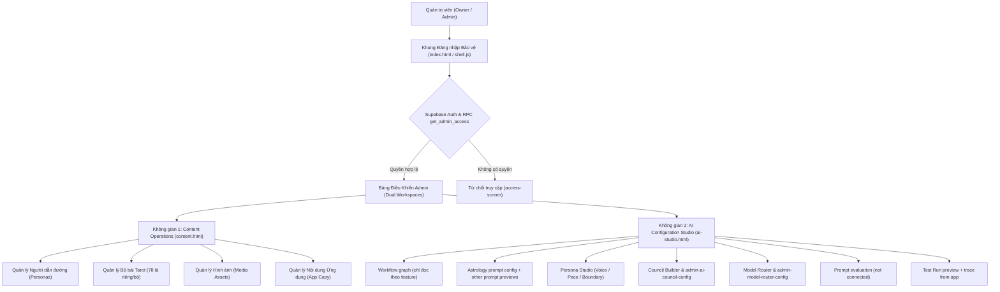

# Sổ tay Vận hành Nilaza Admin Console & AI Configuration Studio

> Cập nhật nhận diện 2026-09-11: Open Reflection v1 theo `docs/BRAND_GUIDELINES.md`. Login và shell dùng biểu tượng mới; Content Operations, AI Studio và quyền truy cập giữ nguyên. Kiểm tra trạng thái tích hợp/kiểm chứng/phát hành tại `docs/BRAND_ROLLOUT_2026-09-11.md`. Tài liệu này chỉ dành cho Owner/Admin; không dùng làm nguồn Help hoặc ấn phẩm công khai.

> **Trạng thái vận hành mới nhất (03/10/2026):** migration AI Studio `20260926152118_ai_studio_operations` đã được áp dụng trên QA cũ; toàn bộ migration ledger vẫn blocked vì divergence riêng, xem [ledger](SUPABASE_MIGRATION_LEDGER.md). Audit hiện tại tải thành công Model Router, prompt Astrology VI/EN, Council và Trace metadata. Test Run/Optimizer chưa gọi LLM; số token/latency mẫu và nút rollback cũ không phải khả năng vận hành. Bản sửa local khóa publish Council vì editor chưa hydrate cấu hình thật và publisher chưa atomic/CAS; GET vẫn dùng để đọc. Không dùng QA cũ để apply thay đổi mới; chủ sản phẩm đã chọn QA sạch và giữ QA cũ làm bằng chứng. Xem [báo cáo Configure](mvp-remediation/2026-10-03/admin-configure/report.vi.md).

## Tài liệu Hướng dẫn Vận hành dành cho Owner/Admin

*Phiên bản tài liệu: 1.0*  
*Cập nhật lần cuối: 2026-10-04*
*Phạm vi: Nilaza Admin Console · Content Operations và AI Studio*
*Ngôn ngữ: Tiếng Việt (kèm thuật ngữ kỹ thuật quốc tế)*  

---

## Mục lục

1. [Giới thiệu & Tổng quan Hệ thống](#1-giới-thiệu--tổng-quan-hệ-thống)
2. [Cơ chế Phân quyền Truy cập & Quyền hạn của Owner](#2-cơ-chế-phân-quyền-truy-cập--quyền-hạn-của-owner)
3. [Đăng nhập & Điều hướng Hai Không gian Làm việc Bảo vệ](#3-đăng-nhập--điều-hướng-hai-không-gian-làm-việc-bảo-vệ)
4. [Vận hành AI Configuration Studio - Cấu hình Tính năng & Luồng AI](#4-vận-hành-ai-configuration-studio---cấu-hình-tính-năng--luồng-ai)
5. [Chuyên sâu Prompt Composer & Persona Prompt Studio](#5-chuyên-sâu-prompt-composer--persona-prompt-studio)
6. [Chuyên sâu Council Builder - Cấu hình Hội đồng Tham vấn AI](#6-chuyên-sâu-council-builder---cấu-hình-hội-đồng-tham-vấn-ai)
7. [Vận hành Model Router & Điều phối Đa Nhà Cung Cấp LLM](#7-vận-hành-model-router--điều-phối-đa-nhà-cung-cấp-llm)
8. [Vòng lặp Tối ưu hóa (Optimization Loop), Chạy Thử nghiệm & Quản lý Phiên bản](#8-vòng-lặp-tối-ưu-hóa-optimization-loop-chạy-thử-nghiệm--quản-lý-phiên-bản)
9. [Vận hành Quản trị Nội dung (Content Operations)](#9-vận-hành-quản-trị-nội-dung-content-operations)
10. [Ranh giới An toàn, Bảo mật Secrets & Tuân thủ Pháp lý](#10-ranh-giới-an-toàn-bảo-mật-secrets--tuân-thủ-pháp-lý)
11. [Checklist Vận hành Thực tế Dành Cho Owner](#11-checklist-vận-hành-thực-tế-dành-cho-owner)

---

## 1. Giới thiệu & Tổng quan Hệ thống

### 1.1. Định vị Nilaza & Vai trò của AI Studio
**Nilaza** là ứng dụng di động người bạn đồng hành AI huyền bí (Mystical AI Companion) dành cho người dùng Gen Z và phụ nữ quan tâm đến tarot, chiêm tinh, khám phá bản thân và đối thoại phản tư nội tâm. 

Admin Console quản trị nội dung và một phần cấu hình AI. Model Router và prompt Astrology có backend thật trên QA cũ. Workflow hiện là graph chỉ đọc theo từng feature, đã phát hành trên local và Admin staging ngày 04/10/2026; nó mô tả nguồn đã review, chưa xác nhận backend tương ứng đã deploy. Context Builder, Persona Studio và các editor prompt chưa nối consumer vẫn là preview. Backend QA cũ của Oracle/Daily còn đường prompt cố định; Oracle candidate local đã có compiler Core + Feature + Locale + Tone nhưng provider đang khóa. Sửa preview chưa làm thay đổi câu trả lời trên app; bundle chung cần được publish và kiểm chứng trên QA sạch trước khi tuyên bố runtime sử dụng. Xem [hồ sơ phát hành Workflow graph](mvp-remediation/2026-10-03/workflow-graph/report.vi.md).

### 1.2. Kiến trúc Tổng thể Hai Không gian Làm việc Độc lập
Hệ thống Admin Console được thiết kế bảo vệ theo tiêu chuẩn kiến trúc kép (Dual-Workspace Architecture):



- **Content Operations (`content.html`)**: Chuyên trách quản trị dữ liệu người dùng nhìn thấy: hồ sơ nhân vật, hình ảnh bài tarot, 78 lá bài riêng cho từng bộ bài, từ khóa, văn bản hiển thị trên app (Tiếng Việt `vi` và Tiếng Anh `en`).
- **AI Configuration Studio (`ai-studio.html`)**: Hiển thị workflow và trạng thái AI; route model có API tải/publish, Astrology có API tải/publish prompt VI/EN theo cặp. Council hiện chỉ tải config để đọc, publish bị khóa trên bản local. Preview, Test Run và tối ưu hóa chưa nối vào runtime.
- **Growth Operations (`growth.html`)**: Không gian thứ ba trong shell hiện tại, quản trị product truth và kế hoạch growth. Tài liệu này tập trung Content/AI; không thay thế hướng dẫn Growth.

---

## 2. Cơ chế Phân quyền Truy cập & Quyền hạn của Owner

### 2.1. Ma trận Phân quyền Vai trò (Role-Based Access Control - RBAC)
Hệ thống xác thực quản trị viên thông qua hàm RPC `get_admin_access` của Supabase. Quyền **Owner** là vai trò tối cao (Super Admin) kiểm soát toàn diện mọi tính năng của hệ sinh thái.

| Vai trò (Role) | Xem dữ liệu (`hub.read`) | Chỉnh sửa bản nháp (`content.draft`) | Xuất bản nội dung (`content.publish`) | Quản lý AI Studio (`ai.manage`) | Xóa vĩnh viễn (`content.delete`) | Quản trị vai trò (`roles.manage`) |
|---|:---:|:---:|:---:|:---:|:---:|:---:|
| **owner** | **Có** | **Có** | **Có** | **Có** | **Có** | **Có** |
| `admin` | Có | Có | Có | Có | Không | Không |
| `editor` | Có | Có | Không | Không | Không | Không |
| `safety_reviewer` | Có | Không | Không | Không (chỉ xem) | Không | Không |
| `regular_user` | **Bị chặn** | **Bị chặn** | **Bị chặn** | **Bị chặn** | **Bị chặn** | **Bị chặn** |

Quyền thực tế lấy từ capabilities do `get_admin_access` trả về, không suy ra quyền publish chỉ từ tên vai trò. Parser hiện hỗ trợ `owner`, `admin`, `editor`, `safety_reviewer`; `viewer` và `content_admin` không phải role được hỗ trợ.

### 2.2. Danh mục 11 Năng lực Kỹ thuật (Capabilities) của Quyền Owner
Khi đăng nhập với quyền `owner`, phiên làm việc của bạn được cấp toàn bộ 11 năng lực hệ thống:
1. `hub.read`: Mở giao diện tổng quan bảng điều khiển Admin.
2. `content.read`: Xem chi tiết dữ liệu nhân vật, bộ bài tarot, 78 lá bài và hình ảnh.
3. `content.draft`: Tạo và chỉnh sửa bản nháp nội dung trong bộ nhớ cục bộ.
4. `content.publish`: Thay đổi trạng thái nội dung sang `active` hoặc `published`.
5. `content.delete`: Xóa vĩnh viễn bản ghi nháp hoặc lưu trữ (khi thỏa mãn quy tắc an toàn).
6. `ai.read`: Xem cấu hình luồng AI, prompt hệ thống, kịch bản Council và Model Router.
7. `ai.manage`: Toàn quyền chỉnh sửa prompt, cấu hình Council Builder, cấu hình Model Router và phát hành phiên bản lên backend.
8. `roles.manage`: Quản trị phân quyền cho các thành viên trong đội ngũ.
9. `overview.read`: Đọc các chỉ số thống kê, báo cáo kiểm toán và tỷ lệ chuyển đổi.
10. `notifications.dispatch`: Kích hoạt gửi thông báo đẩy (push notifications) kiểm thử hoặc sự kiện.
11. `safety.review`: Kiểm định an toàn nội dung và rà soát các trường ngữ cảnh nhạy cảm.

---

## 3. Đăng nhập & Điều hướng Hai Không gian Làm việc Bảo vệ

### 3.1. Quy trình Đăng nhập Quản trị viên
1. **Truy cập đường dẫn bảng điều khiển**:
   - Môi trường thử nghiệm cục bộ: `http://localhost:4173/apps/admin/`
   - Môi trường Staging / Production: Theo domain triển khai nội bộ được cấp riêng cho đội ngũ Owner.
2. **Nhập thông tin xác thực**:
   - Nhập **Email** (ví dụ: tài khoản được cấp quyền owner trên Supabase).
   - Nhập **Mật khẩu**.
   - Bấm **Sign in**.
3. **Cơ chế kiểm soát phiên (Session Guard)**:
   - Hệ thống tự động gọi hàm `client.rpc("get_admin_access")`. Nếu tài khoản chỉ là người dùng app thông thường, màn hình **Admin access required** sẽ hiện lên và chặn truy cập.
   - Nếu đăng nhập thành công, hệ thống chuyển thẳng vào giao diện quản trị với thông tin định danh ở góc trên bên phải: `email@nilaza.ai · owner`.
4. **Khôi phục mật khẩu**:
   - Trường hợp quên mật khẩu, nhấp vào liên kết `Quên mật khẩu? / Forgot password?` để chuyển sang trang `recovery.html`. Hệ thống sẽ gửi email chứa liên kết đặt lại mật khẩu an toàn qua Supabase Auth.

### 3.2. Điều hướng Thanh Tiêu đề (Shell Header)
Thanh tiêu đề trên cùng cho phép chuyển đổi tức thời giữa hai phân hệ lớn:
- Nút **Content Operations**: Chuyển sang không gian quản trị Persona, Tarot, Hình ảnh và Nội dung app.
- Nút **AI Studio**: Chuyển sang không gian workflow, prompt, Council Builder, Model Router, trace và audit.
- Chuyển qua lại giữa hai workspace trong cùng phiên giữ nguyên màn hình đang mở; logout hoặc đổi tài khoản sẽ xóa workspace đang giữ trong bộ nhớ và thông tin phiên.
- Nút **Log out**: Hủy phiên làm việc an toàn và xóa JWT trong bộ nhớ tạm thời của trình duyệt.

### 3.3. Phân định Ba Cấp độ Lưu trữ Dữ liệu (Rất Quan Trọng)
Người vận hành cấp Owner cần nắm vững 3 tầng dữ liệu để tránh nhầm lẫn:
1. **Repository Seed (Dữ liệu gốc dự án)**: Các file JSON chuẩn trong thư mục `packages/content/data/` và `packages/agent-config/`. Đây là nguồn chân lý khi khởi tạo hoặc khôi phục.
2. **Local Review Draft (`localStorage`)**: Dữ liệu lưu trong khóa `nilaza.admin.content.v4` của trình duyệt. Cho phép đội ngũ biên tập viên chỉnh sửa, thử nghiệm giao diện mà không gây ảnh hưởng đến người dùng thực tế đang dùng app.
3. **Backend Production / Staging (Supabase Database & Edge Functions)**: Dữ liệu runtime phục vụ ứng dụng di động. Council, model route và cặp prompt Astrology có đường publish backend riêng. Không publish cấu hình staging trước khi kiểm tra project host và quyền/approval liên quan.

---

## 4. Vận hành AI Configuration Studio - Cấu hình Tính năng & Luồng AI

AI Configuration Studio là nơi Owner kiểm tra workflow, route và các cấu hình đã có backend. Tải được cấu hình chỉ chứng minh nguồn backend đã đọc; cần đối chiếu consumer, revision và trace phù hợp có nguồn ghi đáng tin cậy để xác nhận cấu hình được dùng trong runtime. Preview và graph source không thay thế bằng chứng đó.

### 4.1. Danh mục 8 luồng trong AI Studio

Tại thanh điều hướng bên trái (Sidebar) mục **Features**, nhấp để chọn tính năng. Provider/model bên dưới là **route active đọc từ backend** sau khi Model Router tải thành công; browser draft được đánh dấu riêng. Không dùng các model mặc định cũ trong tài liệu làm khuyến nghị chọn model.

| Tính năng | ID trên UI | Feature backend | Đường chạy |
|---|---|---|---|
| Nilaza Oracle | `oracle_router` | `oracle_router` | `/ai/oracle-turn`; route phản tư trung tâm |
| Persona Chat | `persona_chat` | `persona_chat` | LLM qua shared model router |
| AI Council | `ai_council` | `ai_council` | Council pipeline và shared model router |
| Tarot Reading | `tarot_reading` | `tarot_reading` | LLM qua shared model router |
| Daily Insight | `daily_insight` | `daily_insight` | LLM qua shared model router |
| Astrology | `astrology` | `astrology_report` | `/ai/astrology-insight`; response schema `astrology_ai_insight_v1` |
| Face Reading | `face_reading` | `face_reading` | Không có model route hoạt động trong MVP |
| Notifications | `notifications` | — | Expo Push/in-app; không gọi LLM |

Model names, version và route trạng thái thay đổi theo backend và chỉ được coi là thật khi hiển thị `Backend active`. “Not loaded” và “Local draft” không chứng minh cấu hình runtime.

### 4.2. Workflow: sơ đồ quan sát riêng cho từng tính năng

Chọn **Workflow** và một feature để xem sơ đồ chỉ đọc của feature đó. Sơ đồ mô tả các đường dữ liệu và điều kiện được đối chiếu với mã nguồn; đây không phải workflow engine, không có thao tác kéo nối để thay backend và không tự chạy AI. Mỗi feature có thể có các node, nhánh chặn, primary/fallback và đường lưu khác nhau.

Chọn một node để xem tên/kiểu của **input**, **output**, nguồn cung cấp và nơi sử dụng tiếp theo, cùng đường dẫn contract hoặc mã đã review. Chọn một edge để xem port nguồn/đích, vai trò truyền dữ liệu hay điều khiển và điều kiện của nhánh. Đây là mô tả field/schema; không hiển thị nội dung câu hỏi, chat, Journal, dữ liệu ngày sinh hoặc payload của người dùng. Dùng danh sách node/edge khi cần đọc bằng bàn phím; zoom/fit chỉ đổi góc nhìn sơ đồ.

**Phân biệt hai lớp thông tin:**

| Lớp | Ý nghĩa | Không chứng minh |
| --- | --- | --- |
| Source reviewed / Candidate | Node hoặc nhánh đã được đối chiếu với nguồn mã/contract có provenance; candidate là bản chuẩn bị local | Không xác nhận source đó đã deploy hoặc node vừa được thực thi |
| Recorded trace / Origin unverified | Một trace đúng feature và đúng target/account có span/stage nằm trong allowlist; chưa xác minh bên tạo bản ghi | Không xác nhận provider đã được gọi, toàn pipeline, dữ liệu được lưu hoặc app đã render |
| No explicit evidence / Not instrumented | Chưa có trace phù hợp hoặc trace không có event nhận diện bước này | Không kết luận bước đó thất bại hoặc chưa từng chạy |
| Deferred / Non-LLM | Feature chưa thuộc phạm vi chạy, hoặc là luồng operations không cần LLM | Không gợi bật upload/provider hay publish để thử sơ đồ |

Trạng thái source và bản ghi trace được ghi riêng. Route **Backend active**, GET thành công, provider secret đã cấu hình hoặc root trace **completed** không được dùng để đánh dấu mọi node/edge đã chạy. Một span `llm.<provider>.primary/fallback` hiện chỉ cho biết có bản ghi phù hợp; nó chưa chứng minh provider đã được gọi hoặc auth/context/validation/save/client render hoàn tất. Nếu input/output bị che, sơ đồ giữ phần schema và ghi giới hạn quan sát, không dựng lại giá trị.

Migration trace trong source local cấp quyền `INSERT` vào `ai_trace_runs` và `ai_trace_spans` cho `authenticated`; RLS kiểm tra `user_id` thuộc người đang đăng nhập. Chưa kiểm quyền live trên QA và chưa thử ghi bản giả. Cơ chế trong source này không xác minh bản ghi được tạo bởi backend, nên graph hiển thị **Recorded span · origin unverified**. Chỉ khi nguồn ghi được khóa riêng cho backend đáng tin cậy và quyền thực tế trên môi trường đích đã được kiểm chứng, span tương ứng mới có thể hỗ trợ xác nhận lần gọi provider; vẫn không chứng minh toàn pipeline. Việc sửa quyền ghi/instrumentation cần một kế hoạch database/backend riêng và theo migration ledger; xem graph không tự thay đổi quyền này.

Giới hạn cần biết theo feature:

- **Oracle:** prompt Core + Feature + Locale + Tone trên Admin là compiled candidate. Backend source candidate đang khóa provider; QA cũ có revision khác. Chỉnh hoặc quan sát graph không kích hoạt provider, quota hay publish bundle. Mobile offline fallback vẫn là đường riêng cần nghiệm thu.
- **Tarot:** app/backend chọn lá bài bằng logic xác định; AI chỉ diễn giải lá đã chọn. Checkbox/context/prompt và tone trong legacy preview không xác nhận payload runtime; tone preview hiện không được Tarot consumer dùng.
- **Astrology:** facts được tính riêng rồi chuyển sang interpretation theo consent/entitlement/schema. Trace có model spans và finalization metadata, nhưng sanitizer hiện che chuỗi `stage`/`result` và một số field khác; graph không thể suy ra parse/validate/persist/response từ các giá trị đã bị che. Cần instrumentation riêng mới quan sát được từng bước; không tự bật raw QA capture để lấp chỗ trống.
- **Face Reading:** deferred, không có upload hoặc đường gọi LLM MVP để chạy thử qua graph.
- **Notifications:** in-app/Expo Push, không có Model Call; trạng thái gửi/receipt khác với AI generation.
- **Persona/Council/Daily:** chỉ hiển thị cấu trúc đã source-review và evidence có thật. Các layer hoặc context mẫu chưa nối consumer vẫn phải ghi preview/candidate; không coi canvas là bằng chứng publisher/runtime.

Khi chọn trace, graph chỉ dùng metadata đã allowlist và phải khớp feature, tài khoản quản trị đã xác minh và backend mục tiêu của transport đã khởi tạo. Nhãn hoặc giá trị ENV thay đổi không chuyển client sang một backend khác. Thay URL/key cấu hình sẽ khóa transport, xóa dữ liệu nhạy cảm và yêu cầu tải lại; request/response đang chờ của cấu hình cũ bị từ chối. Đổi feature/trace/account/target/quyền đọc hoặc điều hướng URL/shell/workspace làm mất phạm vi phù hợp cũng phải xóa bản ghi đang hiển thị. Không giữ payload trace trong draft, URL hoặc browser storage. Empty/loading/error khác nhau; lỗi tải không được biến thành số 0 hoặc một pipeline xanh.

Manager test: chọn từng feature, mở node/edge và chỉ ra field lấy từ đâu/đi đâu; chọn trace phù hợp rồi kiểm tra chỉ node có span hợp lệ hiện **Recorded span · origin unverified**, các edge vẫn chưa có bằng chứng execution. Sau đó chuyển feature/trace/workspace hoặc target để kiểm tra evidence cũ không còn xuất hiện; thay cấu hình backend phải yêu cầu tải lại. Kiểm tra Face/Notifications đúng giới hạn. Những thao tác này chỉ đọc, không publish cấu hình, gọi provider hoặc reveal payload.

#### 4.2.1. Legacy inspector: bảy khối tham chiếu thu gọn

Bảy khối cũ dưới đây vẫn là shortcut tới các editor/reference hiện có và được thu gọn trong UI. Chúng không đại diện cho một chuỗi thực thi giống nhau của mọi feature:

```text
[1. Trigger] ──> [2. Context Builder] ──> [3. Safety Gate] ──> [4. Prompt Composer] 
                                                                       │
[7. Save & Audit] <── [6. Output Validator] <── [5. Model Call] <──────┘
```

Khi mở một khối tham chiếu, **Inspector** dẫn tới phần cấu hình/preview tương ứng:

#### Bước 1: Trigger (Khóa - Locked)
- Thể hiện sự kiện kích hoạt từ ứng dụng di động (ví dụ: người dùng gửi tin nhắn hoặc bấm lật bài tarot). Bước này mang tính chất kiến trúc cố định.

#### Bước 2: Context Builder (Local Preview)
Checkbox và mapping trong Inspector chỉ chỉnh dữ liệu mẫu trên trình duyệt để minh họa ngữ cảnh. Chúng không đổi allowlist, payload hay prompt đang chạy ở backend. Dùng contract và trace để kiểm tra dữ liệu thực tế; không suy ra rằng một trường đang gửi chỉ từ trạng thái checkbox.

#### Bước 3: Safety Gate (Policy Reference)
Inspector liệt kê ranh giới chính sách để tham khảo. Các nhãn không phải công tắc, và không chứng minh một lần chạy đã áp dụng quy tắc. Xác minh hành vi thực thi trong contract, validator và kết quả trace của feature.

#### Bước 4: Prompt Composer
Với Astrology, Owner phải tải prompt active từ backend; chỉnh VI/EN sẽ tạo browser draft, còn nút **Review and publish VI + EN pair** ghi cả hai ngôn ngữ nguyên tử thành phiên bản active mới. Với feature khác, Prompt Composer và `@` mention hiện chỉ là local preview; Save draft không đổi prompt runtime.

#### Bước 5: Model Call
Primary/fallback provider, model, temperature và output token limit là bản nháp trên trình duyệt cho đến khi Owner publish route. Model picker hỗ trợ gõ/tìm theo tên hoặc ID; trước khi publish cần đối chiếu model với schema, giới hạn và quyền riêng tư. Model Router đọc route hiện tại, hiển thị project host và yêu cầu xác nhận trước khi publish.

#### Bước 6: Output Validator (Locked)
Đây là bước backend, không sửa trong Inspector. Mỗi feature phải dùng response contract/schema riêng; Astrology kiểm tra schema và evidence fact ID trước khi lưu report. Lỗi parse/validate được ghi theo stage và trả lỗi; không mặc định có fallback sau lỗi schema.

#### Bước 7: Save & Audit Log (Locked)
Trace mặc định đã redact có model spans và metadata finalization theo contract từng feature; không bảo đảm đủ evidence để graph xác nhận mọi bước validation/lưu/response. Audit AI hiện liệt kê publish route, publish Astrology prompt và Owner reveal QA; audit cấu hình không phải event thực thi workflow. Bản raw provider payload chỉ có trong capture QA Astrology riêng, cần consent riêng, staging, Owner và retention đã kiểm chứng; không xem raw như mặc định của mọi feature.

---

## 5. Chuyên sâu Prompt Composer & Persona Prompt Studio

### 5.1. Các thành phần prompt trong kiến trúc Nilaza
Danh sách dưới đây là các loại thành phần có thể tham gia vào pipeline; không có nghĩa mọi feature đều có sáu tầng này trong một editor hoặc một lần gọi:

1. **Global Safety Prompt**: Bộ quy tắc an toàn bất biến chung cho toàn bộ app (không chẩn đoán bệnh, không phán đoán tương lai, xử lý nhạy cảm với ý định tự hại).
2. **Feature Base Prompt**: Phong cách giao tiếp nền tảng cho tính năng (ấm áp, thấu cảm, phản tư).
3. **Archetype Template**: Khuôn mẫu phong cách ứng xử theo nguyên mẫu nhân vật (ví dụ: Hiền giả trầm mặc, Người đồng hành chữa lành).
4. **Persona-Specific Config**: Giọng nói, chiêu thức phản tư, điểm mạnh và ranh giới riêng của từng nhân vật.
5. **Context Block**: Dữ liệu ngữ cảnh động đã được chọn lọc đưa vào (ngôn ngữ, trải bài, câu hỏi).
6. **Output Format**: Cấu trúc khuôn mẫu trả về kết thúc bằng 1 câu hỏi phản tư mở.

### 5.2. Menu biến `@` trong bản xem trước
Ở Prompt Composer cho các feature ngoài Astrology, gõ `@` để tìm biến trong dữ liệu preview đang chọn rồi nhấp để chèn vào bản nháp cục bộ. Tính năng này không xác nhận backend dùng biến đó, không thay đổi runtime prompt, và không có thao tác publish cho prompt Tarot/Persona ở màn hình này. Với Astrology, system prompt lấy từ backend; dữ liệu/câu hỏi được dựng theo contract của endpoint.
- Bạn cũng có thể nhấp trực tiếp vào danh sách **Approved variables** ở khung bên phải để chèn nhanh cú pháp biến chuẩn dạng `{{tên_biến}}`.

### 5.3. Persona Prompt Studio - Bản xem trước Persona Chat
Khi chọn tính năng `Persona Chat` và mở **Persona Prompt Studio**, workspace hiển thị cấu hình persona mẫu, các tầng prompt và bản preview được ghép trong trình duyệt. Những trường này chưa là editor/publish prompt Persona runtime.

```text
┌─────────────────────────┐  ┌────────────────────────────────────────────────────────┐
│ Danh sách Nhân vật      │  │ Thông số Nguyên mẫu & Giọng điệu                       │
│ ─────────────────────── │  │ Archetype: sage_mentor   Voice: quiet, poetic, spacious │
│ [●] Lão Tử (Laozi)      │  │ Pace: slow               Boundary: Inspired by Laozi   │
│ [ ] Aristotle           │  ├────────────────────────────────────────────────────────┤
│ [ ] Communication Mentor│  │ Khung Lắp ghép Prompt 6 Tầng (Layer Stack)             │
│                         │  │ Global Safety -> Base -> Archetype -> Persona -> Output│
│                         │  ├────────────────────────────────────────────────────────┤
│                         │  │ Bản Xem trước Prompt Hợp nhất (Assembled Preview)      │
└─────────────────────────┘  └────────────────────────────────────────────────────────┘
```

1. **Chọn Nhân vật**:
   - **Lão Tử (Laozi)**: Tông giọng yên ả, thi vị, nhịp điệu chậm rãi (`pace: slow`). Điểm mạnh: buông bỏ, thuận tự nhiên, tìm về an yên. Chiêu thức đặc trưng: trả lời bằng một nghịch lý nhẹ nhàng, gợi ý một hành động buông bỏ nhỏ.
   - **Aristotle**: Tông giọng trí tuệ, mạch lạc, thực tế (`pace: measured`). Điểm mạnh: mục đích luận, phân tích thói quen, đưa ra sự rõ ràng cho quyết định.
   - **Chuyên gia Giao tiếp (Communication Mentor)**: Tông giọng ấm áp, khéo léo, trực diện (`pace: direct`). Điểm mạnh: gỡ rối tin nhắn, thiết lập ranh giới cảm xúc lành mạnh trong tình yêu.
2. **Ranh giới Bản quyền & Mạo danh (Legal Boundary)**:
   - Tất cả các nhân vật đều được gắn quy định: *"Lấy cảm hứng từ [Tên Nhân vật]. Đây là người dẫn đường AI biểu tượng, không phải là người thật hay đại diện chính thức trong lịch sử."*
3. **Xem trước Prompt Hệ thống**:
   - Khung này minh họa cách ghép dữ liệu seed đang chọn; không xác nhận chuỗi prompt thật mà backend chuyển tới LLM. Dùng trace runtime đã redact để xem dữ liệu quan sát được; prompt chính xác hiện chỉ có trong luồng capture QA Astrology khi Owner chủ động bật opt-in ở staging.

---

## 6. Council Builder - Cấu hình Hội đồng Tham vấn AI

Hội đồng AI (AI Council) cho phép người dùng nhận được góc nhìn đa chiều từ nhiều người dẫn đường trong cùng một luồng.

### 6.1. Cấu hình Kịch bản Tình huống (Situation Templates)
Khi chọn tính năng `AI Council` và nhấp vào tab **Council Builder**:

1. **4 Kịch bản Mẫu Mặc định**:
   - **Love Confusion Council (Mơ hồ Tình cảm)**: Dành cho sự mập mờ, mất định hướng trong mối quan hệ. Gồm: Chuyên gia giao tiếp (Chủ tọa/Điều phối), Lão Tử (Gương soi), Aristotle (Lý tính thực tế).
   - **Career Fog Council (Sương mù Sự nghiệp)**: Dành cho người đang mất động lực, mâu thuẫn giữa đam mê và ổn định tài chính. Gồm: Aristotle (Chủ tọa), Chuyên gia giao tiếp (Diễn giải), Lão Tử (Giữ nhịp điệu).
   - **Overthinking Reset (Thiết lập lại Suy nghĩ Quá độ)**: Dành cho cơn bão lo âu, suy nghĩ luẩn quẩn. Gồm: Lão Tử (Gốc neo an yên) và Chuyên gia giao tiếp (Đối chiếu thực tế).
   - **Big Decision Board (Bàn cờ Quyết định Lớn)**: Dành cho bước ngoặt cuộc đời cần tranh biện đa chiều giữa Giá trị, Mối quan hệ và Trực giác nội tâm.
2. **Các Thông số Vận hành Council**:
   - **Chế độ họp (Meeting Mode)**:
     - `supportive_roundtable`: Bàn tròn thân mật, hỗ trợ cảm xúc.
     - `advisory_board`: Ban cố vấn chiến lược, phân tích bài bản.
     - `calm_intervention`: Can thiệp làm dịu cơn khủng hoảng suy nghĩ.
     - `structured_debate`: Tranh biện có cấu trúc giữa hai phương án.
   - **Số lượng Người dẫn đường (Max Guides)**: Giới hạn từ 2 đến 4 nhân vật (mặc định khuyến nghị là 3 để tránh phản hồi quá dài).
   - **Chế độ Tổng hợp (Synthesis Mode)**:
     - `gentle_consensus`: Đạt đến sự thấu hiểu đồng thuận nhẹ nhàng.
     - `decision_next_step`: Đưa ra hành động vi mô tiếp theo.
     - `calming_reframe`: Đổi góc nhìn để làm dịu tâm trạng.
     - `balanced_tradeoff`: Phân tích mặt được và mất của từng lựa chọn.

### 6.2. Kết nối & Xuất bản Cấu hình Council lên Supabase (Admin Connector)
Bản Council trong AI Studio là cấu hình mẫu để review. Hiện chưa có luồng publish an toàn từ editor này:

1. **Kiểm tra địa chỉ Endpoint**:
   - Trường **Function endpoint**: Tự động nhận diện từ cấu hình Supabase đã nạp (ví dụ: `https://<project-ref>.supabase.co/functions/v1/admin-ai-council-config`).
2. **Đặt mã phiên bản duy nhất (Config Version)**:
   - Hệ thống tự động sinh mã dạng `2026-06-26-council-builder-v1-admin-YYYYMMDDHHMM`. Owner có thể đặt lại theo phiên bản phát hành (ví dụ: `council-v2.1.0-prod`).
3. **Thao tác tải và xuất bản**:
   - Nút **Load active config**: Đọc cấu hình backend và hiển thị phản hồi JSON trong connector; không tự ghi đè các trường template trong form.
   - **Council publish unavailable**: bị khóa. Không gọi Edge Function POST từ workspace.
   - Đổi Mode/Guides/Synthesis chỉ cập nhật preview trong bộ nhớ, không lưu qua reload. Không dùng nhãn `ready_for_beta` của mẫu để nghiệm thu một cấu hình live.
   - Chỉ mở publish sau khi hydrate đúng active config, lưu base version, review diff, publisher atomic/CAS/idempotent và readback được kiểm chứng trên QA sạch.

---

## 7. Vận hành Model Router & Điều phối Đa Nhà Cung Cấp LLM

Nilaza áp dụng kiến trúc trừu tượng hóa nhà cung cấp (Provider-agnostic Architecture). Ứng dụng di động không bao giờ gọi trực tiếp OpenAI hay Google, mà gọi thông qua các Edge Functions của Nilaza Backend.

### 7.1. Danh mục Nhà Cung Cấp

Chuyển sang tab **Model router**:

Model picker hiện cho phép tìm theo tên/ID ở primary và fallback. Catalog UI chưa là nguồn kiểm chứng khả năng JSON schema, context window, privacy/ZDR, tham số hay chi phí của từng model. Trước khi publish, kiểm tra yêu cầu response schema và privacy của route bằng synthetic staging request. Provider key “configured” chỉ cho biết secret tồn tại; nó không chứng minh model endpoint khỏe hoặc tương thích.

### 7.2. Kiểm tra Kết nối Backend (Backend Readiness Check)
Khung **Supabase Admin Connector** trong tab Model Router cho phép Owner kiểm tra sức khỏe hạ tầng AI:
- Nhấn nút **Kiểm tra kết nối / Check connection**:
  - Hệ thống gửi truy vấn kiểm tra tới Edge Function `admin-model-router-config`.
  - Kết quả trả về cho biết các khóa bí mật (Secrets) tương ứng đã được cấu hình trong Supabase Dashboard hay chưa (`OPENAI_API_KEY`, `GEMINI_API_KEY`, `ANTHROPIC_API_KEY`, `OPENROUTER_API_KEY`).
  > **GHI CHÚ QUAN TRỌNG**: Nút kiểm tra này là thao tác **chỉ đọc (Read-only check)**, không gọi thử mô hình LLM nên hoàn toàn không phát sinh chi phí token.

### 7.3. Thiết lập Tuyến Đường & Xuất bản (Publish Route Configuration)
1. Trong bảng điều khiển của từng tính năng, chọn cặp **Primary Model** và **Fallback Model**.
2. **Quy tắc Chuyển đổi Dự phòng (Fallback Rules)**:
   - Router hiện chuyển fallback khi provider gặp lỗi thuộc `fallbackWhen` như missing key, timeout, rate limit, 5xx hoặc malformed provider response.
   - Astrology validate output sau khi router trả kết quả; schema validation chưa tự kích hoạt fallback/retry.
3. Search model theo tên/ID và kiểm tra đúng host Supabase trước khi publish. Readiness chỉ kiểm tra route và secret đã cấu hình, không gọi provider.
4. Trong **Model Router**, nhấn **Review model route** để xem route/settings/schema. API atomic publish thuộc migration `20260926152118_ai_studio_operations.sql`. Chọn **None · no fallback** khi không có fallback. Publish route chỉ xóa phần draft route; prompt/context preview vẫn được giữ. Có API không thay thế điều kiện môi trường và quyền phát hành.

---

## 8. Vòng lặp Tối ưu hóa (Optimization Loop), Chạy Thử nghiệm & Quản lý Phiên bản

### 8.1. Test output

Nút **Test Run** không gọi LLM. Astrology hiển thị hướng dẫn test thật bằng một request synthetic từ app đã xác thực, để request ID khớp với Trace Explorer. Các token, chi phí, latency và safety score chỉ được trình bày khi backend thực sự ghi nhận; AI Studio không tự ước lượng hoặc dựng số.

### 8.2. Optimization loop

Tab này đang ghi rõ **not connected**. Chưa có evaluation dataset, reviewer score, satisfaction signal, A/B traffic hay thao tác promote. Không dùng tab này để quyết định prompt nào tốt hơn.

### 8.3. Versions

Versions đọc lịch sử route thật và, sau khi Owner tải prompt backend, lịch sử prompt Astrology thật. Local draft được ghi riêng trong trình duyệt. Chưa có nút compare hoặc rollback một chạm; rollback an toàn là tạo version mới từ cấu hình đã xác minh rồi publish qua backend.

### 8.4. Publish

Model Router mở xác nhận có host Supabase mục tiêu, provider/model/fallback, temperature, output token limit và response schema. Astrology Prompt Composer chỉ publish khi đã tải cả VI/EN active; hai ngôn ngữ được publish cùng giao dịch. Không có checklist tự đánh dấu “safety passed” hoặc “production ready”; sau publish cần chạy test staging và kiểm tra trace.

### 8.5. Audit

Audit tải các sự kiện backend thật về publish model route, publish prompt Astrology và reveal Owner QA payload. Metadata không chứa system prompt, câu hỏi người dùng hoặc provider response. Tab rỗng trước khi có event thật.

---

## 9. Vận hành Quản trị Nội dung (Content Operations)

Chuyển sang không gian **Content Operations** bằng nút bấm trên thanh tiêu đề.

### 9.1. Quản lý Người Dẫn Đường (Personas)
- Nhấp chọn route **Personas** trên thanh điều hướng bên dưới:
  - Danh sách bên trái: Hiển thị các nhân vật hiện có kèm nhãn trạng thái (`active`, `draft`, `review`, `archived`) và bậc truy cập (`free`, `premium-preview`, `premium`).
  - Nút **Add persona** (Chỉ Owner/Admin): Tạo nhanh một bản nháp nhân vật mới.
  - Công tắc chuyển đổi ngôn ngữ (**Vietnamese / English**): Cho phép biên dịch nội dung song ngữ chuẩn UTF-8 có dấu:
    - *Display name*: Tên hiển thị (ví dụ: Lão Tử).
    - *Display role*: Vai trò hiển thị (ví dụ: AI guide phản tư về sự buông bỏ).
    - *Description*: Đoạn giới thiệu ngắn.
    - *Transparency note*: Lời tuyên bố minh bạch (ví dụ: "Đây là người dẫn đường AI, không phải người thật").
    - *Persona prompt*: Câu lệnh hệ thống định hình tính cách nhân vật.
    - *Suggested prompts*: Danh sách các câu hỏi gợi ý khi người dùng bắt đầu cuộc trò chuyện.
  - Thanh công cụ hành động (**Action Bar**): `Save draft` -> `Publish` -> `Archive` -> `Restore seed` -> `Delete permanently`.

### 9.2. Quản lý Bộ bài Tarot (Tarot Decks) & Thư viện 78 Lá bài
Nilaza áp dụng triết lý: **Mỗi bộ bài tarot là một thế giới nghệ thuật và giọng đọc riêng biệt**.

```text
[Tạo Bộ Bài Tarot Mới] ──────> Tự động sinh ra ĐÚNG 78 bản nháp lá bài riêng biệt
(createDraftDeck)             (78 Card Drafts for this Deck only)
```

1. **Thêm Bộ bài Mới (`Add deck + 78 cards`)**:
   - Khi Owner nhấp tạo bộ bài mới, hệ thống tự động khởi tạo hồ sơ bộ bài VÀ tự sinh ra đúng 78 bản ghi lá bài độc lập thuộc bộ bài đó (từ The Fool đến King of Pentacles).
   - Thiết lập thông tin bộ bài: *Deck name*, *Vibe* (Âm hưởng), *Visual direction* (Định hướng mỹ thuật), *Reading prompt/style* (Phong cách đọc bài riêng của bộ này).
2. **Quản lý Thư viện Lá bài (Card Library - 78 Lá)**:
   - Nhấp vào route **Card Library** hoặc bấm nút **Open 78-card library** từ trang chi tiết bộ bài.
   - Bộ lọc theo bộ bài (**Select deck**): Giúp lọc xem 78 lá của từng bộ.
   - Chỉnh sửa nội dung từng lá bài:
     - *Card name*: Tên lá bài song ngữ (ví dụ: The Fool / Chàng Khờ).
     - *Keywords*: Các từ khóa biểu tượng.
     - *Upright meaning*: Ý nghĩa khi xuất hiện chiều xuôi.
     - *Reversed meaning*: Ý nghĩa khi xuất hiện chiều ngược.
     - *Reflection question*: Câu hỏi phản tư chiều sâu cho người bốc bài.
     - *Artwork path*: Đường dẫn lưu trữ hình ảnh lá bài (ví dụ: `assets/tarot/rose-mirror/the-fool.webp`).

### 9.3. Quản lý Tài nguyên Hình ảnh (Assets) & Khóa An Toàn Chống Xóa
Chuyển sang route **Assets**:
- Quản lý toàn bộ tệp hình ảnh: bài tarot, mặt lưng bài, avatar persona, hình minh họa banner.
- **Trực quan hóa hình ảnh thực tế (Live Visual Preview)**: Màn hình hiển thị hình ảnh thật lấy trực tiếp từ đường dẫn lưu trữ. Nếu đường dẫn hỏng hoặc chưa có ảnh, hệ thống hiển thị nhãn cảnh báo `Preview unavailable`.
- **Cơ chế Khóa An toàn Chống Xóa (Safe-Delete Rule)**:
  - Nút **Delete permanently** chỉ được phép kích hoạt khi tài sản ở trạng thái `draft` hoặc `archived`.
  - Nếu hình ảnh đang được liên kết với bất kỳ lá bài nào, persona nào hoặc bài viết nào trên app, hệ thống sẽ **CHẶN HOÀN TOÀN** thao tác xóa và thông báo: *"Asset is still linked to content."* Điều này ngăn ngừa tuyệt đối lỗi người dùng mở app bị màn hình trắng do thiếu ảnh.

### 9.4. Quản lý Nội dung Ứng dụng (Front-end Content Blocks)
Chuyển sang route **Front-end Content**:
- Cho phép Owner và đội ngũ Content thay đổi các câu chữ tiếp thị trên app mà không cần yêu cầu lập trình viên phát hành bản cập nhật ứng dụng mới:
  - Các thông điệp chào mừng tại màn hình Onboarding.
  - Các tiêu đề kêu gọi hành động (CTA) trên trang Khám phá (Explore).
  - Hướng dẫn nghi thức bốc bài tarot.

---

## 10. Ranh giới An toàn, Bảo mật Secrets & Tuân thủ Pháp lý

Là người nắm giữ quyền Owner, bạn chịu trách nhiệm cao nhất về tính an toàn và tính pháp lý của toàn bộ nền tảng. Hãy ghi nhớ và thực thi nghiêm ngặt các nguyên tắc sau:

### 10.1. Nguyên tắc Tuyệt đối về Quản lý Khóa Bí mật (Zero-Secrets Exposure)
- **Không bao giờ lưu API Key trong mã nguồn client**: Không bao giờ đặt `OPENAI_API_KEY`, `ANTHROPIC_API_KEY` hay Supabase `service_role_key` trong ứng dụng di động hoặc tải lên kho mã nguồn Git.
- **Chỉ lưu khóa trong Supabase Edge Functions Secrets**: Mọi khóa bí mật chỉ được lưu trên Supabase Dashboard tại mục: `Project Settings` -> `Edge Functions` -> `Secrets`.

### 10.2. Ranh giới Nội dung Tâm linh & Tự hại (Spiritual & Mental Health Boundaries)
- **Chỉ nhằm mục đích Tự phản tư (Self-reflection only)**: Toàn bộ nội dung tarot, bài chiêm tinh phải được định hướng giúp người dùng nhìn lại cảm xúc bên trong.
- **Tuyệt đối cấm đoán định tương lai chắc chắn**: Nghiêm cấm các câu từ như: *"Chắc chắn bạn và người đó sẽ chia tay"*, *"Tháng tới bạn sẽ phá sản"*. Phải luôn dùng ngôn từ mở: *"Lá bài gợi mở một cơ hội để bạn nhìn lại sự cân bằng..."*.
- **Tuyệt đối cấm chẩn đoán chuyên môn**: Không đưa ra chẩn đoán y tế, thuốc men, tư vấn đầu tư tài chính, hoặc tư vấn pháp lý kiện tụng.
- **Kích hoạt hỗ trợ khẩn cấp (Crisis Boundary)**: Khi phát hiện từ khóa liên quan đến trầm cảm nặng hoặc tự làm hại bản thân, AI phải dừng ngay lập tức việc bói bài/triết lý, chuyển sang tông giọng an ủi ấm áp và cung cấp danh bạ đường dây nóng hỗ trợ tâm lý khẩn cấp tại địa phương.

### 10.3. Ranh giới Pháp lý Nhân vật Lịch sử & Tác phẩm Sách
- Không bao giờ tuyên bố AI là chính người thật hay người phát ngôn chính thức của di sản/tác giả.
- Luôn giữ nhãn hiển thị: *"Lấy cảm hứng từ [Tên nhân vật]"*.
- Không sao chép nguyên văn các đoạn văn bản dài có bản quyền từ các cuốn sách hiện đại.

---

## 11. Checklist Vận hành Thực tế Dành Cho Owner

Dưới đây là quy trình theo khả năng hiện có. Migration AI Studio đã áp dụng trên QA cũ; thay đổi cloud mới vẫn phải theo ledger và QA sạch. Test Run không chạy provider, Versions chưa có compare/rollback một chạm.

### Quy trình 1: Phát hành một Persona mới lên Ứng dụng
1. Vào **Content Operations** -> Chọn **Personas**.
2. Nhấn **Add persona**.
3. Nhập tên, chọn tông giọng và nhập bản dịch đầy đủ cho cả 2 tab `Vietnamese` và `English`.
4. Nhập tuyên bố minh bạch (*Transparency note*).
5. Gán đường dẫn Avatar hình ảnh tại mục *Media Asset*.
6. Vào **AI Studio** -> Chọn **Persona Chat** -> Tab **Persona Prompt Studio**.
7. Kiểm tra giọng điệu, nhịp điệu và ranh giới đã được thiết lập đúng hay chưa.
8. Test Run trong AI Studio không gọi model; chỉ dùng một lượt synthetic staging từ app sau khi SQL/functions đã được duyệt và deploy.
9. Quay lại Content Operations, đổi trạng thái từ `draft` -> `review` -> **`active`**.
10. Nhấn **Publish**.

### Quy trình 2: Điều chỉnh Prompt cho Tính năng Tarot Reading
1. Vào **AI Studio** -> Chọn **Tarot Reading**.
2. Nhấp vào khối nút **Prompt Composer** (Số 4 trên Workflow Canvas).
3. Chỉnh sửa câu lệnh, sử dụng menu gõ `@` nếu cần chèn thêm ngữ cảnh lá bài.
4. Nhấn **Save draft**.
5. Hiện Prompt Composer Tarot là local preview; bản nháp đó không đổi prompt runtime.
6. Optimization loop chưa được nối vào evaluation hoặc A/B test.
7. Không publish Tarot prompt từ local preview. Tarot runtime prompt vẫn phải quản lý theo backend contract riêng.

### Quy trình 3: Review một Kịch bản AI Council
1. Vào **AI Studio** -> Chọn **AI Council** -> Chuyển sang tab **Council Builder**.
2. Chọn kịch bản gần nhất hoặc tinh chỉnh trực tiếp trên kịch bản muốn thay đổi.
3. Chọn chế độ họp (*Meeting Mode*) và số lượng người dẫn đường (*Max Guides*).
4. Nhấn **Load active config** để đọc backend response; form mẫu phía trên vẫn không đổi.
5. Đối chiếu version, template và roster trong response. Không lấy preview làm active config.
6. Publish hiện bị khóa. Ghi yêu cầu chỉnh sửa để triển khai khi publisher và editor đã nghiệm thu trên QA sạch.

### Quy trình 4: Chuyển đổi Nhà Cung Cấp Mô Hình Chính khi có Sự cố
1. Giả sử OpenAI bị sự cố gián đoạn dịch vụ toàn cầu và bạn cần chuyển Tarot Reading sang Google Gemini:
2. Vào **AI Studio** -> Chọn **Tarot Reading**.
3. Nhấp vào khối **Model Call** (Số 5 trên Workflow Canvas).
4. Tại mục *Primary provider*, chọn `Google`.
5. Tại mục *Primary model*, chọn `gemini-1.5-pro` hoặc `gemini-2.5-flash`.
6. Tại mục *Fallback provider*, chọn `Anthropic` và mô hình `claude-3-5-sonnet`.
7. Model Router hiển thị provider secret đã được cấu hình; đây không phải kiểm tra model call hoặc compatibility.
8. Xem project host và toàn bộ route payload trong hộp thoại xác nhận trước khi publish. Cấu hình publish tác động tới mọi người dùng của feature trên backend đó.

### Quy trình 5: Xử lý Khẩn cấp khi Phát hiện Phản hồi AI Bị Lỗi
1. Ngay khi nhận được cảnh báo từ người dùng hoặc đội ngũ QA về việc AI trả lời sai lệch:
2. Đăng nhập ngay vào **AI Studio** với tài khoản Owner.
3. Chọn tính năng đang gặp sự cố.
4. Mở **Trace Explorer**, tìm request ID và xác định bước provider/parse/validate/save bị lỗi.
5. Mở **Versions** để xem route history thật; không có nút rollback một chạm.
6. Tạo một route version mới bằng các giá trị đã xác minh từ lịch sử ổn định, publish vào đúng backend, rồi chạy lại synthetic test.
7. Mở **Audit** để đối chiếu ai đã publish và ai đã reveal payload; ghi nhận incident ngoài AI Studio nếu cần.

---

*Tài liệu này được biên soạn độc quyền cho đội ngũ Vận hành Cấp cao (Owner/Admin) của Nilaza. Mọi thắc mắc kỹ thuật hoặc yêu cầu mở rộng năng lực hệ thống, vui lòng tham chiếu thêm tài liệu kiến trúc tại `docs/ADMIN_DATA_CONSOLE_ARCHITECTURE.md` và `docs/AGENT_ARCHITECTURE.md`.*
