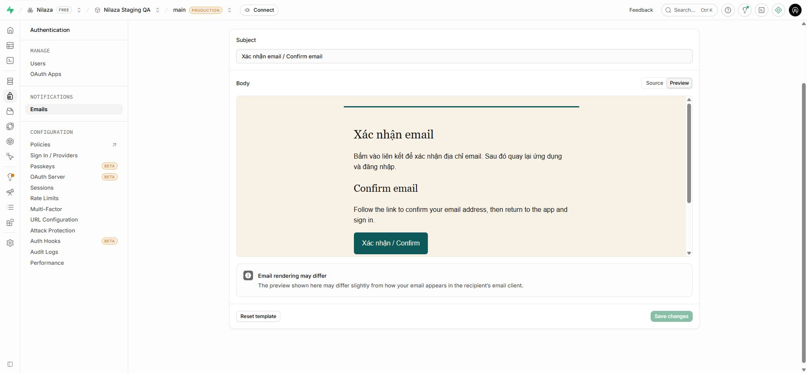
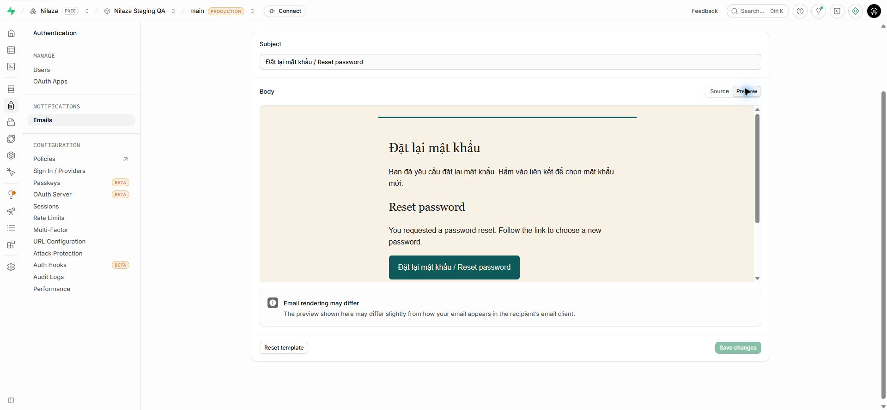

# Auth QA — bước xác minh SMTP và áp dụng template

Ngày tạo 04/10/2026; cập nhật sau chủ sản phẩm đăng nhập lại ngày **05/10/2026**. Đã xác minh SMTP trong phiên Chrome đăng nhập và áp dụng **đúng hai mẫu confirmation/recovery** trên Nilaza Staging QA. Subject được đọc lại sau reload; toàn bộ HTML hậu lưu được chọn/copy từ Source editor và so sánh với file nguồn, **khớp cả hai mẫu** khi chuẩn hóa CRLF thành LF. Đã lưu backup trước sửa, ảnh Preview hậu lưu và receipt hash.

Chủ sản phẩm đã chỉ định mailbox thử và chọn **Android**. APK QA mới đã build/kiểm tra và, theo yêu cầu tiếp theo của chủ sản phẩm, **cài thành công trên Air1 Ultra ngày 05/10 lúc 09:23**, giữ dữ liệu; hash APK đã cài khớp tệp bàn giao. [Receipt cài đặt](../artifacts/resend-auth-android-qa-2026-10-05/device-install-receipt.json). Chưa mở app hoặc kiểm thử Auth/delivery. Địa chỉ người nhận không ghi vào repo. Các lỗi kết nối/sign-in trước đó là lịch sử, đã vượt qua.

## Phạm vi đã chuẩn bị

- Target duy nhất: **Nilaza Staging QA `akgrokwnkfqnfjqrildi`**, org Nilaza. Không thay production/MCY.
- Resend domain Verified và hai callback native đã lưu từ bước trước.
- Static validator chạy lại PASS: 13 mẫu VI/EN, không tracking/remote asset/private metadata; chỉ hai action `confirmation` và `recovery` đã áp dụng QA. 11 mẫu còn lại vẫn chỉ chuẩn bị.
- Subject và HTML nguồn: manifest `supabase/templates/auth/manifest.json` version 1.0.0. Trạng thái `prepared-not-applied` của bộ nguồn được giữ; bằng chứng cloud riêng theo action/target nằm trong receipt bên dưới, không đánh dấu toàn bộ bộ mẫu đã triển khai.
- Không sửa credential, callback, Site URL, rate limit, confirm email, Auth Hook hoặc security notification; không gửi email, tạo tài khoản hoặc chạy SQL trong lượt này.

## Kết quả cloud và bằng chứng

| Hạng mục | Trạng thái ngày 05/10 |
| --- | --- |
| Target | PASS — project `akgrokwnkfqnfjqrildi`, org Nilaza `drxbmvimiekeoeesgssp` |
| SMTP persisted UI | PASS — enabled, `Nilaza QA`, `smtp.resend.com`, 465, interval 60 giây, stored password hidden; Save disabled |
| Sender/username | BLOCKED — công cụ redacted, chưa đối chiếu giá trị; không tìm cách đọc qua đường khác |
| Resend key permission | PASS — danh sách team `magicpendigital` hiển thị `nilaza-auth-qa-smtp`, Sending access, No activity tại thời điểm đọc; không ghi token/prefix vào evidence |
| Key domain restriction | Chủ sản phẩm xác nhận chỉ domain `auth-qa.nilaza.magicpendigital.com`; agent không đọc chi tiết do automatic approval review từ chối vì nguy cơ hiển thị credential, không dùng đường khác để vượt từ chối |
| Confirm sign up | PASS — `Xác nhận email / Confirm email`; source HTML hậu reload khớp nguồn |
| Reset password | PASS — `Đặt lại mật khẩu / Reset password`; source HTML hậu reload khớp nguồn |
| Android APK nội bộ | PASS — đóng gói, kiểm tra và cài trên Air1 Ultra; hash APK trên thiết bị khớp |
| Delivery/native acceptance | BLOCKED — chưa gửi thử; chờ chủ sản phẩm mở app và thử |

Receipt: [templates-applied-20261005.json](email-qa-2026-10-04/templates-applied-20261005.json), [SMTP receipt](email-qa-2026-10-04/smtp-verified-20261005.json). Backup trước sửa: [confirmation](email-qa-2026-10-04/confirmation-before-20261005.json), [recovery](email-qa-2026-10-04/recovery-before-20261005.json). Không chứa secret, mailbox thật hoặc link token. Receipt là ghi nhận thao tác QA, không phải release approval.

## Quy trình đã thực hiện / dùng khi áp dụng lại

1. Mở [SMTP QA](https://supabase.com/dashboard/project/akgrokwnkfqnfjqrildi/auth/smtp), xác nhận custom SMTP bật sau reload và sender/host/port/username khớp [runbook SMTP](RESEND_SMTP_QA_SETUP_2026-10-04.vi.md). Không bấm hiển thị Password hoặc chụp khóa. Kiểm tra phạm vi Resend key là Sending access chỉ cho domain QA, không cần đọc giá trị.
2. Mở [Templates QA](https://supabase.com/dashboard/project/akgrokwnkfqnfjqrildi/auth/templates). Trước sửa, lưu **subject và HTML cũ** của đúng hai mẫu vào file nội bộ không có secret để rollback. Không chép link email thật hoặc token vào backup.
3. Chọn **Confirm sign up**: Subject `Xác nhận email / Confirm email`; ở phần source HTML, thay bằng toàn bộ [confirmation.html](../supabase/templates/auth/confirmation.html), giữ nguyên `{{ .ConfirmationURL }}`. Save rồi mở lại, đối chiếu subject và body với nguồn. Không paste HTML vào một khung preview hoặc visual editor khi chưa xác minh chế độ source.
4. Chọn **Reset password**: Subject `Đặt lại mật khẩu / Reset password`; source dùng toàn bộ [recovery.html](../supabase/templates/auth/recovery.html). Save rồi mở lại và đối chiếu. Không bật các thông báo bảo mật khác.
5. Lưu ảnh persisted state không có credential và kết quả đối chiếu. Nếu custom SMTP/templates chưa edit được hoặc Save lỗi, ghi lỗi thực tế và dừng; không mua gói hoặc đổi target để vượt qua.

Chỉ thực hiện bước 2–5 qua phiên Chrome đã kết nối hoặc chủ sản phẩm tự thao tác. Connector Supabase hiện có không cung cấp công cụ Auth config/template; không dùng SQL hay khai thác token phiên trình duyệt để thay thế.

## Kiểm thử sau áp dụng

Người kiểm thử dùng bản app QA **có confirmation/recovery boundary mới** và đúng backend QA. Bản bundle local đã kiểm tra không chứng minh app đang cài có code đó. Expo Go hoặc website giới thiệu không tự thay thế native build hỗ trợ scheme `nilaza`.

| Luồng | Kết quả cần thấy |
| --- | --- |
| Đăng ký mới | Email VI/EN từ domain QA đến hộp thư; link xác nhận mở app, báo xác nhận thành công; đăng nhập bằng mật khẩu |
| Gửi lại xác nhận | Cooldown hoạt động; không spam request; link hợp lệ mở đúng app |
| Reset mật khẩu | Email đến, link mở màn hình reset; chủ sản phẩm tự nhập mật khẩu mới; mật khẩu cũ thất bại, mới đăng nhập được |
| Link lỗi/hết hạn | App báo lỗi đúng, không báo thành công giả |
| Thiết bị đang ở tài khoản A, mở link B | Không thay phiên A bằng phiên token B |
| Delivery | Phân biệt accepted/delivered với thư thực sự xuất hiện trong inbox/spam; kiểm tra Gmail/Outlook và URL không bị tracking rewrite |

Mailbox cụ thể đã được chủ sản phẩm cho phép dùng để thử; **chưa gửi**. SMTP Settings và hai màn hình template không có nút Send test; Preview chỉ kiểm tra giao diện, không chứng minh truyền thư. Bước kế tiếp là chủ sản phẩm cài APK mới và chạy happy path trên thiết bị. Không dùng APK cũ để nghiệm thu code Auth mới. Việc đăng ký/đổi mật khẩu có credential mới do người kiểm thử nhập và submit trực tiếp theo chính sách trình duyệt. Không gửi khóa, mật khẩu hoặc link chứa token vào chat.

## Bàn giao APK Android QA ngày 05/10

[APK nội bộ](../artifacts/resend-auth-android-qa-2026-10-05/nilaza-auth-qa-20261005.apk), [hướng dẫn chủ sản phẩm](../artifacts/resend-auth-android-qa-2026-10-05/OWNER_TEST.vi.md), [artifact receipt](../artifacts/resend-auth-android-qa-2026-10-05/artifact-receipt.json) và [checks](../artifacts/resend-auth-android-qa-2026-10-05/checks.json). APK 107.847.630 byte, package `app.nilaza.mobile`, 0.1.3/code 4, arm64, chữ ký debug; SHA-256 `b562d0d4189beae08bd81fd5ac6d53baa954709d1ed27f2fb515851e7a46817f`.

Build local thành công sau khi tải các Maven dependency đã khai báo còn thiếu trong cache; giữ log offline thất bại riêng, không đổi phiên bản dependency hoặc source. TypeScript, 11 suite/62 test Auth, cấu hình phiên bản, chữ ký/package/bundle nhúng đều PASS. 2.268 đầu vào nguồn có hash/file set khớp trước/sau build. Bundle nhúng có đúng QA URL và hai callback, khớp hash bundle đã kiểm tra. Web export 1.603 module, validator 69,82 MB PASS; không deploy web export.

Đóng gói dùng dotenv disabled và cấu hình public của đúng QA cũ; không Resend/provider/service-role secret. Bản cũ được giữ riêng. Đây là artifact nội bộ từ nguồn còn thay đổi, chưa có CI cho chính artifact, nghiệm thu thiết bị hoặc delivery; không phải bản phát hành production. Người kiểm thử tự cài theo hướng dẫn, không gỡ app/xóa dữ liệu khi gặp xung đột chữ ký.

Chủ sản phẩm chọn **Android** để thử. Chuẩn bị bản app cần theo [release runbook](release/RELEASE_RUNBOOK.md), [owner packet](release/OWNER_PACKET.vi.md) và [hướng dẫn mobile QA](MOBILE_EAS_TESTING.md). Cloud release target allowlist hiện trống; nguồn còn dirty và migration ledger bị chặn. Không tự retarget sang project Nilaza mới trong org MagicpenDigital, không sửa profile để vượt gate, không chạy cloud build/deploy hoặc cài app trong bước cấu hình này. Local/synthetic rehearsal và bản thử cần ghi rõ giới hạn, không biến kết quả SMTP thành chứng nhận toàn backend.

Web QA chưa có origin/path được xác nhận, Site URL vẫn localhost; nghiệm thu web riêng trước thêm allowlist. Giữ pilot nội bộ, chưa mở public cohort/Growth. SMTP chỉ chuyển email Auth sang Resend; automation nghiệp vụ, inbound/mailbox và Growth chưa được triển khai bằng bước này. Migration ledger vẫn blocked; không db push/repair hoặc schema outbox/queue.

## Bằng chứng và giới hạn

Feature Preflight PASS trước thao tác cloud và cập nhật tài liệu; template validator PASS 13 mẫu. Đã Save riêng hai subject/body, reload, đối chiếu và lưu ảnh live. Không đổi notification, credential, Site URL, callback, quota, code, SQL hoặc dữ liệu người dùng. Plan-QC và Brand vẫn phù hợp vì không đổi thiết kế/nội dung mẫu hay contract; chỉ áp dụng nguồn đã được kiểm tra. Rollback cloud phục hồi riêng subject/HTML cũ của hai action từ backup; không dùng Reset template thay cho backup khi cần phục hồi chính xác.

Nguồn đã kiểm tra: [Supabase email templates](https://supabase.com/docs/guides/auth/auth-email-templates), [custom SMTP](https://supabase.com/docs/guides/auth/auth-smtp). Template hosted được chỉnh trong dashboard; `ConfirmationURL` giữ tuyến xác minh Supabase trước khi redirect về app.
