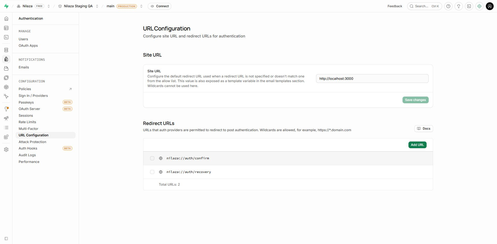

# Resend SMTP — bàn giao cấu hình Auth QA

Ngày 04/10/2026. Chỉ áp dụng cho **Nilaza Staging QA**, project `akgrokwnkfqnfjqrildi`, org Nilaza. Đây là tài liệu nội bộ. Production, Growth và nhận thư có bước triển khai riêng.

## Kết quả đã xác minh

**Hiện trạng 05/10 sau chủ sản phẩm đăng nhập lại:** Đã đọc fresh authenticated state trên đúng QA `akgrokwnkfqnfjqrildi`, org Nilaza. SMTP bật, `Nilaza QA`, `smtp.resend.com`, port 465, interval 60 giây; stored password hidden và Save disabled. Sender/username redacted, không đọc qua đường khác để đối chiếu. Đã lưu [ảnh SMTP](email-qa-2026-10-04/smtp-verified-20261005.png) và [receipt](email-qa-2026-10-04/smtp-verified-20261005.json). Các gián đoạn Chrome/sign-in trước đây đã vượt qua.

Hai mẫu confirmation/recovery VI/EN đã Save, reload và đối chiếu toàn bộ HTML với nguồn: khớp. Đã sao lưu nội dung cũ và chụp Preview; xem [bằng chứng áp dụng](RESEND_AUTH_QA_TEMPLATE_ACTIVATION_2026-10-04.vi.md). Chưa gửi thư hoặc nghiệm thu delivery/native. Mailbox thử đã được chỉ định nhưng không ghi vào repo; chủ sản phẩm chưa có app QA và chọn Android.

- Resend domain `auth-qa.nilaza.magicpendigital.com` và các record Sending/DKIM đều **Verified**; Tokyo. Sending bật, Receiving tắt.
- Configuration yêu cầu tạo tracking subdomain mới: chưa có tracking subdomain cấu hình. Không tạo tracking; checkbox click tracking trong form mới không phải bằng chứng tracking đang bật. TLS hiện Opportunistic, giữ nguyên. Kiểm tra URL thực tế của email khi smoke test.
- Sau xác nhận của chủ sản phẩm, đã lưu **đúng hai Redirect URLs**: `nilaza://auth/confirm`, `nilaza://auth/recovery`. Dashboard hiển thị Total URLs: 2. Site URL vẫn `http://localhost:3000`; public website chưa xử lý token Auth và không thay thế callback app. Web QA cần origin/path của bản app thực tế trước nghiệm thu.
- Resend team `magicpendigital` có khóa `nilaza-auth-qa-smtp` với **Sending access**, No activity tại thời điểm đọc. Chủ sản phẩm xác nhận khóa chỉ giới hạn domain QA. Automatic approval review từ chối mở chi tiết vì nguy cơ hiển thị credential và thiếu ủy quyền cụ thể; agent không mở lại qua đường khác, không đọc giá trị khóa. Domain restriction là xác nhận của chủ sản phẩm, không phải agent inspection; chưa chứng minh khóa này chính là khóa được nhập ở Supabase.

## Thông số SMTP dự kiến và phạm vi kiểm tra

| Trường | Giá trị |
| --- | --- |
| Sender email address | `no-reply@auth-qa.nilaza.magicpendigital.com` |
| Sender name | `Nilaza QA` |
| Host | `smtp.resend.com` |
| Port | `465` |
| Minimum interval per user | `60` giây |
| Username | `resend` |
| Password | API key Resend mới; chủ sản phẩm nhập trực tiếp, không gửi qua chat |

Host, port, name và interval đã đối chiếu live; sender/username chỉ là thông số dự kiến do công cụ redacted. [Ảnh bản nháp trước owner Save](email-qa-2026-10-04/smtp-draft.png) được giữ làm lịch sử, không dùng chứng minh cấu hình hiện tại.

Dashboard ghi khi bật custom SMTP, giới hạn email Auth sẽ là **30 email/giờ**; đây là thông báo sau kích hoạt, chưa phải giá trị đã lưu hiện tại. Rate Limits hiện che giá trị email nên không khẳng định số thực tế. Token refresh 150 request/5 phút/IP; token verification và signup/signin 30 request/5 phút/IP. Không thay rate limit. Quota Resend và giới hạn Supabase là hai lớp riêng.

## Quy trình credential đã bàn giao trước đây

Chủ sản phẩm đã báo lưu SMTP; không tạo lại hoặc thay khóa chỉ để kiểm tra. Các bước này chỉ dùng khi cấu hình/rotation được duyệt riêng.

1. Mở [Resend API keys](https://resend.com/api-keys), đúng team `magicpendigital`. Trong Create API key, điền tên `nilaza-auth-qa-smtp`; đổi Permission từ Full access sang **Sending access**, chọn duy nhất domain **auth-qa.nilaza.magicpendigital.com**. Kiểm tra phạm vi rồi bấm Add. Nếu UI không cho giới hạn domain, dừng và báo lại; không tạo Full access thay thế.
2. Sao chép khóa trực tiếp và lưu trong kho bí mật của chủ sản phẩm; Resend chỉ hiển thị giá trị một lần. Không gửi khóa hoặc ảnh chứa khóa vào chat, không lưu vào repo/mobile.
3. Mở [SMTP QA](https://supabase.com/dashboard/project/akgrokwnkfqnfjqrildi/auth/smtp). Kiểm tra tên project và toàn bộ bảng trên; nếu bản nháp bị mất, nhập lại thông số. Dán khóa vào Password rồi **tự bấm Save changes**. Đây là bước kích hoạt SMTP cho QA, chưa mở production/public cohort. Báo “đã lưu SMTP QA”, không gửi khóa.

Quy tắc thao tác trình duyệt yêu cầu bàn giao khi nhập credential mới: “Ask the user to take over before any new credential is entered”. Đây là lý do chủ sản phẩm thực hiện nhập và submit; không phải yêu cầu approval thêm của skill.

## Bước tiếp theo và nghiệm thu

SMTP enabled và hai template đã được xác minh hậu lưu. [APK Android QA mới](../artifacts/resend-auth-android-qa-2026-10-05/nilaza-auth-qa-20261005.apk) đã build và kiểm tra đúng backend, chữ ký/package/bundle; TypeScript, 62 test Auth và web export validator PASS. [Hướng dẫn cài/thử](../artifacts/resend-auth-android-qa-2026-10-05/OWNER_TEST.vi.md) phân biệt artifact nội bộ với release production. Bước tiếp theo: chủ sản phẩm tự cài và kiểm thử signup/xác nhận/đăng nhập, resend và reset trên mailbox đã chỉ định. Kiểm tra link lỗi/hết hạn, tài khoản B không thay phiên A, Gmail/Outlook, VI/EN, không tracking và delivery thực tế. Không có Send test button ở SMTP/two template UI; Preview không gửi email. Chưa gửi thư, cài app hoặc phát hành production.

13 template nguồn đạt static validator; 2 mẫu đã áp dụng cloud và xem Preview, 11 mẫu vẫn prepared-only. Chưa kiểm tra render trong email client hoặc delivery. Giới hạn pilot đề xuất 20 người nhận nội bộ và 50 email/ngày là quy tắc vận hành, chưa có bộ đếm cưỡng chế tự động. Không mở Growth hoặc security notification chưa nghiệm thu. Mailbox hỗ trợ/reply-to chưa chọn; SMTP không tạo hộp thư.

Migration ledger checker trước đây trả exit 0 nhưng vẫn `blocked_pending_reconciliation`; không db push/repair, SQL, schema outbox/queue hoặc deployment. Code, RLS, dữ liệu người dùng, Admin, credits, payments và AI không đổi ở bước cấu hình này. Rollback template: phục hồi subject/body từ hai backup trước Save. Chủ sản phẩm có thể tắt custom SMTP/thu hồi khóa QA theo bước credential riêng; không tự xóa callback hoặc đổi credential khi chỉ rollback HTML.

Kiểm tra: callback hậu lưu hiển thị hai URL; template validator PASS (13); migration checker xác nhận gate vẫn blocked; Feature Preflight được chạy trước thao tác và khi bàn giao. Skill Plan-QC giữ current vì phạm vi Auth/provider/credential và migration gate đã được bao quát; chi tiết UI nằm trong runbook này.

Nguồn: [Resend SMTP với Supabase](https://resend.com/docs/send-with-supabase-smtp), [API key permissions](https://resend.com/docs/dashboard/api-keys/introduction), [Supabase custom SMTP](https://supabase.com/docs/guides/auth/auth-smtp), [native callback](https://supabase.com/docs/guides/auth/native-mobile-deep-linking).
