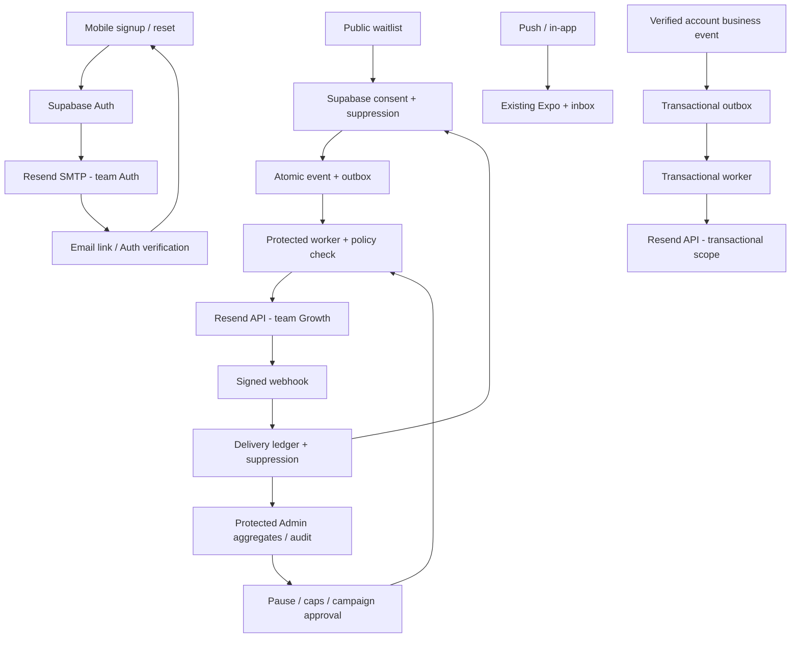

# Phương án tích hợp Resend trên toàn hệ thống Nilaza

Ngày đánh giá: **04/10/2026**, Asia/Bangkok. Owner: `nilaza-resend-plan-owner`.

**Trạng thái: đề xuất kiến trúc và kế hoạch triển khai; chưa tích hợp hoặc kích hoạt gửi thư.** Lượt này chỉ đọc mã nguồn, metadata QA và tài liệu chính thức; tạo báo cáo cùng hồ sơ preflight cho phạm vi phân tích. Không truy cập khóa Resend, gửi thư, sửa SMTP, migration hay deploy. Tài liệu nội bộ, không đưa vào public Help corpus hoặc static Admin snapshot.

## 1. Quyết định đề xuất

Giữ **Supabase làm nguồn sự thật cho tài khoản, consent và trạng thái nghiệp vụ**; dùng **Resend làm nhà cung cấp giao thư**. Triển khai Auth trước, sau đó mới kích hoạt Growth có kiểm soát. Không nối toàn bộ email vào một công tắc chung.

- **Auth:** Supabase Auth → Resend SMTP. Token xác nhận/reset vẫn do Supabase tạo và kiểm tra.
- **Email nghiệp vụ ngoài Auth:** sự kiện đã xác minh → outbox bền vững → worker → Resend API. Chỉ thêm loại email khi tính năng gốc đã hoạt động.
- **Growth:** consent riêng → xác nhận địa chỉ → kiểm tra eligibility ở thời điểm gửi → outbox/worker riêng → Resend → webhook cập nhật delivery/suppression.
- **Push/in-app:** giữ luồng Expo và inbox hiện có; email không tự động thay thế hay bật theo quyền push.
- **Nhận email:** chưa cần cho bước Auth. Hộp thư support có người trực và việc nhận email qua webhook là hai nhu cầu khác nhau; triển khai riêng khi có mục đích và retention cụ thể.

### Tách team, không chỉ tách subdomain

Resend áp dụng suppression trên toàn team: một hard bounce/complaint có thể chặn cùng địa chỉ trên mọi domain/subdomain của team đó. Nhiều API key không giải quyết ranh giới này. Resend hỗ trợ nhiều team dưới cùng một email đăng nhập; mỗi team có API key, billing và usage riêng. [Suppression](https://resend.com/changelog/suppression-list-support), [Teams](https://resend.com/docs/dashboard/settings/team).

Đề xuất dùng team hiện có cho thử nghiệm Auth. Kiến trúc đích có **team Auth/transactional và team Growth riêng**; QA có phạm vi gửi và khóa riêng với production. Tách team giảm coupling về suppression và usage, **không bảo đảm độc lập hoàn toàn về uy tín tên miền, hạ tầng nhà cung cấp hoặc khả năng vào inbox**. Không mua nhiều gói ngay; xác minh cấu hình và ngân sách từng team trước khi mở luồng đó.

## 2. Bằng chứng hiện trạng và giới hạn kiểm tra

| Khu vực | Bằng chứng | Kết luận |
| --- | --- | --- |
| QA Supabase | Kiểm tra live 04/10: `Nilaza Staging QA`, `akgrokwnkfqnfjqrildi`, ACTIVE_HEALTHY, PostgreSQL 17 | Đây là QA hiện có; không suy ra đã có đích production sạch |
| Migration | Ledger `blocked_pending_reconciliation`; live history vẫn có `20260925160325` từ MCY | Không `db push`, repair, retarget hay triển khai schema email trên QA này theo kế hoạch chưa duyệt |
| Marketing data | Live có waitlist, consent events, tokens, deliveries, suppressions; kiểm tra thêm beta_invites | Có nền tảng dữ liệu, không phải luồng giao thư hoàn chỉnh |
| Bảo vệ dữ liệu | Sáu bảng marketing/beta có RLS; anon/authenticated không có SELECT | Giữ đọc PII ở backend; Admin tiếp tục nhận aggregate có capability |
| Scheduling | Live không có `pg_cron`, `pgmq`, `pg_net` | Không coi queue/scheduler đề xuất là đã cài đặt |
| Waitlist function | Live `marketing-waitlist` v21: Turnstile có điều kiện, RPC register, HTTP 202; không có gọi Resend/enqueue | Tạo tài khoản Resend chưa làm form tự gửi email |
| Auth mobile | `supabaseAuth.ts` có signup/resend/reset; signup/resend chưa truyền `emailRedirectTo`; reset có redirect riêng | Cần hoàn thiện hành trình sau khi nhấp email, không chỉ kiểm tra gửi thành công |
| Recovery | Native `nilaza://auth/recovery`; web dùng origin/path hiện tại với `recovery=1`, client ephemeral implicit | Giữ contract này trong bước đầu; kiểm tra cold start, cross-device và tránh log fragment token |
| Notification | Provider hiện có chỉ Expo; PRD 6.11 định hướng email transactional trước | Không bật email cho daily insight/Journal mặc định |
| Privacy | Local export khai báo `saved_data_on_this_device`, loại trừ server-only/billing; nhãn xóa dữ liệu trên máy | Không gửi email “đã xóa tài khoản cloud” hoặc “export cloud sẵn sàng” khi nghiệp vụ chưa hoàn thành |
| Admin Growth | Nguồn có dashboard read-only, aggregates, review fixture; chưa có worker/control gửi | Cần endpoint vận hành thật trước khi thêm nút Send/Pause |
| Resend | Người dùng xác nhận đã tạo tài khoản | Gói, team, domain verified, DNS, quyền và khóa **chưa kiểm tra** |
| Hosted Auth | Audit 01/10 ghi custom SMTP và security notifications chưa bật | Đây là bằng chứng lịch sử; phải đọc lại SMTP, Hooks, Rate Limits và URL Configuration trước cấu hình |

Không truy vấn địa chỉ người dùng, nội dung email, Journal hoặc dữ liệu sinh. Chưa thử gửi email, đánh giá inbox hoặc load test. Changelog index Supabase không đọc được qua web tool; đã kiểm tra trực tiếp changelog liên quan đến hạn chế template Free và các hướng dẫn hiện hành. [Thay đổi template Free](https://supabase.com/changelog/46599-changes-to-email-template-customisation-on-free-tier).

## 3. So sánh các cách tích hợp

| Phương án | Lợi ích | Chi phí/rủi ro | Quyết định |
| --- | --- | --- | --- |
| Chỉ cấu hình SMTP | Bật delivery Auth nhanh, ít code mới | Không tạo consent flow, worker, Growth hoặc theo dõi tập trung | Dùng cho slice Auth đầu tiên |
| Send Email Auth Hook → Resend API | Locale, template và logic giao thư linh hoạt hơn | Endpoint mới nằm trên đường quan trọng của signup/reset; cần signature, đầy đủ email actions và rollback | Chỉ thêm khi yêu cầu localization/headers/failover đã rõ |
| Supabase outbox + API | Nghiệp vụ và consent giữ tại Nilaza; version, retry, audit kiểm soát được | Cần schema, scheduler, worker và vận hành | Kiến trúc cho email ngoài Auth |
| Resend Broadcasts/Automations | Có công cụ campaign và contact management của provider | Thêm bản sao contact/preferences, đồng bộ hai chiều, nguy cơ lệch consent | Đánh giá lại khi đội Growth cần tự vận hành chiến dịch lớn |

**SMTP và Auth Hook là hai đường thay thế.** Khi Send Email Hook bật, Supabase dùng hook và không dùng SMTP cho luồng đó; không cấu hình cả hai rồi kỳ vọng SMTP tự fallback. Hook là một slice riêng, không bật trong pilot SMTP. [Supabase Hook](https://supabase.com/docs/guides/auth/auth-hooks/send-email-hook).

Đề xuất ban đầu cho Growth nhỏ: Nilaza quản lý danh sách và orchestration; provider adapter gửi qua API với unsubscribe do Nilaza xử lý. Nội dung quảng bá vẫn được phân loại là marketing dù dùng API gửi từng thư. Trước activation phải xác nhận hình thức gửi phù hợp chính sách Resend, header và billing; nếu chuyển Broadcasts/Automations, bổ sung contract đồng bộ contact/topic/unsubscribe và test, không âm thầm đổi source of truth. [Phân loại gửi](https://resend.com/docs/knowledge-base/what-sending-feature-to-use), [Danh sách tự quản lý và unsubscribe](https://resend.com/docs/dashboard/emails/add-unsubscribe-to-transactional-emails).

## 4. Sơ đồ đích

Auth không đi qua hàng đợi marketing. Lỗi campaign không thay đổi trạng thái xác nhận Auth, credit ledger, entitlement hoặc kết quả AI.

## 5. Whole-App Impact Brief

| Bề mặt | Tác động cần triển khai | Hợp đồng/kiểm thử phải giữ |
| --- | --- | --- |
| Welcome, signup, login | Loading, pending confirmation, resend cooldown và lỗi gửi rõ ràng; không đăng nhập chỉ vì email được delivery | Auth/session isolation, dữ liệu và onboarding đã hoàn tất |
| Deep link, web/mobile | Explicit confirmation redirect; recovery tách khỏi session đang dùng; trang hướng dẫn khi app chưa cài | Allowlist URL chính xác từng môi trường; link hết hạn, dùng lại, A/B account và app cold start |
| Profile/preferences | Marketing email consent độc lập với push; đổi địa chỉ phải xác minh lại trước gửi marketing | Không dùng client metadata cho authorization; không tự chuyển consent sang địa chỉ mới |
| Website/waitlist | Sau submit thông báo “kiểm tra thư xác nhận” khi luồng đó active; collection-only có copy riêng; confirm/unsubscribe VI/EN | HTTP accepted không đồng nghĩa confirmed; submit trùng không tạo duplicate logical send |
| Data/backend | Transactional outbox, worker leases, webhook event dedupe, delivery state; mở rộng schema có migration duyệt | Không webhook nguyên row PII; không gọi provider trong transaction business |
| Admin | Readiness, backlog, oldest-job age, retry/dead-letter/uncertain, cap, pause, test-send và audit | Server kiểm capability; giữ Content Operations và AI Studio; static asset không chứa PII/secrets |
| Privacy/export/delete | Hủy job, token và liên kết recipient; đồng bộ contact removal khi có mirror; retention tối thiểu | Không gửi export nhạy cảm dưới dạng attachment; xóa máy không được trình bày là xóa cloud |
| Premium/payment | Thư báo giao dịch chỉ từ event đã xác minh; chống duplicate theo event ID | Email lỗi không trừ thêm credit, đổi subscription hay là bằng chứng đã thanh toán; tránh gửi trùng receipt của store |
| AI/Tarot/Astrology/Journal | Chỉ xem xét thông báo chung có opt-in sau này | Không chuyển nội dung riêng tư, câu hỏi, chart hoặc inferred sensitive segments sang Resend/analytics |
| Brand/localization | Template versioned VI/EN, một CTA rõ; Auth tối giản, Growth theo Open Reflection | Không nhúng claim tính năng chưa release; đọc brand guidelines trước tạo template thực tế |
| Analytics | Nguồn event backend và mẫu số funnel có định nghĩa riêng | Submission, unique contact, confirmed, eligible, accepted và delivered không dùng thay thế nhau |
| Operations/release | Env/team/key routing, quotas, cảnh báo, cohort và rollback riêng | Không trộn QA với production; kill switch marketing không ngắt Auth |

Các phần chủ động giữ nguyên trong bước đầu: AI Council/prompt/model contracts, lựa chọn lá bài, tính chart, nội dung Journal, credit/payment logic, branding assets, bottom navigation và push provider. Có review ảnh hưởng, không mở rộng chức năng của chúng trong task email.

## 6. Phân loại email và consent

| Nhóm | Trigger và điều kiện | Quy tắc |
| --- | --- | --- |
| Auth essential | Signup, resend, recovery, đổi email và security actions do Supabase kiểm soát | Không chèn quảng bá; không phụ thuộc marketing opt-in; vẫn tôn trọng chặn deliverability của provider |
| Account transactional | Hoàn tất nghiệp vụ đã xác minh: export/delete thật, payment/subscription thật | Chỉ bật khi backend gốc và authorization đã nghiệm thu |
| Waitlist confirmation | Yêu cầu có consent rõ, CAPTCHA/rate limit hợp lệ | Pending chỉ nhận thư xác nhận với cooldown/cap; không vào chuỗi welcome trước xác nhận |
| Growth | Confirmed + đúng consent scope/version + không suppressed + campaign approved | Có unsubscribe; recheck ngay trước gửi; signed-in không tự trở thành subscribed |
| Daily reminder | Opt-in kênh và loại thông báo riêng; nội dung chung | Deferred; push permission không đồng nghĩa email opt-in |
| Support inbound | Người dùng chủ động gửi tới địa chỉ support | Deferred; không tự cho AI đọc/trả lời dữ liệu nhạy cảm |

Auth confirmation và waitlist confirmation khác mục đích. Không dùng trạng thái “đã xác nhận email tài khoản” để mặc định cấp marketing consent. Contact legacy `subscribed` trong schema không được coi là `confirmed`.

Unsubscribe marketing chỉ chặn marketing của Nilaza, **không thêm địa chỉ vào suppression toàn team Auth**. Hard bounce/complaint có phạm vi deliverability riêng và có thể chặn thư thiết yếu trên team liên quan; không tự xóa suppression để ép gửi. Resubscribe yêu cầu hành động rõ và policy theo reason; hard bounce phải giải quyết địa chỉ, complaint/manual không tự được gỡ chỉ vì submit hoặc confirm mới.

Waitlist hiện độc lập tài khoản. Không liên kết hay xóa chỉ bằng suy đoán cùng email; thiết kế mapping đã xác minh và hành trình privacy cho người không có tài khoản. Khi có contact mirror, đăng ký/xác nhận/hủy/đổi địa chỉ/xóa phải có contract đồng bộ; provider removal không tự tạo consent tại Supabase.

## 7. Dữ liệu, độ tin cậy và bảo mật

### Nguồn hợp đồng

Giữ nền tảng `marketing_*` và `beta_invites`; không tạo bản sao toàn bộ danh sách để tiện gửi. Đề xuất thêm nguồn policy/template versioned ở `packages/communications` và module server `supabase/functions/_shared/email-provider.ts`. Đây là đường dẫn **dự kiến**, chưa tồn tại do task này.

Outbox lưu opaque recipient reference, channel/purpose, environment, campaign/template version, locale, scheduled time, logical delivery ID, attempt/lease và trạng thái. Worker resolve email tại server. Hợp đồng payload duy nhất cần version/schema validator cho các consumer; snapshot Admin là projection, không nguồn sửa thứ hai. Auth template source có bản export/version/checksum đối chiếu hosted Auth.

Đề xuất trạng thái xử lý job và kết quả giao nhận tách nhau. Enum `marketing_deliveries` hiện tại chưa đủ cho lease, dead-letter, uncertain outcome và event dedupe; không ép tất cả vào `sent`/`failed`. Migrations tương lai bổ sung fields/tables có contract tương thích và rollback.

### Outbox/queue

Business event và outbox phải ghi trong cùng transaction để không mất thư khi function dừng sau lưu contact. Worker có claim lease, concurrency cap, retry bounded, dead-letter và reconciliation. Khởi đầu dùng SQL outbox có RPC claim; Supabase Cron gọi protected Edge Function. PGMQ có thể thêm làm transport khi cần throughput; không coi archive queue là bằng chứng provider đã giao thư. Cả lựa chọn SQL và PGMQ đều cần đích/schema được duyệt. [Queues](https://supabase.com/docs/guides/queues), [Schedule Functions](https://supabase.com/docs/guides/functions/schedule-functions).

Logical delivery có UNIQUE key trong database. Provider idempotency giữ **24 giờ**; chỉ có provider key không tạo bảo đảm chống trùng vô thời hạn. Freeze recipient/template/locale/token cho mỗi logical attempt. Nếu timeout mà chưa rõ provider có nhận, retry cùng key trong cửa sổ hỗ trợ; quá cửa sổ thì giữ `uncertain` và reconcile, không gửi lại mù hoặc đổi key. Không hứa exactly-once ở ranh giới hệ thống phân tán. [Idempotency](https://resend.com/docs/dashboard/emails/idempotency-keys).

Token marketing hiện chỉ lưu hash. Trước worker implementation phải chốt cách dựng lại **cùng token/payload** khi retry mà không lưu token thô: đề xuất token opaque tạo bằng Web Crypto HMAC với send ID/nonce/purpose/expiry và key version, persist hash cùng metadata tối thiểu; giữ key cũ đến hết TTL. Thiết kế và replay/rotation tests phải được review trước dùng; không tự tạo token mới ở mỗi retry. Auth token hoàn toàn do Supabase quản lý.

### Endpoint và abuse

- Worker: chỉ internal invocation có authentication riêng; JWT hợp lệ của người dùng thông thường không đủ quyền gửi.
- Webhook: kiểm Svix signature trên raw body, timestamp/replay, body size và event type; unique event ID; acknowledge sau lưu bền vững. Endpoint không dùng end-user JWT nhưng không phải open write API. Không log toàn bộ payload chứa email. [Verification](https://resend.com/docs/webhooks/verify-webhooks-requests).
- Events đến trùng, đến trước response của sender hoặc sai thứ tự cần transaction và pending reconciliation. Delivery muộn không xóa complaint/unsubscribe. Event không khớp environment/team/message ID không được ghi vào contact khác.
- Confirmation GET mở landing page, explicit POST mới tiêu thụ token để hạn chế link scanner. Unsubscribe có GET trang thao tác và POST one-click idempotent, không yêu cầu login. Token một lần hiện tại cần điều chỉnh để unsubscribe lặp vẫn trả thành công và có đường mới cho token hết hạn. Không log token/query; đặt no-store, no-referrer và loại analytics trên các trang token.
- Production waitlist fail closed nếu thiếu Turnstile secret; hiện code thiếu secret thì cho qua. CORS/origin không phải cơ chế chống bot. Thêm server cooldown, caps theo recipient/IP với retention tối thiểu; không để resend trở thành email-bombing endpoint.
- Auth dùng CAPTCHA/rate limits server; cooldown client chỉ giúp UX. Không tiết lộ account existence qua lỗi email; rà soát thông báo duplicate signup hiện tại.

### Secrets và retention

SMTP credential thuộc hosted Supabase Auth; API key gửi từng team có quyền sending-only/domain restriction phù hợp. Webhook secret và scheduler auth chỉ ở server/Vault; quyền quản trị full-access không cấp cho sender. Không `EXPO_PUBLIC_*`, browser env, generated snapshot hay Git. [API key permissions](https://resend.com/docs/api-reference/api-keys/create-api-key).

Provider thấy email recipient và nội dung thư khi gửi. Không đưa chat/Journal/birth data hoặc raw tokens vào app logs, AI traces, tags và metrics; hash email hiện có vẫn là dữ liệu liên kết được, không gọi là anonymous. Chốt retention cho delivery, tokens, provider message body và consent với review privacy trước release. Cloud export/delete là slice riêng có test authorization, cancel jobs và late webhook; không mất suppression tối thiểu rồi vô tình gửi lại sau xóa.

## 8. Auth: chọn SMTP trước, localization sau

1. Xác minh lại hosted SMTP, Send Email Hook, Site URL, Redirect URLs và rate limits trên đúng project. Không assume hook đang tắt từ audit cũ.
2. Domain tổ chức được chốt là `magicpendigital.com`, website Nilaza `https://nilaza.magicpendigital.com`. Chọn subdomain gửi Auth/Growth riêng dưới domain tổ chức sau khi xác minh ownership/DNS; chưa chốt tên sender/subdomain cụ thể. QA dùng sender/URL rõ môi trường.
3. Verify DNS theo records Resend cấp; kiểm SPF/DKIM/DMARC alignment, không ghi đè MX của hộp thư support để bật sending.
4. Configure SMTP TLS theo hướng dẫn chính thức; template tối giản cho các Auth actions đang dùng. Không bật action mới chỉ vì Supabase có sẵn. [SMTP setup](https://resend.com/docs/send-with-supabase-smtp).
5. Thêm explicit confirmation redirect cho signup/resend và kiểm Site URL không rơi vào localhost/Admin. Recovery giữ contract hiện có cho pilot; mọi nâng cấp universal/app links là slice native/web riêng.
6. Pilot SMTP dùng template VI/EN gọn trong cùng email nếu chưa có locale routing tin cậy. Nếu yêu cầu chỉ một ngôn ngữ ngay từ đầu, triển khai locale và hook như prerequisite thay vì tuyên bố đã cá nhân hóa. Signup hiện chỉ gửi `name`; profile locale có thể chưa tồn tại khi gửi xác nhận. Locale là input trình bày allowlisted, không authorization claim.
7. Kiểm security notifications password/email changed đang dùng, bật sau test. Các phone/MFA/social actions chưa dùng tiếp tục deferred.
8. Tắt click/open tracking cho Auth; không rewrite token link. Kiểm expired/reused link, thiết bị khác, account khác và lỗi quota.

Supabase áp hạn mức khởi đầu 30 email/giờ khi cấu hình custom SMTP; phải chỉnh theo nhu cầu và abuse controls. Free default SMTP không phải production fallback. [Supabase SMTP](https://supabase.com/docs/guides/auth/auth-smtp).

## 9. Admin và observability

Không gắn nút gửi vào prototype hoặc coi graph node count là eligible audience. Backend thực thi capability mới riêng cho template review, internal test, pause/resume và campaign approval. Test-send chỉ tới allowlist server; không nhận recipient tùy ý từ browser.

Readiness cần hiển thị: target environment, team/domain verified, template version, link tests, consent/suppression query health, worker/lease health, webhook freshness, cap/quota và owner approval. Configuration đã lưu khác với đã test, đã release.

Health tối thiểu: oldest pending job, accepted/delivered/bounced/complained/suppressed, retry/dead-letter/uncertain, last successful worker/webhook, quota remaining khi có nguồn, paused reason và template version. Audit mọi thay đổi cap/pause/publish, không audit raw body/address. Tách metrics Auth khỏi Growth; pilot SMTP quan sát trên provider dashboard, không tự nhận Admin đã có end-to-end Auth metrics.

HTTP 202 waitlist là yêu cầu đã nhận, không phải unique contact hay confirmed. Provider accepted không phải delivered; delivered không chứng minh inbox hay người đã đọc. Tắt tracking mặc định; chỉ bật Growth sau consent/measurement review, không dùng open rate làm North Star. Chưa có attribution chắc chắn từ email đến activation/first reflection; thêm event backend và mapping opaque có review nếu cần.

Pause Growth: dừng claim mới, worker recheck ngay trước send, cancel pending sends ở provider nếu có lịch ngoài hệ thống. Không thể thu hồi thư đã giao/đang gửi; ghi rõ số in-flight. Không đổi Auth confirmation hoặc xóa dữ liệu consent để rollback campaign.

## 10. Lộ trình và cổng nghiệm thu

| Slice | Công việc | Điều kiện bắt đầu và nghiệm thu |
| --- | --- | --- |
| R0 — target/config | Chốt QA sạch/production, domain, team, quyền và ngân sách; kiểm hosted settings | Desired schema/target và forward path được owner duyệt trước mọi schema write; không sửa QA hiện có để né ledger |
| R1 — Auth pilot | SMTP, template, confirmation/recovery redirect, resend/error/rate handling | Internal recipients; signup→confirm→login và reset→new password pass native/web; không bật campaign |
| R1b — Auth locale/hook nếu cần | Locale input, signed hook, đủ email actions, template deploy parity | Regression toàn bộ Auth + rollback về SMTP; không kích hoạt hook cùng SMTP với giả định fallback |
| R2 — communication foundation | Outbox, worker, leases, webhook, suppression, health/pause | Migration approved, race/retry/quota/signature tests; sender vẫn allowlist-only |
| R3 — waitlist một vòng | Confirmation→welcome; unsubscribe/resubscribe policy; website/Help copy | Không confirmed thì không welcome; repeat/late event không duplicate hay re-enable suppressed |
| R4 — beta invite | Campaign/template immutable, đủ product evidence, cohort cap và delivery QA | Team Growth riêng, owner approval, nhỏ trước; chưa bật chuỗi Day 2/5/10 mặc định |
| R5 — email nghiệp vụ mở rộng | Export/delete cloud và payment events đã hoàn chỉnh; preferences/sync | Email chỉ báo trạng thái nghiệp vụ thật, không thay thế kiểm chứng backend/entitlement |

Ưu tiên **R0→R1**. R2 có thể chuẩn bị code/migration local sau preflight riêng, nhưng cloud rollout phụ thuộc cổng ledger và đích được duyệt. Không cần dựng campaign builder tự do, chuyển toàn bộ notification sang email hoặc tự động hóa support để hoàn thành Auth pilot.

## 11. Công suất và chi phí

Lưu lượng chưa đo được; không suy từ số user thành số email. Dự toán theo: signup confirmations + resends + resets + security events + nghiệp vụ + campaign recipients × số bước + inbound nếu bật. Tính theo recipient, không theo số API request.

Resend Free 3.000/tháng, 100/ngày phù hợp internal pilot; Pro 20 USD/tháng gồm 50.000 email transactional. Growth marketing có pricing riêng; team riêng có billing riêng. **20 USD không phải dự toán toàn hệ thống sau khi bật hai team và campaign.** Chỉ chốt số tiền sau kiểm gói của tài khoản và audience/cadence. [Pricing](https://resend.com/pricing).

API rate limit hiện khởi đầu 10 requests/giây, chia sẻ theo team; không diễn giải thành SMTP throughput. Quota và rate là hai giới hạn khác nhau. Worker đọc rate-limit response, backoff khi 429 và có batch/cohort cap; không chờ chạm trần mới dừng campaign. Inbound cũng tiêu quota nếu bật. [Quotas](https://resend.com/docs/knowledge-base/account-quotas-and-limits).

Đề xuất pilot internal tối đa 20 recipient và 50 email/ngày trên QA, có tổng cap bảo vệ Free; đây là lựa chọn vận hành, không số lượng thực tế đã gửi. Khi mở beta, chốt ngân sách ngày/tháng, dự phòng resend/reset và alert; không cho phép unlimited overage tự động mà chưa quyết định chi phí.

## 12. Validation, manager test path và rollback

### Nghiệm thu toàn hệ thống

1. Signup VI/EN đúng môi trường; nhận email; confirm; login; resend không gây spam; expired/reused link báo rõ.
2. Reset từ cold start và web; account B đang đăng nhập không bị đổi thành account A; token không vào log; lỗi provider không báo thành công giả.
3. Người không đăng ký marketing vẫn nhận email tài khoản cần thiết; người chỉ ở waitlist không tự có tài khoản.
4. Pending chỉ nhận confirmation; confirmed mới welcome. Submit trùng, hai worker cạnh tranh và timeout không tạo logical send mới.
5. Unsubscribe click và one-click POST, token dùng lại/hết hạn, resubscribe, hard bounce và complaint đều đúng policy; GET scanner không xác nhận thay người.
6. Webhook giả/replay/sai team bị từ chối; duplicate/out-of-order và webhook đến trước sender response không làm sai consent/delivery.
7. Xóa dữ liệu máy chỉ báo phạm vi máy; cloud delete/export khi triển khai phải cancel job và handle late events, không lộ export nhạy cảm qua email.
8. Provider outage/quota/429/unknown outcome: job không mất, không retry mù, Admin thấy trạng thái; Growth pause vẫn cho Auth hoạt động.
9. Mobile local fallback, AI, credits, push/inbox không thay đổi; người ngoài quyền không đọc PII hoặc gửi email qua Admin.
10. Seed inbox Gmail/Outlook và native Android/iOS test thực tế; provider delivered riêng với inbox observation. Tăng cap sau review, không từ một test suy ra load readiness.

Validation cho implementation tương lai: `npm --workspace apps/mobile run check`, targeted Auth/recovery tests, `npm run web:check`, `npm run web:build`, `npm run validate:public-content`, `npm run admin:check`, `npm run admin:test`, `npm run validate:backend`, `npm run supabase:check`, `npm run supabase:migration-ledger:check`, `npm run growth:validate`, `npm run growth:test`; bổ sung worker/webhook/token/RLS staging tests. Brand checks khi có template/asset mới. Không gọi đây là các kiểm tra đã chạy cho tính năng email.

Rollback Growth: pause scheduler và worker, disable campaign, preserve consent/suppression/delivery; form có thể collection-only với copy đúng. Rollback Auth: cấu hình SMTP đã test hoặc provider standby đã verify; nếu chưa có standby, hiện lỗi và kiểm soát signup/resend, không tắt xác nhận hoặc quay về default SMTP cho public users. Restore không đổi token/session/consent tự động. Rollback migration theo additive compatibility, không drop lịch sử/audit.

### Kiểm tra thực sự đã chạy trong lượt phân tích

- Live project, function list/source waitlist và SQL metadata (extensions, migration version, RLS/grants): thành công, không đọc recipient rows.
- `npm run supabase:migration-ledger:check`: exit 0; **thông báo ledger bị chặn**, chỉ xác minh cấu trúc metadata.
- `npm run skills:check`: skill cài đặt khớp nguồn reviewed.
- Feature preflight cho **analysis-only**: PASS trước viết báo cáo; không phải preflight của implementation.
- Chưa có test SMTP, DNS, hook, webhook, inbox, native link hoặc load; Resend account chưa được kiểm tra.

## 13. Handoff

Task: phân tích Resend toàn hệ thống. Changed: báo cáo này và hồ sơ `docs/feature-plans/resend-system-integration-analysis-2026-10-04.json`. Runtime/cloud không đổi.

Khuyến nghị bước kế tiếp: thực hiện R0 rồi R1 trên đích đã xác nhận, giữ Growth disabled. Trước thao tác cấu hình cần xác minh quyền truy cập Resend/DNS, team/gói, địa chỉ From/Reply-To thật, hosted Auth settings và môi trường triển khai. Không yêu cầu đưa API key vào chat; dùng secret storage được kiểm soát. R2 cần reviewed forward database path theo ledger và phê duyệt database owner; tạo record mới đúng write scope và quyền thực tế.

Các quyết định còn phải chốt trước phần phụ thuộc: domain/URL đích, chiến lược QA sạch, localization cho pilot, team/billing cho Growth, campaign consent scope, provider policy cho sending mode, retention/export/delete, token retry protocol và giới hạn cohort. Những điểm này không ngăn hoàn thành báo cáo, nhưng không được coi là đã được phê duyệt để triển khai.
