# Nilaza — nội dung Tarot/Astrology, chất lượng AI và khả năng vận hành trong Admin

Ngày 14/10/2026 · Bản đánh giá cập nhật theo ba ảnh tham khảo của owner · Phạm vi: phân tích và kế hoạch, chưa triển khai các đề xuất mới.

**Kết luận đề xuất:** Giữ hướng nội dung nhiều lớp và phân phối hybrid. Điều chỉnh thứ tự công việc: hoàn thiện một đường đi xuyên suốt **Admin → nội dung được duyệt → dữ liệu AI sử dụng → kết quả trên app → lưu/mở lại → phản hồi → kiểm thử sửa lỗi**, rồi mới mở rộng từ 6 lên 78 bài Tarot chuyên sâu. Sửa riêng màn hình hoặc tăng độ dài prompt sẽ không giải quyết được những chỗ đứt giữa các hệ thống hiện nay.

Báo cáo này thay thế phần **ưu tiên công việc tiếp theo** trong [đánh giá UX trước](UX_CONTENT_DEPTH_REVIEW_2026-10-14.vi.md). [Báo cáo triển khai đợt đầu](UX_CONTENT_DEPTH_IMPLEMENTATION_2026-10-14.vi.md) vẫn là hồ sơ lịch sử: giữ sections, sửa chủ thể Astrology, snapshot Tarot và sáu bài mẫu đã được tích hợp; không phủ nhận những cải thiện đó.

**Cách đọc bằng chứng.** “Có trong source” nghĩa là đã đối chiếu mã/dữ liệu tại workspace hiện tại; không tự suy thành “đang chạy trên production”. Kết quả 302 tests và preview 390/320 px thuộc đợt triển khai trước. Lượt này kiểm lại source, chạy một số kiểm tra hợp đồng/giả lập được ghi ở cuối; không truy cập tài khoản, logs riêng tư, Admin live, provider hay database. Không có nghiên cứu người dùng mới hoặc số liệu retention thực trong lượt này. Workspace có nhiều thay đổi có sẵn, nên bằng chứng gắn với file/hash, không coi toàn workspace là một bản phát hành đã nghiệm thu.

**1. Nên học gì từ từng ảnh?**

Cả ba ảnh đều tập trung vào Tarot. Chúng không cung cấp ví dụ chart Astrology, cách tính giờ sinh hoặc cách kết hợp hành tinh–cung–nhà. Có thể học cách tổ chức kiến thức rồi thiết kế riêng cho Astrology; không chuyển bảng liên tưởng Tarot thành dữ kiện thiên văn.

| Ảnh owner cung cấp | Giá trị nên học | Điều cần kiểm chứng hoặc điều chỉnh | Áp dụng phù hợp với Nilaza |
|---|---|---|---|
| 1 — The Fool (`36ab…jpg`) | Một lá được giải thích qua nhiều góc: ý chính, biểu tượng, nghĩa xuôi/ngược, tình huống, góc khuất, câu hỏi. Người mới thấy quan hệ giữa hình và ý. | Câu thúc giục hành động, hứa khởi đầu tình cảm hoặc gán Aquarius/Uranus/Air không phải kết luận khoa học hay quy ước duy nhất. Bướm, vách đá, hoa hồng có thể không xuất hiện trên tranh Nilaza. Danh ngôn/nguồn gốc và quyền sử dụng chưa được xác minh. | Màn học lá có tóm tắt, chú giải tranh đúng deck, tình huống nguyên bản, hiểu nhầm và thực hành tự chọn. Dùng chữ thật trong UI, không nhúng cả poster thành bài học. |
| 2 — Numerology 0–10 (`298f…jpg`) | Dạy cấu trúc để giảm học thuộc: so sánh cùng số giữa các chất và các bước trong một chuỗi. Ví dụ đối chiếu giúp người dùng tự đọc. | “Rung động của con số” là cách diễn đạt biểu tượng. Gắn một số với một nguyên tố không phải định luật phổ quát. Một công thức số không thay thế nghĩa riêng từng lá; Court và Major cần quy ước riêng. | Bài “số × chất” có phạm vi áp dụng, ngoại lệ, nguồn/truyền thống và câu hỏi kiểm tra hiểu. Không tự sinh lại 78 nghĩa từ một template số. |
| 3 — Four Elements (`c411…jpg`) | Bốn cột tạo bản đồ dễ nhớ: hành động, cảm xúc, suy nghĩ, nguồn lực. Có thể dùng để so sánh nhiều góc nhìn trong một tình huống. | Các mục dự đoán sức khỏe, tài chính, kết quả pháp lý, khả năng ngoại cảm và suy luận từ “thiếu nguyên tố” không phù hợp với định vị phản chiếu của Nilaza. | Hiển thị chất của các lá thực sự được rút; gợi mở một góc nhìn chưa được bàn tới. Không chẩn đoán tính cách, sức khỏe hay hoàn cảnh của người dùng. |

Nên học **cấu trúc giải thích**, không sao chép câu chữ, bố cục trang, minh họa, biểu tượng trang trí hoặc danh ngôn. Ảnh đính kèm chưa có hồ sơ quyền sử dụng; chỉ dùng làm tài liệu tham khảo nội bộ. Khi viết bài Nilaza, biên tập lại từ nguồn đã kiểm chứng và lưu provenance. Chưa đưa ảnh nào vào asset app, corpus hay dữ liệu huấn luyện/đánh giá.

Đối với biểu tượng, nguồn lịch sử có thể giúp xác định một truyền thống mô tả điều gì. Chẳng hạn [mô tả The Fool của A. E. Waite](https://original.sacred-texts.com/tarot/pkt/pktar00.htm) có người lữ hành, chó, hoa, gậy và hành lý. Đây là tư liệu diễn giải lịch sử, không chứng minh dự đoán, và không chứng minh các vật thể ấy có mặt trong mọi deck Nilaza. Chú giải tranh phải kiểm chính artwork đang hiển thị.

**2. “Học hỏi khoa học” nên được hiểu và đo thế nào?**

| Lớp thông tin | Ví dụ | Cách trình bày/kiểm tra |
|---|---|---|
| Dữ kiện của hệ thống | ID lá đã rút, chiều xuôi/ngược, vị trí trong trải; kinh độ/góc/nhà do calculator trả về | Đối chiếu logic và fixture; AI không tự tạo hay thay đổi. |
| Quy ước văn hóa/biểu tượng | Wands–Fire, cách đọc số, ý nghĩa cung hoặc thần thoại | Ghi truyền thống/phạm vi, nguồn, ngoại lệ; không gọi là kết quả khoa học về con người. |
| Diễn giải phản chiếu | “Bạn có thể thử nhìn tình huống này qua nhu cầu về sự ổn định” | Nêu cơ sở biểu tượng, giới hạn và quyền không đồng tình; không coi là sự thật đã biết về người dùng. |
| Giả thuyết sản phẩm | Bài ngắn có thực hành sẽ tăng hiểu biết và quay lại | Đo bằng người dùng và thí nghiệm có đối chứng; chưa được coi là hiệu quả đã chứng minh. |

Tính đúng tọa độ thiên thể không xác nhận tính đúng của dự đoán chiêm tinh; [README của calculator](../packages/astrology-core/README.md) đã nêu ranh giới này. Một nghiên cứu mù đôi của Carlson báo cáo việc ghép chart với hồ sơ tính cách không tốt hơn ngẫu nhiên trong thiết kế được thử nghiệm. Không dùng một nghiên cứu để kết luận mọi trải nghiệm biểu tượng là vô giá trị, nhưng không có cơ sở từ các poster để quảng bá khả năng dự đoán khoa học. [Bài Nature](https://doi.org/10.1038/318419a0), [toàn văn lưu tại LBL](https://muller.lbl.gov/papers/Astrology-Carlson.pdf).

Ví dụ kiểm tra lập luận “thiếu chất”: trải ba lá không thể có đủ cả bốn chất Minor. Nếu rút đều ba lá khác nhau từ bộ 78 lá có 14 Wands, xác suất không có Wands là `C(64,3) / C(78,3) ≈ 54,77%`. Đây là phép tính theo giả định rút đều, không phải đo thuật toán Nilaza; không gán nguyên tố cho 22 Major trong phép đếm này. Vì vậy “không có Wands” tự nó không đủ suy ra người dùng thiếu động lực. Với chart cũng cần công bố tập thiên thể, trọng số và quy tắc đếm; kết quả đếm không phải chẩn đoán con người.

Nghiên cứu thực nghiệm về học cho thấy tự nhớ lại nội dung có thể cải thiện ghi nhớ sau một khoảng thời gian so với chỉ đọc lại trong các điều kiện nghiên cứu. Điều này gợi ý thêm câu hỏi ôn nhỏ, nhưng **không chứng minh tăng D7 retention của Nilaza**. [Roediger & Karpicke, 2006](https://www.psychologicalscience.org/journals/psychological-science/j.1467-9280.2006.01693.x/).

Về động lực, quyền lựa chọn và cảm giác học được điều gì đó là cơ sở đáng thử cho lộ trình tự chọn, tiến độ và thực hành vừa sức. Đây là suy luận thiết kế từ nghiên cứu động lực, chưa phải dữ liệu thị trường của nhóm Gen Z/phụ nữ dùng Nilaza. [Ryan & Deci, 2000](https://selfdeterminationtheory.org/wp-content/uploads/2014/04/2000_RyanDeci_IntExtDefs.pdf).

**3. Đối chiếu với nội dung hiện có trong Nilaza**

| Hạng mục | Hiện trạng đã xác minh từ source | Khoảng cách cần giải quyết |
|---|---|---|
| Tarot nền | Đủ 78 lá: tên, từ khóa, intro, chân dung, nghĩa xuôi/ngược, câu hỏi VI/EN trong `tarot-cards.json`. | Có đủ trường không đồng nghĩa đủ chiều sâu. Cần giải thích và ví dụ khác biệt, giúp vận dụng. |
| Tarot chuyên sâu | 6/78 lá có sáu phần mới: biểu tượng, xuôi, ngược, ví dụ, hiểu nhầm, thực hành. | 72 lá còn thiếu; sáu bài tra theo card ID và dùng chung giữa các deck, chưa có chú giải artwork riêng. |
| Giọng và tranh của deck | Classic Arcana có 78 intro riêng; sáu deck còn lại dùng fallback canonical ở lớp intro được kiểm. | Giữ 78 nghĩa nền; bổ sung overlay theo tranh/giọng khi có giá trị. Không cần viết 546 bộ nghĩa khác nhau. |
| Số và nguyên tố | 14 lá mỗi chất Minor; cả 22 Major đang có `element: spirit`; Court dùng `number: 11–14`. Bài học có giới thiệu bốn chất và chú ý số lặp. | Chưa có module số chuyên sâu có biên tập. Không dùng các trường phân loại này làm bảng correspondences phổ quát hoặc thay chúng cho giống poster. |
| Tiến độ học Tarot | Sáu bài có nút chọn và thực hành một lá; bài đang chọn nằm ở component state. | Chưa có đường tiến độ học dài hạn/ôn/so sánh lá rõ như Astrology. |
| Astrology thư viện | 12 hướng dẫn cung, bốn nguyên tố, ba modalities; 12 chương thần thoại sâu có phiên bản kể lại, lăng kính, thực hành, nguồn. | Không nên gọi toàn bộ thư viện Astrology là sơ sài. Cần cải thiện khám phá và nối bài học với tình huống/placement. |
| Astrology quay lại | Có bookmark, đánh dấu hoàn thành, chương đọc gần nhất, lưu có xử lý lỗi và lối viết suy ngẫm. | Có thể tái dùng pattern này cho Tarot; chưa cần tạo thêm hệ tiến độ khác. |
| Astrology diễn giải local | Đã ghép chức năng thiên thể × cung × nhà Whole Sign khi đủ dữ kiện. | Vẫn là kết hợp câu mẫu. Hai cặp hành tinh có cùng loại góc đang dùng chung phần nghĩa góc, chưa giải thích khác biệt hai chức năng. |
| Hiển thị AI | Đợt trước đã giữ các section hợp lệ Tarot và mọi phần sâu Astrology; câu hỏi chọn Venus/aspect đúng hơn. | Renderer chỉ hiển thị độ sâu được cung cấp. Dữ liệu và prompt upstream vẫn có thể tạo câu trả lời nông. |
| Lưu kết quả | Tarot giữ nội dung/sections/ngôn ngữ khi mở lại. Astrology có lưu chart và ghi chú. | Chưa giữ đầy đủ provenance AI; lưu chart/ghi chú Astrology không tương đương lưu nguyên câu trả lời AI. |

Nguồn đối chiếu: [Tarot canonical](../packages/content/data/tarot-cards.json), [bài sâu](../packages/content/data/tarot-learning-depth.json), [adapter học Tarot](../apps/mobile/src/features/tarot/learning.ts), [hướng dẫn cung](../packages/content/data/astrology-zodiac-guides.json), [thần thoại sâu](../packages/content/data/astrology-mythology-depth.json), [MythologyWorld](../apps/mobile/src/features/astrology/MythologyWorld.tsx), [diễn giải Astrology](../apps/mobile/src/features/astrology/interpretation.ts). Các vị trí kiểm cụ thể nằm trong bảng bằng chứng ở cuối.

**4. Nội dung và UI nên phát triển theo mô hình nào?**

Đề xuất ba tầng: **hiểu nhanh → đọc giải thích → tự thử**. Màn đầu cho biết ý chính và một hành động rõ. Các mục sâu có tiêu đề mô tả cụ thể, báo người dùng có thể đọc gì tiếp; tránh giấu mọi giá trị sau một nút chung chung. Cách tách thông tin cơ bản và nâng cao phù hợp [progressive disclosure của NN/g](https://www.nngroup.com/articles/progressive-disclosure/). Đây là nguyên tắc thiết kế cần kiểm nghiệm lại trong Nilaza.

| Bề mặt | Nội dung nhìn thấy trước | Phần mở sâu | Hành động có giá trị |
|---|---|---|---|
| Học một lá Tarot | Tranh lớn, tên, 3–5 từ khóa, ý chính ngắn | Biểu tượng đúng tranh; xuôi/ngược; ví dụ theo chủ đề; hiểu nhầm; so sánh lá liên quan | Quan sát một chi tiết → trả lời một câu hỏi → lưu ghi chú hoặc thực hành. |
| Kết quả Tarot | Câu hỏi, các lá/vị trí/chiều, thông điệp tổng hợp | Từng lá trong vị trí; mối liên hệ giữa lá; góc nhìn khác; cơ sở biểu tượng | Chọn một điều muốn kiểm nghiệm trong đời sống; hỏi tiếp/lưu/báo vấn đề. |
| Số và chất | Một quy luật với phạm vi rõ | So sánh hai ví dụ, ngoại lệ, nguồn/truyền thống | Chọn diễn giải phù hợp và xem giải thích; không chấm “niềm tin đúng/sai”. |
| Astrology người mới | Phần “bắt đầu ở đây”, biết dữ kiện nào có/không có | Sun/Moon/Ascendant khi đủ dữ kiện; thiên thể × cung × nhà; từ điển tại chỗ | Chọn một chủ đề bản thân quan tâm, không buộc hiểu toàn bộ vòng chart. |
| Một placement/aspect | Thiên thể/cung/nhà hoặc hai thiên thể và loại góc thực tế | Chức năng từng thành phần, mối liên hệ, điều chưa biết và ví dụ phản chiếu | Hỏi tiếp đúng đối tượng; lưu nguyên bài AI nếu người dùng muốn. |
| Nhật ký | Đúng kết quả đã lưu, nguồn AI/thư viện/fallback và ngày | Nội dung gốc không đổi khi thư viện cập nhật; có lối xem phiên bản mới riêng | “Điều nào phù hợp/không phù hợp sau khi thử?” và feedback gắn đúng bài cũ. |

Không mang nhiều cột, chữ rất nhỏ, nền trang trí dày và mọi mục của poster lên một màn điện thoại. Duy trì Open Reflection, typography đang duyệt, vùng chạm 48 px, VI/EN, chữ có thể phóng lớn, nhãn screen reader và tải/lỗi/offline rõ. Thuật ngữ được giải thích tại nơi cần. Chú giải tương tác phải có danh sách văn bản tương đương; không chỉ dựa vào màu hoặc tọa độ trên ảnh.

Ví dụ biên tập mới, chỉ là mẫu đề xuất: The Fool với câu hỏi “Mình muốn thử một hoạt động mới nhưng ngại không giỏi”. Bài học có thể giải thích sự cởi mở của người bắt đầu, phân biệt sẵn lòng thử với bỏ qua giới hạn, rồi mời người dùng chọn một phiên thử nhỏ và ghi điều họ thực sự cảm thấy. Không suy “sắp có cơ hội chắc chắn”. Câu hỏi VI: “Bạn muốn thử điều gì mà chưa cần làm tốt ngay?”; EN: “What would you like to try without needing to be good at it yet?”

Với Astrology, mẫu kiểm là **Sun và Venus cùng một cung**, để xem nội dung có phân biệt chức năng hai thiên thể; rồi **hai cặp thiên thể cùng một loại góc**, để phát hiện câu trả lời chỉ thay tên. Nhà chỉ xuất hiện khi calculator cho phép. Không có giờ sinh đáng tin thì giới hạn nội dung theo uncertainty thực tế, không chọn đại một nhà để bài có vẻ đầy đủ.

**5. Giá trị thu hút và giữ chân: giả thuyết cần thử**

Giá trị khác biệt khả thi của Nilaza là bộ hình riêng, nội dung biên tập có tổ chức, dữ kiện lá/chart nhất quán, bài học liên tục và Nhật ký giữ đúng trải nghiệm. ChatGPT có thể viết dài; Nilaza cần giúp người dùng hiểu, tự ứng dụng và quay lại một việc có ý nghĩa. Chưa có benchmark để tuyên bố Nilaza ngang hoặc hơn ChatGPT.

| Cơ chế đề xuất | Giá trị cho người dùng | Cách kiểm, không suy diễn hiệu quả |
|---|---|---|
| Học một ý → nhìn tranh → tự giải thích → xem đáp án | Cảm giác hiểu được điều trước đây khó hiểu | Người mới phân biệt hai lá/khái niệm bằng lời của họ; kiểm ngay và sau vài ngày. |
| Thực hành → ghi một dòng → xem lại trải nghiệm | Liên hệ nội dung với đời sống và kiểm điều có/không phù hợp | Tỷ lệ tự chọn thực hành và đánh giá hữu ích sau đó; không chỉ số lượt rút bài. |
| Tiếp tục bài đang đọc và bookmark | Quay lại thuận tiện, không mất công tìm | Hoàn thành đường tiếp tục; so sánh với hiện trạng và hỏi lý do bỏ dở. |
| Hỏi tiếp có ngữ cảnh | Giảm câu trả lời chung chung và công nhập lại | Đúng chủ thể/câu hỏi cũ, dùng đúng dữ kiện cho phép, không âm thầm lấy Journal/history. |
| Chia sẻ một ý đã học | Có thể giúp khám phá app qua nội dung hữu ích | Preview riêng tư, chỉ chia sẻ khi chủ động; đo mở từ link/ảnh khi cơ chế đo đã được duyệt. |

Không dùng nhắc nhở gây sợ, mất streak để tạo tội lỗi, thông báo định mệnh hoặc khuyến khích rút lại liên tục để “đổi vận”. Nhắc học/viết chỉ khi opt-in và không chứa câu hỏi riêng tư ngoài app. Ưu tiên người dùng có quyền bỏ qua một diễn giải không phù hợp.

Đề xuất nghiên cứu khám phá với 8–12 người mới và 6–8 người đã biết Tarot/Astrology, có cả hai locale khi tuyển được. Đây là cỡ nhóm để tìm lỗi/hiểu động cơ, không đại diện thị trường hay đủ chứng minh retention. Kiểm tác vụ không gợi đáp án: tìm nghĩa lá, hiểu ngược, phân biệt Sun/Venus, nhận ra giờ sinh không chắc, lưu/mở lại, gửi feedback. Sau đó mới thiết kế thử nghiệm định lượng đủ mẫu theo baseline và mức cải thiện nhỏ nhất đáng quan tâm.

**6. Frontend, Admin và backend hiện chưa cùng sử dụng một phiên bản nội dung**

| Năng lực | Có trong source | Khoảng trống và hậu quả |
|---|---|---|
| Content Operations | Có nháp, load, publish bundle có expected published version; editor deck/card. | Bundle chỉ gồm personas/decks/baseCards/cards/assets/frontendContent. Bài sâu Tarot và thư viện Astrology chưa có editor/publish path. |
| Card override theo deck | Admin lưu nghĩa/reflection đã sửa trong `overrides`. | Mobile ưu tiên `baseCards`; backend Tarot dựng context từ JSON canonical tĩnh. Ba nơi có thể dùng ba nội dung khác nhau. |
| Giọng bộ bài | Admin sửa `prompt`. | Mobile ưu tiên `readingStyle` hiện có; backend chỉ nhận deck ID/slug. Chỉnh giọng chưa đảm bảo đổi câu trả lời. |
| Prompt Tarot | Backend có resolver đọc active localized `prompt_versions`, fallback canonical rõ. | Prompt Composer Tarot hiện là browser preview; chưa có publish path Tarot tương đương Astrology. |
| Prompt Astrology | Có editor VI/EN, publish cặp qua backend với kiểm revision, runtime đọc active locale. | Backend còn nối safety/schema guidance; cần preview effective prompt dùng đúng compiler, không chỉ phần người quản trị gõ. |
| Model/temperature/output tokens | Có UI, endpoint và runtime resolver. | Source Edge gửi field phẳng nhưng SQL đọc object lồng; cần sửa/test xuyên ranh giới trước khi tin đường publish. Active cloud chưa được đọc trong lượt này. |
| Response depth | Astrology có schema/evidence; UI mới giữ phần sâu. Tarot có optional sections. | Tarot chưa ép đủ phần có ý nghĩa hay gắn card/position/chiều tường minh; parser dễ chấp nhận thiếu/malformed content. |
| Trace Explorer | Có filter, model/attempt/latency/token/fallback và inspection đã che dữ liệu. | Mobile làm mất correlation; một số version bị redaction; Tarot trace kết thúc sớm; nguồn ghi trace chưa được coi là server đã xác thực. |
| Test/Optimizer | Có giao diện và các case chuẩn bị. | Chưa có measured runs/scores/feedback linkage; nút Test hiện không gọi provider. Không coi điểm mock/ô UI là chất lượng đã đo. |
| Version/rollback | Có lịch sử route/prompt Astrology và cơ chế release manifest tổng quát của repo. | AI Studio chưa có một bản phát hành liên kết nội dung–prompt–route với runtime, evaluation và rollback như một đơn vị. Tái sử dụng release manifest hiện có để ràng buộc revision/schema/build và bằng chứng; khôi phục bằng revision mới có audit. |

**Những phát hiện cần ưu tiên trước beta:**

1. **Publish model route không khớp hợp đồng trong source.** Edge `admin-model-router-config` chuyển thành `primary_provider/primary_model`, nhưng SQL `publish_model_route_config` đọc `primary.provider/primary.model` và từ chối nếu thiếu. Đây là lỗi của cặp source đang có, chưa phải xác nhận SQL/Edge live đang dùng cùng phiên bản. Validator backend và ba UI tests vẫn PASS vì không đi qua toàn bộ Edge → RPC → SQL. Cần test hợp đồng thật, giữ atomicity và bổ sung kiểm expected revision/idempotency để tránh ghi đè thao tác của người khác.
2. **Sửa nội dung trong Admin chưa bảo đảm đổi nội dung app/AI.** Cần một resolver chung cho canonical + deck overlay + locale + revision. Backend tiếp tục tự xác thực card/fact ID; không chuyển sang tin nguyên văn meaning client gửi lên để giải quyết chênh lệch.
3. **Báo cáo Tarot chưa đến đội vận hành.** Nút Report đi vào state/AsyncStorage và toast, không có đường gửi feedback tương ứng trong call graph đã kiểm. Cần trạng thái gửi thật và receipt; không để người dùng hiểu rằng đội ngũ đã nhận chỉ vì thao tác local thành công.
4. **Trace chưa đủ độ tin cậy để làm bằng chứng toàn quy trình.** Theo migration source, authenticated client có thể insert trace của chính họ. Phải tách quan sát từ client và event đáng tin do server ghi trước khi dùng trace để quyết định đánh giá/phát hành. Không suy hiện trạng grants trên target live từ source này.

**Vì sao tăng số chữ chưa đủ?** Tarot có default 650 output tokens trong config source; đây có thể là giới hạn đáng thử cho JSON cùng diễn giải ba lá. Astrology config source là 1400 và schema mới; fallback chung cũ là 760/schema cũ, nhưng endpoint Astrology mới từ chối route thiếu/không active/sai schema. Không được gọi 760 là ngân sách Astrology live. Mức active cần readback đúng target; điều chỉnh theo tokenizer/model, finish reason, tỷ lệ bị cắt, độ sâu, chi phí và latency. “Số token tối đa” là trần, không bảo đảm model dùng hết hoặc viết hữu ích.

**7. Mô hình nội dung và cấu hình đề xuất cho Admin**

| Nhóm dữ liệu | Trường cần có | Người dùng/AI sử dụng thế nào |
|---|---|---|
| Khái niệm Tarot canonical | ID, tên/ý chính, xuôi/ngược có sắc thái, tình huống, hiểu nhầm, lá so sánh, câu hỏi, bài thực hành, câu hỏi ôn VI/EN | Thư viện và AI lấy cùng nội dung đã duyệt; không nhân bản nghĩa theo mọi deck. |
| Số/chất/truyền thống | Namespace, tradition ID, phạm vi Major/Minor/Court, quy tắc/ngoại lệ, nguồn và claim type | Module học riêng; không suy `number: 11` thành thông điệp thần số học mặc định. |
| Chú giải artwork | deck ID + card ID + artwork hash, vật thể đã quan sát, vị trí nếu cần, ý nghĩa liên kết, reviewer | Chỉ nói “trong tranh này” khi đã kiểm đúng bản hình. Symbol truyền thống không hiện trên tranh có nhãn riêng. |
| Astrology tri thức | body/sign/house/aspect IDs; chức năng, ví dụ, hiểu nhầm, lăng kính, hai thiên thể của aspect; nguồn thần thoại/truyền thống | Resolver lấy phần phù hợp với facts calculator; không tạo mọi tổ hợp thành hàng nghìn bài lặp trước khi chứng minh giá trị. |
| Editorial governance | schemaVersion, contentRevision, locale, source/rights, reviewer, draft/review/published/retired, allowedAiUses, safety limits | Biết ai duyệt, dữ liệu nào được AI dùng, bản nào đang phục vụ app, bản nào chưa sẵn sàng. |
| Chính sách AI từng feature | Prompt bundle/locale/tone, context policy, output schema, độ sâu mong muốn, giới hạn input/output, model route, fallback | Mỗi field phải có consumer và kiểm chứng. Field chưa được dùng hiện rõ preview/read-only. |
| Evaluation/release | Dataset/rubric revision, candidate hashes, model parameters, kết quả, reviewer, target/build, rollback reference | Chỉ promote đúng bản đã kiểm; không thay “latest” từng mảnh không đồng bộ. |

Với 78 lá và taxonomy có ID rõ, ưu tiên tra cứu có cấu trúc theo ID và context budget. Chưa cần thêm vector search/RAG phức tạp chỉ để tạo cảm giác hệ thống AI cao cấp. Chỉ bổ sung retrieval rộng khi tập nội dung, tác vụ và eval cho thấy có lợi. Admin phải cho xem những đoạn được cấp vào model và những đoạn bị loại vì giới hạn, kèm lý do; mặc định preview dùng câu hỏi giả lập.

Một thay đổi trong Admin cần đi qua sáu trạng thái phân biệt: **nháp trong trình duyệt → backend đã lưu → revision đã publish → runtime đã dùng → app đã nhận/hiển thị → người dùng đã lưu**. UI phải hiển thị đúng môi trường, locale, phiên bản base/current và thời điểm. GET thành công không chứng minh runtime dùng; route active không chứng minh provider khỏe; trace completed không chứng minh app đã render.

Admin tiếp tục giữ Content Operations, AI Studio và Growth Operations. Thêm các workspace con/field theo kiến trúc hiện có; không gộp lại thành một editor khổng lồ. Preview mobile cần dùng cùng schema/renderer hoặc fixture kiểm parity. Quy trình publish phải khóa snapshot đã review, kiểm quyền lại ở server, kiểm revision cạnh tranh, có audit và readback.

**8. Vòng phản hồi và logs để xử lý nội dung không phù hợp**

Luồng cần đạt:

```mermaid
flowchart LR
  A[Người dùng xem một câu trả lời] --> B[Chọn phần và loại phản hồi]
  B --> C[Gửi có receipt hoặc chờ gửi]
  C --> D[Admin phân loại và tra đúng phiên bản]
  D --> E[Tái hiện bằng tình huống giả lập]
  E --> F[Sửa nội dung hoặc cấu hình nháp]
  F --> G[Đánh giá ứng viên và hồi quy]
  G --> H[Publish đúng revision đã duyệt]
  H --> I[Kiểm runtime và app rồi đóng hồ sơ]
```

Đây là sơ đồ **đề xuất**, chưa phải pipeline đã chạy.

| Điểm hiện tại | Bằng chứng/tác động | Yêu cầu tiếp theo |
|---|---|---|
| Tarot server trả `remoteId`, model/trace, persistence status | Mobile builder tạo local ID và giữ chủ yếu promptVersionId; snapshot không có đủ correlation. | `AnswerProvenance` đi xuyên response → renderer → lưu → mở lại → hỏi tiếp → feedback. |
| Astrology trả request/report IDs | Adapter giữ presentation; lưu chart không lưu nguyên AI response/provenance. | Lưu bài AI riêng, liên kết chart revision và facts/caveats đã sử dụng; có feedback ở panel và khi mở lại. |
| `contentVersion` Tarot hiện là `tarot-reading-presentation-v1` | Đây là version hiển thị, không phải hash/revision thư viện thực. | Tách presentationVersion, contentRevision, promptRevision, schemaVersion và artwork revision. |
| Redaction hiện dùng regex tên field | `routeVersion`, `promptVersion`, `calculationVersion`, `responseSchema` dạng camelCase bị che; model/requestId giữ được. Tarot đã có một số alias config an toàn. | Schema allowlist metadata tường minh; test giữ provenance và che text/birth/Journal/secrets. Không mở raw logs rộng để chữa thiếu version. |
| Tarot trace đóng ở model router | Parse/save xảy ra sau đó; parser có thể trộn fallback mà vẫn mang status passed. | Kết thúc trace server sau parse/validate/persist; phân biệt provider, parser, persistence, fallback và client. |
| Trace/score tables đã tồn tại | Chưa có vòng ghi/chấm feedback–evaluation hoàn chỉnh. | Feedback inbox, người phụ trách, severity, trạng thái, regression case, candidate comparison và quyết định có reviewer. |

Provenance tối thiểu: `interactionId`, `attemptId`, `clientRequestId`, backend reading/report ID, trace ID nếu có, feature/locale/app build, source kind (`ai`, `reference`, `fallback`, `blocked`, `mock`), content/prompt/route/schema revision, calculation policy khi là Astrology. Retry giữ interaction nhưng tạo attempt mới; provider request ID khác client request ID. Bài offline không có trace AI vẫn báo lỗi được. Đây là metadata vận hành, không cần phơi toàn bộ ra màn người dùng.

UI feedback gồm các nhóm dễ hiểu: quá chung chung; sai lá/dữ kiện; khó hiểu; không phù hợp/gây khó chịu; lỗi ngôn ngữ; lỗi kỹ thuật. Cho chọn section và ghi chú tùy ý. Trạng thái phải là **đã gửi** sau server acknowledgment, **đang chờ gửi trên thiết bị** khi offline, hoặc **gửi chưa thành công**. Queue theo account, idempotency và giới hạn tốc độ; đổi tài khoản không gửi nhầm phản hồi cũ.

Không thể vừa không thu nội dung riêng tư vừa tái dựng chính xác mọi câu trả lời qua logs. Mặc định Admin xem metadata đã che; để kiểm khiếu nại về câu chữ, người dùng có thể **chủ động chọn đoạn cần chia sẻ, xem preview và đồng ý**. Nội dung này nằm trong hồ sơ phản hồi có quyền hạn/lưu trữ riêng, không tự vào analytics hay tập eval. Case hồi quy dùng ví dụ giả lập do reviewer duyệt. Không lưu suy nghĩ nội bộ của model; lưu facts/đoạn nguồn, cấu hình, lỗi validation và phần giải thích dành cho người dùng đủ để kiểm tra.

Thiết kế quyền truy cập: người biên tập xem thư viện/cấu hình; người xử lý feedback xem hồ sơ được phân quyền; quyền reveal dữ liệu đặc biệt tách riêng, có audit, thời hạn và xóa. RLS cần đi cùng grants và kiểm quyền sở hữu; authenticated không tự đồng nghĩa được đọc/ghi mọi hồ sơ. [Hướng dẫn Supabase hiện hành](https://supabase.com/docs/guides/database/postgres/row-level-security).

Theo hồ sơ trước đây, raw QA capture Astrology bị khóa chờ bằng chứng purge; không giả định gate này đã được đáp ứng trên Singapore. Hết hạn không đồng nghĩa ciphertext đã xóa vật lý. Kế hoạch phải có kiểm purge, export/delete và retention cho feedback/attachment/eval; không bật thu raw hàng loạt để tiện debug.

**9. Đánh giá AI và đo hiệu quả sản phẩm**

Mở rộng bộ 12 tình huống đã chuẩn bị bằng các case phát hiện lỗi tốt: Fool trên hai tranh khác nhau; bốn lá Five; một Court; một/ba lá và chiều ngược; câu hỏi mơ hồ; AI bị cắt hoặc JSON sai; Sun khác Venus; Sun/Venus cùng cung; hai cặp cùng square; giờ sinh không chắc; mở bài cũ sau cập nhật nội dung; phản hồi một section sau retry. Chạy VI và EN, phiên bản dữ liệu/prompt/model cố định; một nhóm case lỗi/an toàn là gate riêng.

| Tiêu chí | Bằng chứng cần đạt |
|---|---|
| Đúng dữ kiện | Đúng card ID, vị trí, chiều; đúng facts/caveats calculator; không bịa vật thể, nhà hoặc ngữ cảnh người dùng. |
| Đúng câu hỏi và đủ sâu | Trả lời điều được hỏi; giải thích liên hệ cụ thể; phân biệt các lá/thành phần và có tổng hợp. |
| Hữu ích | Một lựa chọn phản chiếu/thực hành tự nguyện, có thể hiểu và thử; không chỉ lời khuyên chung lặp lại. |
| Dễ đọc | Tóm tắt hữu ích, phần sâu dễ tìm, VI/EN tự nhiên, không dài chỉ để đủ quota. |
| Tiếp nối | Lưu/mở lại không đổi; hỏi tiếp đúng ngữ cảnh được đồng ý; feedback về đúng attempt/section. |
| An toàn | Không định mệnh, gây sợ/đổ lỗi, suy ý nghĩ người khác như sự thật, hoặc chỉ dẫn chuyên môn từ bói đoán. |
| Vận hành | Latency p50/p95, output tokens, cost/accepted answer, truncation, parse/persist/fallback/error rate; thiếu telemetry ghi unknown. |

Đề xuất nghiệm thu vòng pilot: không có lỗi chặn về grounding/privacy/safety trong bộ case đã duyệt; hai reviewer song ngữ chấm độc lập thang 1–5, phần độ cụ thể/hữu ích đạt trung vị ít nhất 4 và xử lý bất đồng trước promote. Các ngưỡng này là **mục tiêu đề xuất**, không phải kết quả hiện có; pass một bộ case không chứng minh mọi câu trả lời tương lai đều an toàn.

Đối chiếu ChatGPT cần cùng câu hỏi, cards/positions/orientation hoặc calculated facts, locale và context được phép. Ghi ngày/model/chế độ/cấu hình biết được, tools/memory có hay không; tránh gọi API model là cùng trải nghiệm ChatGPT. Chấm mù tên sản phẩm trước, ghi giới hạn vì system instructions của sản phẩm khác không hoàn toàn kiểm soát được. So sánh current Nilaza và candidate cũng cần nhiều lần chạy để thấy biến thiên, không chọn một câu trả lời đẹp nhất. Không kết luận thắng chỉ nhờ dài hơn.

| Chỉ số sản phẩm đề xuất | Định nghĩa cần thống nhất trước khi đo |
|---|---|
| Hoàn thành lượt đầu | Số người mới thấy kết quả hợp lệ / số người mới bắt đầu lượt; tách AI/reference/fallback và Tarot/Astrology. |
| Hiểu đúng | Số người hoàn thành tác vụ giải thích không trợ giúp / số người được kiểm; đo lại sau vài ngày nếu kiểm học. |
| Helpful rate | Phản hồi hữu ích / phản hồi hợp lệ; luôn báo response rate để thấy thiên lệch người chịu đánh giá. |
| D7/D30 có giá trị | Trong cohort người dùng đã có lượt đầu hợp lệ, tỷ lệ trở lại trong cửa sổ ngày đã chốt và làm một hành động có ý nghĩa; không tính chỉ mở thông báo. |
| Save/reopen parity | Số kết quả mở lại đúng nội dung/version / số lần reopen được kiểm hoặc quan sát theo metadata phù hợp. |
| Feedback diagnosis | Tỷ lệ feedback tra được provenance; thời gian đến triage/tái hiện/verified fix; không coi không có complaint là không có lỗi. |

Analytics dùng enum/ID phiên bản và sự kiện cần thiết; không gửi câu hỏi, birth input, Journal hoặc raw answer. Chia cohort theo mức kinh nghiệm/locale/platform nếu có dữ liệu tự nguyện phù hợp; không suy giới tính hay đặc điểm nhạy cảm. Retention cao không được đánh đổi lấy cảm giác phụ thuộc hoặc lo âu; thêm câu hỏi hài lòng sau trải nghiệm và khả năng dừng nhắc nhở.

**10. Kế hoạch tiếp theo đã điều chỉnh**

Các đợt dưới đây là đề xuất, mỗi đợt phải có preflight/impact và nghiệm thu riêng. Không xem đồng ý với báo cáo là quyền tự retarget, chạy SQL hoặc publish production.

| Đợt | Kết quả bàn giao cụ thể | Dependency và phạm vi | Nghiệm thu của owner |
|---|---|---|---|
| A1 — Publish cấu hình đúng | Sửa Edge→RPC contract; optimistic concurrency/idempotency; phân biệt nháp/published/runtime và giữ null/disabled fallback. | Backend + Admin + SQL contract tests; bắt đầu ở local/fixture. Cloud readback/activation theo gate môi trường. | Request thật của Edge đúng schema RPC; stale/duplicate/unauthorized publish được xử lý; setting đã tắt không tự bật lại; rollback revision có audit. |
| A2 — Kết quả truy nguyên được | Giữ provenance qua response/save/reopen; typed validation Tarot, status parse/fallback/persist; giữ version qua redaction; lưu nguyên bài AI Astrology. | Mobile + backend + canonical contracts; dùng revision contract từ A1. Giữ snapshot cũ tương thích. | Một bài và một retry có interaction chung/attempt khác; mở lại đúng nội dung và metadata; JSON sai không mang nhãn AI thành công; facts/version không mất. |
| A3 — Feedback đến được đội vận hành | Endpoint/queue có receipt, Admin inbox, liên kết section/attempt; quyền sở hữu và trusted trace boundary; định nghĩa retention/excerpt consent. | Dựa trên A2; backend/Admin/mobile cùng một contract. Trước khi dùng trace làm bằng chứng, xác minh server producer và quyền ghi; không bật raw capture. | Report online/offline đúng trạng thái; retry không duplicate; đổi account không gửi nhầm; Admin tra đúng bài; client không giả thành server trace; xóa/retention kiểm được. |
| B — Một lát cắt nội dung đầy đủ | Fool ở hai deck + một placement Venus và unknown-time: schema biên tập, resolver, editor VI/EN, preview, typed response và bản lưu. | Dựa trên A1–A3; liên kết canonical/overlay/artwork hash; compiler dùng chung Admin/backend; không đổi calculator. | Nháp chưa ảnh hưởng active; publish đúng môi trường → thư viện và AI dùng đúng revision; rollback tạo revision mới; bài cũ giữ nguyên. |
| C — Học qua so sánh và quay lại | Bốn chất, một cụm bài số×chất, bốn Fives, một Court; Sun/Venus cùng cung và hai cặp cùng góc; tiến độ/bookmark thực hành. | Dựa trên schema/resolver B; tái dùng pattern Astrology; người mới được thử tác vụ. | Người dùng phân biệt nghĩa mà không cần trợ giúp; không có “thiếu chất = thiếu phẩm chất”; mọi vật thể/chủ thể đều khớp. |
| D — Đánh giá có đo lường | Test workspace chạy case giả lập đã duyệt; so sánh current/candidate, review song ngữ, cost/latency/errors; feedback thành regression case. | Dataset/rubric và eval plumbing chuẩn bị song song A/B; provider runs chỉ ở target QA được duyệt. | Xem được input hợp lệ, version, kết quả thật và reviewer; có lỗi chặn thì không promote; không dùng điểm placeholder. |
| E — Mở rộng có kiểm định | Từ sáu bài hiện có + mẫu đã duyệt lên đủ 78; bổ sung taxonomy/lesson Astrology ưu tiên theo vấn đề người dùng. | Chỉ mở rộng hàng loạt sau B và vòng eval D đầu; chia lô để QC độc lập; không dùng template thay từ khóa. | Coverage VI/EN, khác biệt từng lá, nguồn/tranh/safety, dữ liệu và preview đạt; cả Admin/mobile/backend dùng cùng revision. |
| F — Pilot phân phối hybrid | Dùng pack Rose Mirror đã chuẩn bị; thêm manifest tương thích content/artwork, tải/cache/resume/checksum/rollback và Admin quản lý revision. | Schema B ổn định; đo build song song nhưng không bật download trước origin/target được duyệt. | Default dùng ngay/offline; tải hỏng không thay active pack; hủy/tải lại được; đo APK/IPA thực; bài đã lưu không đổi. |

**Việc kế tiếp nên bắt đầu là A1, rồi A2–A3 và B.** Mỗi lát cắt có preflight và bàn giao độc lập; có thể chuẩn bị case/schema song song nhưng không gom thành một lần sửa lớn khó nghiệm thu. Không dời việc đánh giá đến cuối: chuẩn bị case từ A1; đo AI sau khi đường cấu hình và target QA đủ tin cậy. Chưa đưa ETA/ngân sách cứng vì còn gate môi trường, phạm vi schema và năng lực nhóm chưa chốt.

**Lát cắt mẫu B phải kiểm theo một kịch bản hoàn chỉnh:** reviewer sửa một câu nguyên bản của Fool trong Admin, kiểm VI/EN và đúng hai artwork; lưu draft; app active chưa đổi; publish ở QA đã được duyệt; tạo request giả lập mới và thấy đúng content/prompt/route revision trong context/trace; mở kết quả/lưu/mở lại; báo “quá chung chung” ở một section; Admin nhận receipt đúng bài; tạo regression case giả lập; sửa candidate, chấm và khôi phục revision trước. Lặp với Venus/unknown-time. Mục tiêu là owner theo được toàn quy trình, không phải chỉ thấy một màn hình đẹp.

**11. Whole-App Impact Brief cho việc triển khai sau báo cáo**

| Phạm vi | Điều phải đi cùng nhau |
|---|---|
| Entry/navigation | Giữ năm tab, Tarot subflow, học/library/reading khác nhau; feedback từ kết quả và Journal; Admin giữ các workspace hiện có. |
| UI/loading/error/offline | Đọc nhanh và mở sâu, lỗi validation dễ hiểu, trạng thái gửi thật, queue/retry và font lớn; native acceptance riêng. |
| Data/write/delete | Snapshot optional backward-compatible; content revisions, provenance, feedback và attachments có schema; export/delete/retention và account isolation. |
| Canonical contracts | Một nguồn cho content resolver, prompt compiler, response schema và metadata; generated consumers/versions được kiểm, không để ba bản meaning lệch. |
| Backend | Server xác thực IDs/ownership/facts; publish atomic + conflict/replay checks; parse/validate/persist status; context và output budget. |
| Admin | Editors có consumer; hiệu lực revision và target rõ; inbox, trace, eval, audit, readback và rollback. Không đưa private raw data vào editor chung. |
| Privacy/safety | Consent cho context và excerpt riêng; RLS/grants/server producer, no secrets in clients; dữ liệu biểu tượng tách dữ kiện tính được. |
| Analytics | Funnel/quality/eval và error taxonomy; client observation khác trusted server event; không ghi raw text. |
| Credits/cost | Retry không tạo double charge, attempt và interaction rõ, giới hạn abuse; đo cost/accepted answer trước tăng token cap. |
| Rollback | Khôi phục bản cấu hình/nội dung đã duyệt bằng revision mới; giữ snapshot cũ; app dùng last-known-good hoặc bundle offline nếu version mới không tương thích. |
| Giữ nguyên trong lượt này | Tất cả app/Admin/backend/content/assets, auth/credits, calculator, SQL, target, provider và production; chỉ cập nhật tài liệu/bằng chứng. |

Việc tiếp theo cần các kiểm tra phù hợp với diff: mobile type/tests + web export/Android embed; data/content QC; Admin check/tests và cả workspace happy paths; prompt consumer/AI contract checks; test thật Edge→RPC→SQL; authenticated QA đúng target; native iOS/Android, font scaling/screen reader. Không chạy `db push`/migration repair để vượt ledger đang blocked. Singapore là candidate được owner chọn, chưa tự động thay current binding legacy QA; các quyết định môi trường trong AGENTS vẫn có hiệu lực.

**12. Bằng chứng, kiểm tra của lượt đánh giá và giới hạn**

| Mã | Vị trí source được đối chiếu | Kết luận chính |
|---|---|---|
| C1 | `tarot-learning-depth.json:2–49`; `learning.ts:1,13`; `App.tsx:8254` | Sáu bài sâu được import local, lookup không có deckId. |
| C2 | `tarot-cards.json:8,1413`; `App.tsx:1493,1517` | Major spirit, Court number11–14; bốn chất/số lặp có giới thiệu nhưng chưa là hệ correspondences. |
| C3 | `classic-arcana-full-deck-manifest.json:34` | Scene Fool ghi ngã đường; đây là manifest, chưa xác nhận pixels trong lượt này. |
| C4 | `MythologyWorld.tsx:32,121,185,300,361,384,485`; `interpretation.ts:59`; `AstrologyGlossary.tsx:55` | Astrology có bài sâu/tiến độ; phần aspect local còn theo loại góc. |
| A1 | `apps/admin/content-sync.js:4,17,40,93,129,149`; `scripts/build-admin-seed.mjs:7` | Bundle/editor hiện chưa chứa lớp nội dung sâu mới. |
| A2 | `apps/admin/content.js:280,284`; `apps/mobile/App.tsx:318,321`; `_shared/tarot-prompt.ts:2,84,95` | Style/override/AI source chưa đồng nhất. |
| A3 | `apps/admin/app.js:390,2355,2372`; `admin-astrology-prompt-config/index.ts:44`; `ai-astrology-insight/index.ts:60,206` | Tarot prompt preview khác Astrology publish; effective prompt còn phần nối ở backend. |
| A4 | `admin-model-router-config/index.ts:77,86,103`; migration `20260926152118_ai_studio_operations.sql:18,29,40` | Flat/nested mismatch; atomic route publish chưa có expected revision như prompt pair. |
| A5 | `model-routing.json:114,137`; `_shared/model-router.ts:97,111`; `ai-astrology-insight/index.ts:202` | Trần token/default schema phải phân biệt với route active thực. |
| O1 | `App.tsx:3558,3562,3880,5514,8545`; `backendClient.ts:801` | Report/analytics local không phải feedback đã gửi backend. |
| O2 | `ai-tarot-reading/index.ts:160,184`; `_shared/model-provider.ts:193`; `backendClient.ts:264`; `App.tsx:2389,4743,8516` | Backend có correlation nhưng mobile/snapshot làm mất phần lớn metadata. |
| O3 | `astrologyAiInsight.ts:34,168,220`; `AstrologyExperience.tsx:459,1210`; `persistence.ts:14` | Request/report IDs không đi cùng toàn bộ AI result qua lưu/mở lại. |
| O4 | `_shared/ai-trace.ts:74,123,478`; `ai-astrology-insight/index.ts:343`; `_shared/tarot-prompt.ts:121` | Redaction che một số camelCase version fields; alias Tarot được giữ. |
| O5 | `_shared/model-router.ts:274`; `ai-tarot-reading/index.ts:53,137,151`; `ai-astrology-insight/index.ts:324,406,467` | Tarot trace/validation chưa bao phủ parse/persist như Astrology. |
| O6 | migration `20260909014614_ai_trace_observability.sql:90`; `20261004183447_client_table_privilege_boundary.sql:1,37`; `apps/admin/app.js:1723` | Source chưa bảo đảm server-only trace; Admin đã có nhãn origin unverified. |
| O7 | `apps/admin/app.js:1323,2687,2714,2742`; migration trace `:71`; AI Studio migration `:193,228,320` | Measured eval/feedback loop chưa nối; QA payload có gate/expiry, purge phải xác minh. |

Các đường chỉ ghi tên ngắn trong bảng được giải đầy đủ và hash trong [evidence.json](../artifacts/content-admin-review-2026-10-14/evidence.json). Các kết luận hiện trạng lấy từ source được kiểm; tài liệu cũ chỉ là bối cảnh/hồ sơ lịch sử.

Kiểm tra riêng trong lượt này: Feature Preflight; validator backend; ba UI tests chọn lọc về Model Router request, giữ draft khi publish và editor prompt Astrology; canonical prompt consumers check (6 file); Astrology AI contract check; validate:data; phép kiểm redaction với field giả lập; phép tính xác suất minh họa; kiểm link/path và whitespace tài liệu. Các kiểm tra đã chạy đều PASS, nhưng validator backend và ba UI tests **không bắt được** lỗi Edge→SQL nêu trên vì coverage không đi qua ranh giới đó. Validate:data không thay thế review ngữ nghĩa sáu bài sâu mới. Không dùng kết quả này để gắn nhãn “backend tốt” hay “release-ready”.

Các skill Nilaza Plan & QC, Brand Experience, Tarot Content QC vẫn phù hợp; phát hiện lần này củng cố quy tắc kiểm consumer/provenance vốn có, chưa cần sửa skill. Hướng dẫn Supabase được dùng cho ranh giới quyền/logs; nguồn công khai được đọc ngày 14/10/2026. Không chạy lại toàn bộ bộ test mobile vì không đổi runtime; không có provider benchmark, kiểm native, nghiên cứu retention, readback active config hay live logs trong lượt này.

**Hành động đề xuất được chốt trong báo cáo:** xây đường cấu hình–nội dung–phản hồi đáng tin trước, chứng minh bằng Fool/Venus, đo chất lượng rồi mở rộng. Cấu trúc nhiều lớp trong ba ảnh là gợi ý tốt cho bài học; giá trị bền vững của Nilaza phải được chứng minh bằng trải nghiệm hiểu được, dùng được và đội ngũ có thể sửa được khi có phản hồi.
