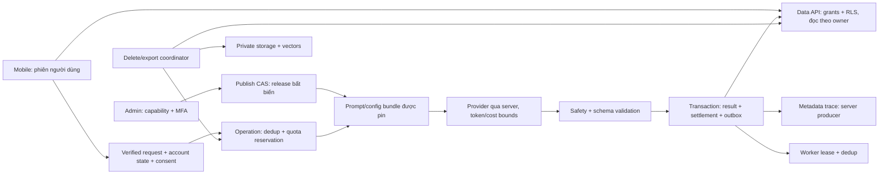

# Phương án Supabase production cho Nilaza

## Updated allocation — 2026-10-05

Owner desired allocation is Nilaza Free and only MCY in MagicpenDigital Pro. Existing Singapore candidate etfajmrwyywokgafzxsb is verified Pro, created 2026-10-04T17:39:22.367486Z; runtime-backed QA akgrokwnkfqnfjqrildi remains Free. Canonical selection is pending. Preferred proposal is transfer MCY to Pro, then existing Singapore to Free after quota/roles/cost/downgrade approval; retain legacy QA and all release gates. The earlier one-Pro-Nilaza budget proposal below is historical, not a current execution instruction. No transfer-back or runtime retarget is completed. See [current allocation and workflow](../../release/SUPABASE_ALLOCATION_2026-10-05.md).

Ngày review: 04/10/2026. Trạng thái: **đề xuất kiến trúc và kế hoạch triển khai; chưa tạo project, chưa apply SQL, chưa mở người dùng thật**.

## Quyết định đề xuất

**Cập nhật theo quyết định owner ngày 04/10/2026:** dùng gói Supabase Pro **25 USD/tháng đã mua**, AI thanh toán riêng qua **OpenRouter** theo sử dụng thực tế. Phương án hiện hành là **một** `nilaza-prod` trong MagicpenDigital (`rzbpjfrndhrtxagpgdre`): Singapore `ap-southeast-1`, Standard Postgres17, compute **Micro**, daily DB backup sẵn có; **không bật PITR, không nâng Small, không tạo staging trả phí hoặc mua add-on** trong đợt này. Các con số $130/$140 của phương án trước đã được thay thế, không còn là khuyến nghị mặc định.

Theo release profile hiện hành, staging thuộc org Free cũ `drxbmvimiekeoeesgssp`; local phục vụ phát triển/replay. QA cũ giữ nguyên để đối chiếu. Mức $25 là base estimate với một Micro được compute credit của org bù, trong included usage và không có add-on/compute khác; kiểm Upcoming Invoice trước execution, không coi là bảo đảm hóa đơn cuối cùng luôn đúng $25. [Pricing](https://supabase.com/pricing).

Org Free hiện đã dùng hết hai slot và QA Nilaza còn ledger blocked, nên staging hiện có không tự là clean replay đạt chuẩn. Ưu tiên khôi phục local managed-compatible Supabase để rehearsal với synthetic data; không dùng prod làm chỗ test có dữ liệu thật, không import QA. Nếu local/Free không đủ một gate, ghi BLOCKED và chuẩn bị cách test trong ngân sách hoặc resource proposal riêng; không tự tạo paid staging để đi vòng giới hạn.

Chưa có project mới theo xác nhận của owner. Link organization không phải link database. Tạo project rỗng chỉ là provision hạ tầng: sản phẩm vẫn đóng signup công khai, AI có trả phí, worker và checkout cho đến khi vượt các gate bên dưới. [Thông số đề xuất](project-spec.json) ghi rõ giá trị chưa được duyệt hoặc chưa có, không chứa secret.

MVP production nên mở Onboarding/Profile, Home, Oracle/Persona Chat, Tarot, Journal và privacy settings sau nghiệm thu. Daily insight dùng nội dung đã duyệt nếu đường AI chưa đạt gate. Astrology AI/Council và notification delivery chỉ mở nếu đáp ứng cùng chuẩn auth/quota/privacy; không mặc định bật vì đã có UI. Face reading, community và marketplace tiếp tục hoãn. Premium có thể giữ giao diện giới thiệu nhưng không mở mua khi webhook/entitlement chưa hoàn chỉnh.

Đây là phân tích source, migration, các báo cáo kiểm thử trước và tài liệu Supabase hiện hành. Không phải chứng nhận an toàn, cũng không bảo đảm mọi sự cố tương lai đều đã được dự đoán. Tất cả tiêu chí dưới đây là **mục tiêu cần kiểm thử**, không phải kết quả production đã đạt.

## Phạm vi tác động và bằng chứng

| Bề mặt | Thay đổi dự kiến | Điều kiện giữ an toàn |
|---|---|---|
| Mobile | Backend theo môi trường; sync có ACK; lỗi auth/quota/offline phân biệt; export/delete cloud | Build staging và production riêng; test hai tài khoản/hai thiết bị iOS và Android |
| Backend | Auth trước chi phí; quyền ghi kết quả riêng; operation/quota/result transaction; deletion/export jobs | Endpoint chưa tích hợp giữ disabled; không fallback sang route trả phí khi config lỗi |
| Admin | Capability + MFA; draft theo user/project; publish CAS và bundle bất biến; readback runtime | Không cho quản trị nội dung đọc Journal/chat khách hàng mặc định |
| Database | Replay Nilaza canonical, thêm forward hardening; grants/RLS/FK/constraints/indexes | Target-scoped ledger; allowlist hash; không sửa migration lịch sử để che drift |
| Storage/vector | Chỉ asset công khai đã duyệt; dữ liệu cá nhân và raw sources private | Policy riêng, signed URL ngắn hạn, nguồn licensed/approved, xóa object và embedding |
| Ops | Backup, restore, rate/cost caps, metrics, incident runbook | Không đưa prompt/chat/token vào log; restore phải tái áp dụng yêu cầu xóa |

Các agent hiện có đã review độc lập runtime/privacy, 25 migration canonical + 2 forward và hạ tầng/giá. Không cần tạo Agent sản phẩm mới cho đợt này. Agent thực thi vẫn cần scope, kế hoạch, preflight và quyền action cụ thể; tên vai trò không cấp quyền deploy hoặc đọc dữ liệu khách hàng. [Release runbook](../../release/RELEASE_RUNBOOK.md) và [release profile](../../release/release-profile.json) vừa được review: allowlist còn trống, local checker không tự cấp cloud authority; budget/provider preference không tự là exact project manifest approval.

R02 hiện vẫn `candidate_not_execution_ready`. 27/27 hash SQL khớp manifest chỉ chứng minh đúng source đã liệt kê. **Không apply mặc định cả 27 SQL vào production**: R10 `20261002000000_ai_usage_reservation.sql` tự INSERT campaign `qa-g1`, có giới hạn 14 ngày và QA caps ngay trong migration. Giữ R10 làm QA reference; production cần forward/policy riêng trong target allowlist mới, không sửa SQL lịch sử để đổi tên campaign. 25 canonical + raw-source boundary forward cũng cần replay/review trước khi được nhận vào manifest production. Chưa replay toàn bộ trong managed Supabase. Docker daemon local chưa khả dụng; kiểm thử PGlite quota trước đây dùng fixture và không thay thế JWT/RLS/concurrency thật. Ledger QA cũ còn blocked. Preflight hiện kiểm ledger cũ khi `databaseWrite=true` bất kể target; cần sửa guard theo project trước việc apply production ([guard](../../../scripts/feature-preflight.mjs)).

Candidate mô tả 46 public tables và 5 private quota tables, nhưng **số bảng không phải tiêu chí readiness**. Có prerequisite managed `auth`, roles, extensions và publication: migration `20260925155619_generation_activity_contract_forward.sql` thực sự thêm `generation_jobs` vào `supabase_realtime`. Phải kiểm membership theo target và bảo vệ dữ liệu row/payload; không copy publication QA hoặc mô tả rằng baseline không có Realtime.

## Các vấn đề cần đóng trước launch

| ID | Mức | Bằng chứng hiện tại | Công việc cụ thể và dấu hiệu nghiệm thu |
|---|---|---|---|
| PROD-01 | P0 | Ledger/preflight đang gắn QA cũ; baseline chưa replay | Manifest/ledger mới binding project ID, SQL hash, prerequisite và approval; replay sạch và catalog/grants diff được review; QA cũ vẫn blocked |
| PROD-02 | P0 | Daily/Council/Astrology source tiếp tục gọi model khi `getUser` lỗi | Shared verified-user guard trước body/prompt/provider trên mọi đường bật; JWT thiếu/sai/hết hạn, account deleting/disabled và anonymous không gọi provider |
| PROD-03 | P0 | Authenticated client có thể INSERT usage/trace và ghi own-user output | Revoke producer writes; tách user input/feedback khỏi generated output; trace/run/result gắn operation do server tạo; forgery REST/RPC bị từ chối |
| PROD-04 | P0 | R10 quota là campaign QA 14 ngày, audience pilot/evaluation và 3 feature | Policy production riêng, atomic reserve/settle, pricing/token bounds, dedup và reconciliation; tất cả đường tính phí kể cả Admin/cron/fallback có ngân sách |
| PROD-05 | P0 | Journal upsert sửa nội dung trước khi phát hiện tombstone | Mutation transaction kiểm delete/revision trước write; delete thắng late replay; DB vẫn không chứa nội dung sau xóa |
| PROD-06 | P0 | Export và clear-account hiện chỉ local; FK audit có `NOT NULL` cùng `ON DELETE SET NULL` | Export/delete cloud có job/receipt; sửa actor lifecycle; xóa payload, storage, vectors, sessions; restore tái xóa; không coi Auth cascade là đủ |
| PROD-07 | P0 | Raw sources từng có quyền public; forward chưa role-test thật | Allowlist published content; raw/source_chunks/embeddings không đọc qua public/client; retrieval kiểm license, approval, ownership, version |
| PROD-08 | P0 nếu bán | Subscription/credit thiếu verified receipt, event uniqueness/order, atomic refund | Signature/receipt verification, immutable ledger, webhook replay/out-of-order/refund/reconciliation; trước đó checkout disabled |
| PROD-09 | P1; nâng P0 khi bật tính năng | Birth delete hiện không xóa `birth_profiles`; empty profile bỏ qua write; preview có thể báo synced | Explicit erase birth + derived rows, ACK thật; CAS/revision sync profile; device B/relogin không hồi dữ liệu đã xóa |
| PROD-10 | P1; gate AI/content | Publish model route thiếu expected baseline; Council còn nhiều write rời; published bundle có UPDATE policy | Atomic publish/CAS, unique active release và payload bất biến; request pin full bundle; stale admin nhận 409 và giữ draft |
| PROD-11 | P1; gate tương ứng | Daily cache không UNIQUE; child-parent owner chưa constraint đồng đều; jobs/notification chưa đủ claim/dedupe | Composite FK, unique daily key, lease/outbox/dedup, preference/quiet-hours; test race và retry |
| PROD-12 | P0 vận hành | Chưa có production SMTP/native/restore/load evidence | Environment/auth manifest, native callback, load và restore drill; alert/kill switch/runbook được thử thực tế |

Các endpoint auth ở PROD-02 là **đường fail-open thấy trong source**, chưa xác minh gateway JWT của deployment nên không kết luận có khai thác unauthenticated live. Forward dự kiến ở PROD-07 chưa được apply. Oracle candidate hiện `providerDispatched:false`, `conversationPersisted:false`; credit debit đóng 503. Các cơ chế đóng này giúp hạn chế rủi ro, chưa thể nghiệm thu thành tính năng AI/billing đã hoàn tất.

Nguồn chi tiết: [Daily](../../../supabase/functions/ai-daily-insight/index.ts), [Council](../../../supabase/functions/ai-council/index.ts), [Astrology](../../../supabase/functions/ai-astrology-report/index.ts), [shared guard](../../../supabase/functions/_shared/ai-request-guard.ts), [trace SQL](../../../supabase/migrations/20260909014614_ai_trace_observability.sql), [R10 SQL](../../../supabase/migrations/20261002000000_ai_usage_reservation.sql), [Journal adapter](../../../supabase/functions/journal-entries/index.ts), [Journal handler](../../../supabase/functions/journal-entries/handler.ts), [bundle/audit SQL](../../../supabase/migrations/20260917172721_admin_content_sync.sql). [Evidence register](evidence.json) ghi đường dẫn, hash và giới hạn xác minh.

## Kiến trúc và quyền ghi

Chọn kiến trúc kết hợp: RLS bảo vệ dữ liệu cá nhân; client đọc dữ liệu được phép và chỉnh nội dung do mình tạo qua contract hẹp. Kết quả AI, usage, trace vận hành, credit, entitlement và publication là **server-only write**. Shared verified request boundary và transaction/RPC sở hữu operation là nguồn quyết định, thay cho các caller tự ghép nhiều write độc lập.

Mũi tên là luồng dữ liệu/kiểm soát mong muốn, không phải graph Admin đang thực thi. Provider call nằm ngoài transaction DB: không giữ khóa database trong khi chờ LLM. Operation lưu trạng thái trước/sau call để reconciliation xử lý crash, mất ACK và timeout chưa rõ kết quả. Không hứa “exactly once” với nhà cung cấp bên ngoài nếu provider không hỗ trợ idempotency; mục tiêu là at-most-one active attempt được claim, một settlement/result hợp lệ và không retry mù khi chưa rõ call đã chạy.

Phương án vá từng endpoint có thể dùng cho containment khẩn cấp nhưng dễ lệch khi thêm feature/ngôn ngữ/provider. Phương án shared boundary có chi phí migration và transaction nhưng phù hợp khi Nilaza mở nhiều tính năng AI. Bản so sánh hai phương án, threat boundary và rollout được lưu riêng bằng plugin Codex Security; đây là đề xuất derived từ source, không phải security scan đã chứng nhận sửa lỗi.

### Schema theo domain

Tên bổ sung dưới đây là **logical entities dự kiến**; lập forward SQL mới sau khi đối chiếu catalog, không tạo bảng trùng với canonical.

| Domain | Dữ liệu/quan hệ | Quyền và invariants bắt buộc |
|---|---|---|
| Identity/access | Managed `auth.users`; account state; `user_profiles`; operator capability | user_id UUID từ verified identity; client không tự đặt role/entitlement/account state. Owner bootstrap riêng, có handoff trước xóa last owner |
| Consent/privacy | Consent theo purpose/policy version; export/delete request; deletion task/receipt | Có timestamp, withdrawal và audit tối thiểu; product/AI, marketing, push tách nhau. Không coi chấp nhận điều khoản là consent mọi purpose |
| Birth/profile | `birth_profiles`, locale/tone/goals, calculated chart version | Birth optional; bounds ngày/giờ/timezone/coordinate; nguồn tính chart deterministic; erase birth và derived data. Không cần birth/name để chat mặc định |
| Content | personas/decks/cards/templates; approved source/license; published release | ID ổn định, bilingual vi/en; immutable published snapshot; chỉ released asset/content đọc được; không seed QA artifacts hoặc toàn bộ prompt admin ra public |
| Chat/reading | sessions/messages, tarot readings, astrology reports, saved insights | Composite `(parent_id,user_id)` FK/unique parent key; client không tạo guide/completed/provenance. Cards chọn bằng app/backend logic; model không tự chọn/invent chart |
| Journal/sync | entry local_id, revision, mutation_id, deleted_at/tombstone | Unique owner+local_id; compare-and-set revision; delete thắng late save; tách tombstone khỏi private body nếu cần; conflict được UI giải thích |
| AI/config | prompt sections, locale packs, feature contracts, routes, immutable release | Core + feature + locale + tone chung; một active release theo scope; NULL owner không làm thủng uniqueness; pin version/hash; runtime chỉ đọc bundle được publish |
| Usage/operations | generation operation, attempt, reservation, provider receipt, settlement | Idempotency theo user+feature+key; unique result→operation; bounded attempts; integer micro-USD; server timestamps; reconcile unknown state; service-only writes |
| Billing | subscription, verified provider event, credit ledger, reversal | event ID unique theo provider; signature/receipt verified; append-only delta/reason; idempotent grant/debit/refund; balance transaction, không trust số client gửi |
| Delivery | generation jobs, outbox, device tokens, notification delivery | Atomic claim/lease, owner FK, retry/backoff/dead-letter/dedup; token rotation và logout unlink; push generic, opt-in, quiet hours |
| Audit/safety | admin publication events, operational trace, minimal safety event | Server producer; operator chỉ metadata cần thiết. actor lifecycle không chặn account deletion sai; raw message không mặc định trong payload |
| Retrieval | persona_sources/source_chunks/source_embeddings | Private; license/approved/version/lang filters trước retrieval; dimension/model version; delete/reindex có theo dõi; không ingest book text chưa được phép |
| Marketing | lead consent, suppression, double opt-in nếu dùng, delivery event | Tách product auth và marketing; service-only; token hash; unsubscribe được giữ suppression tối thiểu có chính sách; chưa bật campaign worker khi chưa review |

Mọi bảng exposed có explicit grants **và** RLS cho SELECT/INSERT/UPDATE/DELETE. Không chỉ “bật RLS” rồi coi đủ. `service_role` bypass RLS nên server phải tự kiểm owner/capability; không đưa key này vào mobile, Admin JS, build public hoặc chat. Anonymous Auth cũng có thể thuộc role `authenticated`, phải kiểm `is_anonymous` khi feature yêu cầu signed-in user. View cần xét `security_invoker`; RPC `SECURITY DEFINER` cần `search_path` cố định, revoke EXECUTE mặc định và validate caller/owner; không nhận tên SQL/bảng/schema từ client. [Supabase RLS](https://supabase.com/docs/guides/database/postgres/row-level-security), [API security](https://supabase.com/docs/guides/api/securing-your-api).

Ưu tiên `private`/unexposed schema cho dữ liệu vận hành mới. Chuyển bảng public hiện có cần migration API có kế hoạch; revoke quyền producer đúng bảng/RPC ngay cả khi chưa đổi schema. Không chuyển mọi bảng một lần chỉ để kiến trúc trông gọn. Tạo schema không tự bảo đảm secrecy nếu grants/RPC/view còn mở.

### Constraints, indexes và format

Foreign key kiểm owner phải ở DB ngoài handler: session/message, reading/saved insight, job/result, notification/job, source/chunk/embedding. Không chấp nhận child của A trỏ parent của B dù child.user_id=A. Dùng CHECK/typed validators cho status values, body size, JSON contract version, birth values, credit sign/reason và provider usage. CHECK không kiểm được transition OLD→NEW: guarded RPC/CAS/trigger thực thi state machine và published immutability, có concurrent negative tests. Timestamps `timestamptz`, thời gian authoritative từ server.

Bổ sung unique cho daily cache `(user_id,local_date,feature,content_version)` hoặc policy tương ứng đã chốt; chống duplicate cùng request cả trước provider. Active config cần unique partial/index hoặc scope key phù hợp với version Postgres; published row không UPDATE/DELETE trực tiếp. Delete/export phải giải quyết `actor_id NOT NULL ON DELETE SET NULL`, các RESTRICT/NO ACTION publisher và last-owner constraint bằng handoff/redaction được review.

Index theo truy vấn thật: `(user_id,created_at,id)` cho keyset pagination, `(user_id,local_id)` Journal, parent FK, partial status/next_attempt_at cho queue, operation idempotency key và provider event ID. Dùng EXPLAIN ANALYZE với data giống production nhưng synthetic. Tránh tải toàn bộ lịch sử chat/Journal, full-table count, N+1 và index mọi JSON. Chưa partition/shard/read-replica khi không có tải đo được; chúng thêm chi phí và rủi ro migration.

## Auth, Admin và môi trường

Production chỉ allowlist domain/callback đã sở hữu và đã test; URL localhost, wildcard preview chỉ staging. Repo hiện scheme `nilaza`, package/bundle `app.nilaza.mobile`: staging phải có định danh/callback phân biệt để không lấy nhầm phiên hoặc data production. Domain Admin production và mobile callback chính xác là quyết định còn mở; không tự lấy domain `nilaza-admin-staging.vercel.app` làm production. Manifest bind cả organizationId, projectRef và environment kind; tên app/project hoặc domain một mình không xác định target.

Bật email confirmation, secure password change, leaked-password protection; đề xuất password tối thiểu 12 ký tự. SMTP riêng, SPF/DKIM/DMARC, Auth và marketing tách, tắt link tracking. SMTP mặc định của Supabase không phù hợp launch công khai; xác minh rate và deliverability của SMTP production trước test signup/reset. CAPTCHA phải thử trên native, có fallback UX rõ ràng; SMS giữ tắt MVP. [Auth SMTP](https://supabase.com/docs/guides/auth/auth-smtp), [redirect URLs](https://supabase.com/docs/guides/auth/redirect-urls), [native deep links](https://supabase.com/docs/guides/auth/native-mobile-deep-linking).

Operator/Admin dùng MFA, server kiểm AAL2 cùng capability tại thời điểm mutation; stale JWT/role revoke không được publish chỉ vì UI còn nút. Bootstrap owner phải dùng tài khoản thật được xác nhận riêng, không hard-code email QA vào SQL; không gửi password/key qua hội thoại. Tách content editor, AI publisher, billing operator, auditor và infrastructure owner. Auditor được metadata cần thiết; truy cập nội dung cá nhân nếu thực sự cần phải có flow có mục đích, scope, thời hạn và audit riêng.

Pro không cung cấp project-scoped/read-only Dashboard roles như Team. Hai project trong một org cách ly DB/key nhưng vẫn chung một số quyền quản trị/billing. Cùng org phù hợp khi owner quản lý hạ tầng; khi thêm nhiều nhân sự cần chọn separate org hoặc gói quyền phù hợp. [Plan/access comparison](https://supabase.com/pricing).

Auth sessions cần refresh/re-auth UX, account-state check trước hoạt động nhạy cảm và response codes riêng 401/403/409/429/503. Revoke refresh token không đồng nghĩa mọi access JWT lập tức mất hiệu lực; account deletion/ban phải có server deny state cho write/AI, và policy cho Data API được kiểm thử. Kiểm SecureStore/keychain/keystore phù hợp thay vì coi AsyncStorage đủ cho token; private cache, app backup, clipboard và export temp files được kiểm trên binary native. [Session lifecycle](https://supabase.com/docs/guides/auth/sessions).

Mỗi môi trường có keys/provider/SMTP/webhook secrets riêng, secret chỉ ở Dashboard hoặc protected release job/operator được cấp quyền; không vào agent session, fork PR hoặc untrusted build. Public publishable/anon config không phải secret nhưng RLS vẫn bắt buộc. Inventory chỉ ghi tên, owner, version và nơi lưu; không ghi value. CI pin project ID và environment; production deployment không lấy cấu hình từ `.env` QA tình cờ còn trên máy. Required independent review/checks, protected environment, một release lock và drift check ngay trước execution cần xác minh enforcement remote. Checker local chỉ kiểm evidence hashes; không chứng minh remote permissions hoặc chất lượng test.

## AI: dữ liệu truyền, chất lượng, quota và chi phí

Owner xác nhận dùng **OpenRouter** để kết nối LLM và trả chi phí AI riêng. Luồng production dự kiến: mobile/Admin → Nilaza backend → OpenRouter → model đã được duyệt. Backend vẫn chạy trên Supabase, nên AI request có thể sử dụng Edge invocations/network/DB ngoài tiền inference OpenRouter; tách hóa đơn không làm những tài nguyên này bằng0.

Source đã có OpenRouter adapter, nhưng routes/defaults vẫn có direct OpenAI/Anthropic/Gemini ở một số features. **Chưa chuyển toàn runtime sang OpenRouter chỉ bằng sửa tài liệu.** Production manifest cần primary/fallback đều OpenRouter với model/pricing được duyệt; direct-vendor fallback disabled cho scope này. Adapter hiện giữ resolved model và token counts nhưng chưa giữ cost receipt/generation ID riêng/cache/reasoning details để reconcile đầy đủ. W08 phải bổ sung authoritative OpenRouter cost và unique generation receipt cho từng attempt; unknown/missing cost là pending reconciliation, không tự tính 0. Privacy/provider restrictions hiện không đồng đều giữa features; model-prefix metadata chưa là API allowlist được enforce. Production cần approved model/upstream provider allowlist, price ceiling, retention/ZDR settings được review; free/auto route không tự chứng minh chất lượng/cost bounds. [Adapter](../../../supabase/functions/_shared/providers/openrouter.ts), [routes](../../../packages/agent-config/model-routing.json), [OpenRouter usage accounting](https://openrouter.ai/docs/cookbook/administration/usage-accounting).

Core prompt dùng chung có version; feature sections mô tả contract, locale pack điều chỉnh ngôn ngữ/văn hóa, tone pack giới hạn phong cách. Thêm ngôn ngữ không fork toàn bộ safety và schema. Locale fallback có quy tắc rõ, không tự đổi ngôn ngữ ở giữa hội thoại. Prompt/config/model/context versions được pin vào operation; request đang chạy không nhận nửa config cũ/nửa mới khi admin publish.

Context mặc định: latest user message + lịch sử gần có budget + persona approved + locale/tone + feature data cần thiết. Birth/name/Journal/archive/source chỉ được đưa vào khi feature cần, consent và owner đúng; raw images không thuộc MVP. Untrusted user/retrieved text là data, không được override system/tool policy. Backend đo token **sau compile đầy đủ**, reserve theo input/output max và rate của route/fallback; byte limit 32 KiB không phải token budget. Chỉ rate/model đã xác minh mới được bật; unknown pricing/config lookup error fail closed.

Reserve gồm quota, cost headroom và concurrency. Claim attempt theo lease; provider response schema/safety validate; transaction ghi immutable result liên kết operation + settle usage + outbox. Replay trả cùng result; mất ACK query operation, không tính lượt hai lần. Unknown provider timeout giữ trạng thái reconciliation có TTL/receipt, không refund ngay rồi retry vô hạn. Nhiều attempt/fallback cộng tất cả cost đã phát sinh; estimate không thay actual usage. Zero provider usage receipt hoặc lỗi persistence phải hiển thị đúng trạng thái, không dựng trace “thành công”.

G1 đã được owner đồng ý: Tarot miễn phí **1 lá/ngày**, Chat+Oracle **5 lượt dùng chung/ngày**; ngân sách **QA** $5/ngày và $50/14 ngày gồm evaluation. Free spread chỉ 1 card; multi-card spread phải disabled hoặc có entitlement/policy riêng, không được lách bằng một reading chứa 3 lá. **Không dùng ngân sách QA làm ngân sách production**. Production policy không phụ thuộc campaign 14 ngày/pilot. Đề xuất giữ quota miễn phí nhưng chốt timezone reset: ngày tài khoản theo IANA timezone đã xác minh, đổi timezone không reset quota tùy ý; server clock authoritative, chống concurrent rollover.

Đề xuất semantics: free lượt chỉ consume sau khi valid result đã persist; failure/không lưu trả quota khi trạng thái đã xác định nhưng actual provider cost vẫn giữ trong ngân sách. Unknown attempt giữ reservation đến reconciliation; attempt-abuse cap riêng tránh người dùng cố tình tạo nhiều failed calls miễn lượt. Idempotency key gắn canonical request digest/user/feature; đổi question/cards/locale dưới cùng key trả409, không lấy output sai; replay completed key trả bản original pinned release. Đề xuất cửa sổ offline replay 30 ngày: client quá hạn rebase từ server, tombstone/dedup metadata không chứa body giữ ít nhất 35 ngày và không cho old mutation tạo lại ID đã xóa; giá trị cuối phải test/chốt trước launch.

**Ngân sách OpenRouter tách khỏi Supabase $25.** Chi phí phụ thuộc users, lượt thực, model, input/output/reasoning/cache tokens và retry/fallback, không chỉ số đăng ký. Chưa đủ dữ liệu để duyệt một USD hard cap production duy nhất. Không tự đặt lại campaign QA $5/ngày làm production cap. Đo actual `usage.cost`, lưu generation ID tách khỏi HTTP request ID, đối chiếu receipt/usage; streaming đọc usage cuối hoặc reconcile nếu stream mất. Dùng mô hình:

`AI/tháng ≈ DAU × lượt thật trung bình/ngày × 30 × chi phí đo được/lượt + Daily/cron/Admin/evaluation + retry/fallback + dự phòng`

Ví dụ **giả định**, không phải giá OpenAI/model: 1.000 DAU × 2 lượt/ngày × 30 = 60.000 lượt; nếu đo được $0,001/$0,003/$0,01 mỗi lượt thì tương ứng $60/$180/$600 trước chi phí còn lại. Đây là lý do quota 5 lượt không đủ để kiểm soát tổng hóa đơn. Staging cần ≥100 lượt synthetic đại diện mỗi feature/locale, đo p50/p95 cost, latency và token, rồi lập volume model và chốt hard daily/monthly cap. Khi đạt cap: giảm/tắt paid dispatch, trả thông báo rõ; không ảnh hưởng đọc dữ liệu đã lưu và crisis help tĩnh.

Rate limit theo account/feature, số operation đang chạy, IP/device ở mức tối thiểu có retention; signup abuse/CAPTCHA; system+provider budget độc lập; kill switch server; cảnh báo theo ngưỡng. Cron/Daily/Council/Admin playground cũng phải qua cost authority. Premium không được bypass safety hoặc total cost cap. Nếu chưa tích hợp đầy đủ, giữ endpoint đó disabled thay vì default paid fallback.

Quality gate Oracle/Tarot/Persona: bộ test vi/en gồm emotional reflection, relationship, ambiguity, deterministic claims, crisis, prompt injection, long history và adversarial source. Reviewer/customer simulation chấm warm/concise/actionable, đúng persona, không fake facts, không diagnosis; automated contract + human approval. Đề xuất không còn lỗi safety nghiêm trọng trong release suite, ≥90% case đạt rubric và mỗi response có reflection hữu ích; ngưỡng cần owner phê duyệt. Agent mô phỏng không thay thế phản hồi người dùng thật. ChatGPT comparison chỉ tham khảo chất lượng; Nilaza thắng bằng persona nhất quán, context có consent, reflection lưu được, tarot deterministic và trải nghiệm riêng tư, không chạy đua số chữ.

## Đồng bộ, xóa/export và retention

Local/online đồng bộ **source release và contract**, không đồng bộ mọi dữ liệu/credential. Pipeline build một revision, deploy staging → test → promote cùng artifact khi phù hợp; backend/schema/config release có manifest hash và compatibility range. Mobile native phát hành riêng; app cũ có thể tồn tại vài tuần/tháng, nên expand–contract và server min-supported-version có UX nâng cấp, không xóa column ngay khi web đã đổi.

| Thành phần | Đồng bộ thế nào | Phần không dùng chung và lý do |
|---|---|---|
| Admin source/assets | Cùng Git revision/build digest, local+staging+prod release evidence | Browser drafts/session/localStorage theo domain/user/project, tránh leak phiên và ghi nhầm |
| SQL/config structure | Canonical+forward allowlist/replay; immutable config release promotion | Project ID, Auth settings, secrets, keys, publication/buckets kiểm riêng; managed config không tự theo Git |
| Prompt/content | Promote approved version/hash và license metadata | Preview sample không là runtime; draft/QA seed không tự publish; locale pack thiếu cần review |
| Mobile | API/schema compatibility; staging/prod build manifest | Native signing, store release, callback, push tokens và device acceptance riêng |
| User data | Sync theo owner/revision/ACK trong cùng môi trường | Không copy Auth/chat/Journal/birth/subscription từ QA vào production; không dùng prod raw data ở local |
| Backup | Versioned DB+object+config recovery manifest | DB backup không chứa Storage objects hoặc secret store; cần các nguồn recovery riêng |

Journal/profile outbox cần mutation ID, retry/backoff, revision và conflict policy; ACK chỉ khi backend save được. Delete tombstone phải chặn content rewrite ở SQL/RPC **trước** mutation. Birth erase xóa dữ liệu cloud gốc và report/cache/derived context; profile empty không được nghĩa “bỏ qua xóa”. Không báo synced/deleted khi auth/config thiếu.

Account deletion flow: re-auth thích hợp → mark deleting/deny new operations → revoke sessions/unlink devices → cancel queued jobs, prevent late output persistence → purge/redact private DB rows/vectors/storage/export objects → xử lý billing/audit actor theo chính sách → delete Auth identity khi dependency an toàn → receipt. Xử lý lặp lại idempotent và có trạng thái progress/error. Last owner phải handoff trước; đây là ngoại lệ cần UI rõ, không âm thầm bỏ qua xóa.

Export flow: authenticated request với allowlist dữ liệu owner; snapshot nhất quán phù hợp; async nếu lớn; private encrypted object, object purge ≤24 giờ; không có tokens, raw operator prompts hoặc dữ liệu người khác. **Đề xuất download qua server kiểm current account/owner mỗi lần, response `Cache-Control: no-store`, không expose Storage signed URL trực tiếp cho export nhạy cảm.** Export handle TTL ≤15 phút, không là bearer access độc lập với auth. Log metadata request/status, không body; test account switch/delete và cache thực tế.

Nếu một loại asset khác dùng direct signed URL, phải chấp nhận/test bounded bearer và cache risk: Auth logout/key rotation không tự revoke Storage URL; CDN có thể phục vụ cached response sau token expiry, object delete invalidation cũng có độ trễ. Không hứa thu hồi tức thì hoặc xóa bản người dùng đã tải. [Storage downloads](https://supabase.com/docs/guides/storage/serving/downloads), [Smart CDN](https://supabase.com/docs/guides/storage/cdn/smart-cdn).

Retention **đề xuất để chốt**, không phải yêu cầu pháp luật đã xác định:

| Loại | Default đề xuất | Cơ chế/điều kiện |
|---|---|---|
| Chat/Journal/reading/profile | Đến khi user xóa hoặc account closure | Delete private content sau ACK; tombstone tối thiểu sống đủ cửa sổ offline/replay theo policy; không chứa body |
| Trace metadata | 30 ngày; raw prompt/response logging OFF production | expires_at bắt buộc; purge job báo tuổi dữ liệu; provider retention phải được kiểm riêng |
| Export files | Auth-checked handle ≤15 phút, object ≤24 giờ | Server download no-store, current account check + object cleanup test |
| Completed jobs/delivery metadata | 30 ngày; dedup keys theo retry window | Không private prompt trong job payload lâu dài; giá trị vận hành đã tổng hợp không định danh nếu cần |
| Safety events | 30 ngày metadata tối thiểu, raw content OFF | Review mục đích/nhu cầu trước khi giữ thêm; crisis response không yêu cầu marketing consent |
| Operator publication audit | Đề xuất 180 ngày, actor tối thiểu | Không private user body; pseudonymization/handoff; cần policy owner/legal |
| Billing/fraud records | Chưa chốt số ngày | Phụ thuộc thị trường/payment/obligation; counsel review, tách khỏi private reflections |
| Backups | Daily DB backup Pro giữ7ngày; PITR hoãn; object backup policy riêng | Access giới hạn; deletion ledger độc lập giúp tái purge sau restore; recovery không tương đương PITR |

Consent, age gate/treatment với người chưa thành niên, privacy notice, processing locations/subprocessors/DPA, chính sách thanh toán và retention cần owner/legal review theo thị trường launch. Region Singapore không tự chứng minh tuân thủ. Kế hoạch kỹ thuật này không đưa kết luận pháp lý.

## Storage, Realtime và notifications

Bucket public chỉ chứa artwork/brand/content đã release và có quyền sử dụng; không raw licensed book text. Avatar nếu mở cần MIME/size/actual bytes validation, signed/private access theo owner và metadata strip phù hợp. Journal/export/attachment private; không có face upload MVP. Object path có owner là một kiểm tra, chưa đủ nếu policy chỉ so tên đường dẫn do client tự chọn. Service signer kiểm authorization trước cấp URL; short TTL, no sensitive body in URL/log.

Realtime chỉ bật bảng/kênh cần thiết. `generation_jobs` hiện có publication source; review owner RLS và payload column, delete behavior, reconnect, subscription unbind sau logout/account switch. Nếu job payload có private context thì dùng status projection/contract sạch thay vì expose nguyên row. Không expose trace/quota/private sources qua Realtime.

Worker claim/lease atomic, outbox transactional, dedup delivery key và backoff; notification chỉ generic (không câu Journal hoặc relationship bí mật ở lock screen). Push preference, consent, quiet hours và token invalidation được thực thi server. Provider accepted receipt không đồng nghĩa người dùng đã thấy thông báo. Feature notification delivery không mở nếu còn mock/scheduler placeholder.

## Hạ tầng, chi phí và recovery

Singapore là đề xuất theo người dùng Việt Nam/Đông Nam Á, cần đo latency thực tế. Chọn Standard Postgres 17 phù hợp major local; xác minh minor/extension compatibility khi provision. Không chọn OrioleDB beta hoặc engine khác cho lần launch này. Đổi region về sau cần project/migration mới. [Regions](https://supabase.com/docs/guides/platform/regions), [region migration](https://supabase.com/docs/guides/troubleshooting/change-project-region-eWJo5Z), [OrioleDB](https://supabase.com/docs/guides/database/orioledb).

Giá tra 04/10/2026, USD/tháng xấp xỉ chạy đủ tháng, **chưa thuế/overage/AI/SMTP/backup ngoài/Vercel/EAS**:

| Phương án | Supabase ước tính | Phù hợp |
|---|---:|---|
| **Một prod Micro + staging Free/local, không paid add-on** | **$25** | Owner chọn cho giai đoạn đầu; credit org bù một Micro, included usage |
| Nâng prod Small, giữ staging Free/local | $30 | Hoãn; chỉ xem xét sau đo tải và duyệt chi phí |
| Prod Micro + thêm paid staging Micro | $35 | Hoãn; vượt ngân sách và cần review environment policy |
| Prod Small + PITR7ngày, không paid staging | $130 | Phương án recovery nâng cấp sau này, chưa chọn |

Công thức hiện hành: **$25 subscription + $10 Micro − $10 compute credit/org = $25**, nếu không có compute/add-on/overage khác. Credit theo org, không phải mỗi project; Pro base đã tồn tại, đây là tổng base estimate. Tất cả paid staging/branch/PITR/Small/custom domain/log-drain/IOPS/IPv4 add-on hoãn. Free/local không hạ gate security/API parity. Giá/credit/current projects xác minh lại trước action. [Pricing](https://supabase.com/pricing), [billing FAQ](https://supabase.com/docs/guides/platform/billing-faq).

Micro có1GB RAM, direct DB connections60 và pooler clients200 theo bảng compute; đây không phải số user đồng thời app chịu được. Load acceptance phải trên compute tương đương **Micro**, rồi giới hạn traffic theo kết quả; không quảng cáo capacity dựa số connection. Mobile/Admin dùng Data API; serverless SQL dùng Supavisor transaction khi thích hợp (không prepared statements), migration/dump direct/session theo network. Giữ disk mặc định; resize có downtime và chỉ thực hiện khi owner duyệt cost mới. [Compute](https://supabase.com/docs/guides/platform/compute-and-disk), [connections](https://supabase.com/docs/guides/database/connecting-to-postgres).

Trong ngân sách hiện tại dùng **daily DB backup Pro giữ7ngày**, PITR hoãn; Storage objects không thuộc DB backup. **Không còn mục tiêu DB RPO15phút của phương án PITR.** Planning target theo cadence daily là mất tối đa khoảng24giờ dữ liệu từ last-good backup; kiểm thời điểm backup thật và đo restore, chưa được coi bảo đảm≤24giờ. RTO≤4giờ vẫn là mục tiêu cần drill, không SLA. Bản sao object mã hóa riêng, manifest/hash, versioned schema/functions/config và independent deletion ledger vẫn cần; ưu tiên cơ chế trong tài nguyên sẵn có, không tự mua backup service. Nếu recovery hoặc independent copy chưa đạt thì giữ gate BLOCKED/giới hạn rollout, không ghi pass vì cần tiết kiệm. [Backups](https://supabase.com/docs/guides/platform/backups).

Restore drill dùng destination cách ly; đo mất dữ liệu, integrity DB+object, grants/RLS/capabilities, key rotation, account deletion replay và client reconnect. **Deletion/suppression events phải có nguồn recovery bền vững độc lập với DB snapshot đang restore**, không chỉ bảng trong chính database: append event tối thiểu, mã hóa/access restricted, có policy retention/redundancy và checkpoint/ack. Lấy các event sau restore-point từ nguồn này để reapply purge/suppression trước exposure. Nếu thiếu/không xác minh được event range, destination giữ đóng. Test mất ledger/replication lag và reconcile để không có khoảng trống giữa delete ACK và recovery event. Xóa project có thể mất managed backups; cần recovery ngoài nếu yêu cầu sống qua sự cố/xóa project.

Spend Cap không là trần tổng hóa đơn: compute/PITR/add-ons cùng AI/SMTP/SMS ngoài có chi phí riêng. Cảnh báo 70/85/95% là tính năng phải cấu hình/thử, không mặc định đã có. Cap chạm ngưỡng có thể giới hạn dịch vụ; app cần degraded state giữ đọc dữ liệu, không báo sync giả. [Cost control](https://supabase.com/docs/guides/platform/cost-control).

Theo dõi CPU/RAM/disk/connections, slow query/p95, auth failure/email rate, Edge error/timeout, provider latency/rate/cost, unsettled operations, quota-denied, worker lag/dead-letter, deletion lag, backup age và purge expiry. Trace chỉ metadata server-owned; correlation ID không private body. Alert phải có người nhận/chủ ca và runbook, thử cảnh báo synthetic. Pro không có uptime SLA; không hứa availability của nhà cung cấp ngoài hợp đồng. [Metrics](https://supabase.com/docs/guides/observability/metrics), [plan comparison](https://supabase.com/pricing).

## Lộ trình và trách nhiệm

Các giai đoạn theo dependency, không cam kết ngày cố định trước replay/load. Mỗi work package cần plan JSON, preflight, source/version review, tests và handoff độc lập. Chỉ owner/database owner duyệt cloud target/action; agent không tự cấp authority.

| Giai đoạn | Work package | Agent hiện có / thực thi | Gate ra |
|---|---|---|---|
| G0 — Chốt thiết kế | W01: environment/cost/domain/retention/MVP toggle + rehearsal resource plan; W02: target-scoped ledger/guard và release checker | Root orchestration + backend/data; owner chốt cost/policy | Exact org/project mapping; allowlist không tự điền; old QA gate giữ nguyên |
| G1 — Baseline | W11a: local managed-compatible replay khả dụng, hoặc staging sạch theo resource plan/policy đã duyệt; W03: replay production allowlist; W04: forward grants/owner/producer/config/FK | Ops + Backend/data; security reviewer độc lập | Không giả định slot Free thứ ba; external dispatch paused; clean replay và synthetic upgrade/role tests; zero unresolved P0 |
| G2 — Privacy/auth | W05: common verified boundary; W06: Journal/profile/birth delete; W07: export/account deletion lifecycle | Backend + mobile; privacy reviewer | Race/replay/delete/account-switch và native storage bằng chứng |
| G3 — AI runtime | W08: operation/quota/cost/provenance; W09: atomic config/release/compiler + Admin CAS; W10: quality evaluation | Backend prompt + Admin + customer-quality reviewer | Full runtime release hash, provider receipt, tests failure/abuse, cost benchmark |
| G4 — Staging integration | W11b: bootstrap owner/content, deploy env, SMTP/native trên staging đã tạo ở W11a | Infra/ops + Admin/mobile; owner duyệt exact action | A/B RLS/storage/Realtime, callbacks, sanitized logs; functions scope đúng |
| G5 — Ops/billing | W12: backup/object/restore/load/alerts; W13: billing nếu mở; W14: worker nếu mở | Ops + backend; security/QA độc lập | Restore/load thresholds, receipts/replay/opt-out; chưa đạt thì feature disabled |
| G6 — Production đóng | W15: provision một prod Micro/noPITR, apply reviewed target manifest, deploy same tested release, staff canary OpenRouter | Root/ops; owner duyệt exact target/settings và apply riêng | Readback/invoice base25, isolation, daily backup restore; không public signup |
| G7 — Mở dần | W16: controlled beta → 5% →25%→100% người dùng mục tiêu | Owner điều phối + ops + customer review | Mỗi bước theo cost/errors/safety/privacy gates; kill switch sẵn |

Không cần tạo Agent mới để làm G0–G6: dùng vai trò hiện có Backend, Admin, Mobile, Security/QA, Customer Quality và orchestration, cấp task scope hẹp. Nếu sau launch cần vận hành liên tục, có thể định nghĩa vai trò Cost/Ops reviewer có lịch kiểm và quyền metadata; chưa cần thêm production AI persona. Agent reviewer không dùng service role để tự đọc phản ánh cá nhân.

### Trình tự tạo project cụ thể sau khi chốt

1. Ghi approval exact candidate/manifest đối với **org, tên, region, engine, một Micro/noPITR/noadd-on, base25USD và trạng thái đóng**. Owner đã chọn mức ngân sách/provider, chưa có project ID hoặc exact apply manifest. Xác minh Dashboard đúng org, available credit/invoice; clean rehearsal local/Free; không giả định slot Free thứ ba hoặc tự paid staging. Production provision sau readiness/recovery gate.
2. Sau tạo, readback project ID/URL/region/engine/compute/health và hóa đơn estimate. Thêm target ID vào manifest môi trường/ledger; kiểm target trước mọi command. Không dùng `db push/repair` để đi vòng ledger QA.
3. Kiểm managed prerequisite/auth roles/extensions/publication; apply đúng **production allowlist** canonical+forward đã review trong thứ tự; không apply R10 QA campaign SQL nguyên bản. Schema diff/grants diff và smoke tests bằng synthetic users. Chạy seed **approved content** riêng, không bê seed QA DELETE/template route/campaign; seed hiện có `psql \ir` không phù hợp đưa nguyên vào `execute_sql`.
4. Bootstrap first owner qua flow riêng đã review; cấu hình Auth/redirect/SMTP/MFA/buckets/realtime/secrets theo manifest. Deploy Edge functions với auth settings đúng từng endpoint; webhook public entry được kiểm signature, khác verified user entry.
5. Deploy Admin/mobile staging và test đầy đủ. Production dùng artifact/backend/config đã nghiệm thu, credentials mới; pin exact release. Không trỏ Admin staging hoặc APK QA vào prod để “đồng bộ nhanh”.
6. Bật provider chỉ cho staff canary đã allowlist cùng caps đã duyệt; thực hiện quality/cost/failure tests. Sau gate production mới bật signup/traffic dần. Ngày mở, bảng flags ghi feature enabled/disabled cùng lý do.

## Tiêu chí nghiệm thu

[SCENARIOS.vi.md](SCENARIOS.vi.md) là matrix test chi tiết, gồm expected DB/provider/UI evidence. Không chỉ happy path qua màn hình. Mỗi case ghi target/revision/schema/config/build, test actor, timestamp, pass/fail và dữ liệu synthetic; không paste JWT/private content vào report.

Điều kiện tối thiểu để public launch:

- Tất cả P0 và gate của feature được bật đã pass trên target thật; không có “not tested” được coi như pass. Feature chưa pass phải disabled cả server và UI, đồng thời được ghi trong release notes.
- Isolation anon/A/B/editor/auditor/worker/owner bằng Data API/RPC/storage/Realtime; direct client không forge output/usage/credit/trace/config. DB constraints bảo vệ child-parent và publication, không chỉ handler.
- Auth trước cost; mọi route/provider/cron/Admin paid call có quota/budget/token bounds; replay/concurrency/lost ACK/crash không double settle; unknown cost có reconciliation và alert.
- Export/delete cloud hoạt động; deleted content không quay lại khi sync/retry/restore; account A/B logout switch và native callbacks trên binary phát hành đúng môi trường.
- Admin publish atomic/CAS, immutable full bundle, version/hash readback đúng runtime; prompt/core safety tương đương vi/en, future locale có gate.
- Load test synthetic trên compute tương đương production: đề xuất 10 RPS non-AI trong 15 phút và burst 100 user synthetic đồng thời, thêm tối thiểu 20 concurrent AI operations trong cap test đã duyệt. Đây là workload acceptance ban đầu, không suy ra capacity marketing. Non-AI API p95 ≤800ms, server error <1%; AI latency mục tiêu p95 ≤15s hoặc job/streaming progress có timeout rõ; không overload connection/quota race. Điều chỉnh theo benchmark nhưng không hạ tiêu chí để giấu lỗi.
- Restore đo data-loss theo last-good daily backup (planning khoảng24giờ, không PITR15phút) và RTO mục tiêu≤4giờ; DB+objects+release+deletion ledger phục hồi. Ops thử alert, kill switch, OpenRouter outage/low credit/rate limit, DB unavailable, stale job và app budget cap. Owner biết xem health/AI costs, dừng AI, rollback và liên hệ incident owner.

Rollback bình thường: dừng paid dispatch/worker/signup nếu cần, revert frontend/Edge/config sang release compatible đã duyệt; migrations theo expand–contract và forward fix. Không down-migrate/delete database khách hàng tùy tiện. DB restore dành cho disaster recovery và cần tính loss/reconciliation/deletion replay; không phải cách undo mọi deploy.

## Quyết định còn mở và bước tiếp theo

Owner đã chọn **Supabase25USD base với một Micro, noPITR/no paid staging/add-on; OpenRouter thanh toán AI riêng theo thực dùng**. Small/PITR là nâng cấp hoãn, không điều kiện bắt buộc mua để tiếp tục sửa local. Các gate security/schema/privacy, measured load/daily restore vẫn giữ. Còn mở: market/age policy, domain/callback, retention/billing, actual traffic và OpenRouter cost thresholds sau benchmark. Không yêu cầu gửi key/password.

Sau khi thiết kế được chọn, có thể triển khai W02–W10 local theo từng slice và chuẩn bị manifest tạo staging; approval cloud chỉ cần ở bước action với exact scope, target và cost đã review. Org Pro đã tồn tại không tự đồng nghĩa đã duyệt tạo hai project hoặc bật add-on $100.

Không sửa nội dung repository skills trong lượt phân tích này. Đã review PlanQC1.5.4/release-control vừa được thêm trong repository và đồng bộ đúng hai installed files drift từ bản cũ đã xác minh; các skills/metadata khác giữ nguyên. Supabase/Postgres và Security Hardening cung cấp hướng dẫn review. Khám phá mới về target-scoped ledger, server producer và deletion races cần cập nhật guidance sau implementation/acceptance, không ghi phương án chưa làm thành “đã chạy”. `skills:check` kiểm drift, không chứng minh production readiness.

Bộ hồ sơ: [project-spec.json](project-spec.json), [SCENARIOS.vi.md](SCENARIOS.vi.md), [evidence.json](evidence.json). Các báo cáo MVP/QA cũ vẫn là lịch sử môi trường cũ; kế hoạch này thay mục tiêu clean-QA bằng production mới nhưng không thay đổi dữ liệu hoặc trạng thái QA.

**Cập nhật triển khai local tiếp theo ngày04/10:** W02a đã có target-scoped helper + tích hợp preflight, giữ gate legacy và release checker độc lập; manifest mới còn BLOCKED. W08a đã giữ receipt OpenRouter theo từng attempt và có lookup helper, chưa có ledger/worker hoặc đổi published routes. Skill PlanQC1.5.5 đã cập nhật và sync. Các mô tả “chưa có guard/receipt” phía trên là tình trạng source lúc phân tích trước triển khai; trạng thái hiện hành và phần chưa làm được ghi riêng trong [implementation-progress.vi.md](implementation-progress.vi.md), [database-target-gate.vi.md](database-target-gate.vi.md) và [openrouter-receipts.vi.md](openrouter-receipts.vi.md). `evidence.json` giữ snapshot phân tích cũ; dùng [implementation-evidence.json](implementation-evidence.json) cho code local hiện tại. Chưa có hành động cloud hoặc nghiệm thu production.

Lượt phân tích ban đầu: preflight/skills validation và drift PASS; JSON/UTF-8,18links/54source hashes PASS;37scenario IDs đầy đủ; managed Security artifacts đọc lại7/7. Lượt cập nhật owner25USD/OpenRouter: preflight PASS, JSON/UTF-8 **20links/57source hashes PASS**, spec mộtMicro/noPITR/AI separate billing nhất quán, được agent review độc lập. Review giá130/140 trong evidence được đánh dấu lịch sử đã thay thế. `migration-ledger:check` trước đó thành công về metadata nhưng **ledger vẫn BLOCKED**, không cho DB push/repair. Không đổi app/settings/routes hay chạy provider; clean replay, live permissions, concurrency, native, billing, load và restore đều còn BLOCKED.
